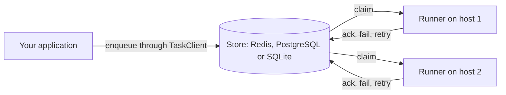

# Background Task Handler (BTH4J)

A Java library for background tasks with at-least-once delivery. Tasks live in a store (Redis, PostgreSQL or
SQLite), several instances share the work through that store, and every state change is one atomic
transition guarded by a revision, so a runner that lost its task cannot change it.



## Contents

- [Features](#features)
- [Choose a store](#choose-a-store)
- [Installation](#installation)
- [Quick start](#quick-start)
- [Documentation](#documentation)
- [Requirements](#requirements)
- [Limitations](#limitations)
- [Contributing](#contributing)

## Features

BTH4J handles three kinds of work:

| Kind | When it runs | Guide |
|---|---|---|
| Immediate task | as soon as a runner has a free slot | [Enqueueing](docs/enqueueing.md) |
| Scheduled task | after a delay or at a run time | [Enqueueing](docs/enqueueing.md) |
| Recurring task | one task per fire time of a cron or fixed-delay definition | [Recurring tasks](docs/recurring-tasks.md) |

Every task carries the same parts:

| Part | What it does | Guide |
|---|---|---|
| Type and payload | a `TaskType` names the kind of task and the class of its payload | [Tasks, processors and steps](docs/tasks.md) |
| Queue | decides which runners take the task and how many run at once | [Queues and concurrency](docs/queues-and-concurrency.md) |
| Unique key (optional) | a second request with the same key is answered `Duplicate` | [Unique keys](docs/enqueueing.md#unique-keys) |
| Retry budget | a failed attempt is retried until the budget is spent | [Retries and cancelling](docs/retries-and-cancelling.md) |
| Lease | held while the task runs and renewed by the runner, so a crashed runner's task runs again | [How it works](docs/how-it-works.md) |
| Steps (optional) | durable parts of a processor, so a retry resumes where the failed attempt stopped | [Steps](docs/tasks.md#steps) |

Around the tasks, a runner gives you:

| Area | What you get | Guide |
|---|---|---|
| Monitoring | task events, inspection, health, issues and Micrometer metrics | [Monitoring](docs/monitoring.md) |
| Operations | an admin API, a JSON admin HTTP server with users, roles and sessions, and an operator dashboard | [Admin API and dashboard](docs/admin.md) |
| Testing | an in-memory store and a clock you control | [Testing](docs/testing.md) |

## Choose a store

The store is an interface with a Redis, a PostgreSQL, a SQLite and an in-memory implementation. The runner
behaves the same on each; [Stores](docs/stores.md) compares them in full.

| Store | Best for | Guide |
|---|---|---|
| Redis | runners on several machines, when your task writes do not need to join a database transaction | [Redis store](docs/stores/redis.md) |
| PostgreSQL | runners on several machines, and tasks that must commit or roll back with your own data | [PostgreSQL store](docs/stores/postgresql.md) |
| SQLite | runners on one machine, with the database file on a local disk | [SQLite store](docs/stores/sqlite.md) |
| In-memory | tests of your application | [Testing](docs/testing.md) |

## Installation

Add `bth4j-core` and one store module. Add `bth4j-testing` for tests.

```xml
<dependency>
    <groupId>today.bonfire.oss</groupId>
    <artifactId>bth4j-core</artifactId>
    <version>4.2.0</version>
</dependency>
<dependency>
    <groupId>today.bonfire.oss</groupId>
    <artifactId>bth4j-redis</artifactId>       <!-- or bth4j-postgres or bth4j-sqlite -->
    <version>4.2.0</version>
</dependency>
<dependency>
    <groupId>today.bonfire.oss</groupId>
    <artifactId>bth4j-testing</artifactId>
    <version>4.2.0</version>
    <scope>test</scope>
</dependency>
```

The metrics and the admin HTTP server are separate modules. Add them when you use them:

```xml
<dependency>
    <groupId>today.bonfire.oss</groupId>
    <artifactId>bth4j-micrometer</artifactId>
    <version>4.2.0</version>
</dependency>
<dependency>
    <groupId>today.bonfire.oss</groupId>
    <artifactId>bth4j-admin-http</artifactId>
    <version>4.2.0</version>
</dependency>
```

| Module | Content |
|---|---|
| `bth4j-core` | task model, runner, services, the store interface (`today.bonfire.oss.bth4j.spi`) |
| `bth4j-redis` | `RedisTaskStore`; uses Jedis |
| `bth4j-postgres` | `PostgresTaskStore`; uses only `java.sql`, the application supplies the JDBC driver and a pooled `DataSource` |
| `bth4j-sqlite` | `SqliteTaskStore`, for runners on one machine; uses only `java.sql`, the application supplies the JDBC driver and a pooled `DataSource` |
| `bth4j-testing` | `InMemoryStore` and `MutableClock` for tests of applications |
| `bth4j-micrometer` | `MicrometerTaskObserver` and `MicrometerRunnerMetrics`; `micrometer-core` is a provided dependency, the application supplies it |
| `bth4j-admin-http` | `AdminHttpServer`: a JSON admin API over `AdminOps` on the JDK HTTP server, with users, roles and sessions; no dependencies besides `bth4j-core` |
| `bth4j-store-tests` | `StoreContract` and `RunnerContract`, the tests every store must pass (not published) |

The `dashboard/` directory is not a Maven module. It holds the operator dashboard, a static Vue app that the
admin HTTP server can serve (see [The dashboard](docs/admin.md#the-dashboard)).

## Quick start

A payload is converted to text by a `JsonMapper`, a two-method interface that wraps the JSON library you
already use. With Jackson (2.12 or newer for records):

```java
public class JacksonMapper implements JsonMapper {
    private final ObjectMapper mapper = new ObjectMapper();

    @Override public <T> T fromJson(String json, Class<T> type) throws Exception { return mapper.readValue(json, type); }
    @Override public String toJson(Object o) throws Exception { return mapper.writeValueAsString(o); }
}
```

Declare one `TaskType` constant per kind of task and use it for enqueueing and for the processor:

```java
public record MailRequest(String to, String subject) {}

static final TaskType<MailRequest> SEND_MAIL = TaskType.of("send-mail", MailRequest.class);
static final TaskType<Void> NIGHTLY_REPORT = TaskType.of("nightly-report");
```

Build a runner on a store, register the processors, start it and enqueue through its client:

```java
var jedis = RedisClient.builder()
        .hostAndPort(new HostAndPort("localhost", 6379))
        .build();

var runner = BackgroundRunner.builder()
        .store(RedisTaskStore.builder().client(jedis).namespace("my-app").build())   // runners with the same namespace share the work
        .jsonMapper(new JacksonMapper())
        .queues(Queues.of("general", "mail", "reports"))  // optional: without it there is the one queue "general"
        .build();

runner.registry()
        .register(SEND_MAIL, (ctx, mail) -> {
            // split the work into steps: a retry skips the steps that completed
            String body = ctx.step("render", String.class, () -> render(mail));
            ctx.step("deliver", () -> deliver(mail.to(), body));
        })
        .register(NIGHTLY_REPORT, (ctx, none) -> buildReport());

runner.start();                                        // returns at once, the services run on their own threads

var client = runner.client();

EnqueueResult result = client.enqueue(TaskRequest.of(SEND_MAIL, new MailRequest("a@example.com", "Welcome"))
        .queue("mail")                                 // without it the task goes to the first queue, "general"
        .delay(Duration.ofMinutes(5))
        .uniqueKey("welcome-42")                       // a second request with this key is answered Duplicate
        .build());
if (result instanceof EnqueueResult.Duplicate d) {
    log.info("already queued as task {}", d.existingId());
}

client.putSchedule(ScheduleDefinition.of("nightly-report", NIGHTLY_REPORT, "30 2 * * *", Overlap.ALLOW).withQueue("reports"));

// on shutdown
runner.stop();                                         // waits for running tasks, up to the shutdown timeout
jedis.close();
```

`render`, `deliver` and `buildReport` stand for your own code. The processor lambda receives a
`TaskContext` and the decoded payload (`Void`, so `null`, for a type without payload).

## Documentation

| Guide | What it covers |
|---|---|
| [How it works](docs/how-it-works.md) | the parts of a runner, the seven task states, one attempt from claim to outcome, retention |
| [Tasks, processors and steps](docs/tasks.md) | task types, processors, `TaskContext` and durable steps |
| [Enqueueing](docs/enqueueing.md) | request options, results, limits, unique keys, enqueueing in your own transaction, resending after a store failure |
| [Retries and cancelling](docs/retries-and-cancelling.md) | retry policies, clock skew, cancel requests, lease loss, maximum run time, `startBy` |
| [Recurring tasks](docs/recurring-tasks.md) | cron and fixed-delay definitions, time zones, misfires, overlap, pausing and triggering |
| [Queues and concurrency](docs/queues-and-concurrency.md) | queues, queue policies, pausing, fixed and adaptive concurrency |
| [Exceptions](docs/errors.md) | what bth4j throws, when, and what to do about it |
| [Configuration](docs/configuration.md) | every runner setting with its default, starting and stopping, how outcomes are written |
| [Monitoring](docs/monitoring.md) | events, logging, inspection, health, issues, runners, metrics |
| [Admin API and dashboard](docs/admin.md) | `AdminOps`, the admin HTTP server, roles, sessions, endpoints, the dashboard |
| [Testing](docs/testing.md) | the test tools, a test with a clock you control, the store integration tests |
| [Stores](docs/stores.md) | choosing a store and how the stores differ: clocks, precision, durability, transactions |
| [Redis store](docs/stores/redis.md), [PostgreSQL store](docs/stores/postgresql.md), [SQLite store](docs/stores/sqlite.md) | setup, requirements, caveats and the inside of each store |
| [Writing a store](docs/writing-a-store.md) | the store interfaces, the rules every store follows, the contract tests |
| [Fault-tolerance tests](docs/fault-tolerance-tests.md) | how the stores are tested with cut calls, and what a resend answers |
| [Upgrading from 4.x to 5.0](docs/upgrading.md) | what to do with your data, the changes the compiler does not show, and every old name with its new one |
| [Changelog](CHANGELOG.md) | every release and what it changed |

## Requirements

| Component | Supported | Tested on |
|---|---|---|
| Java | 21 or later | |
| Redis | Redis 7.4 or newer, or Valkey 9 or newer | standalone Redis 8.10 and Valkey 9.1.3; Redis Cluster is not tested (see [Redis Cluster](docs/stores/redis.md#redis-cluster)) |
| PostgreSQL | 16 or newer, 17 or newer recommended | 18 |
| SQLite | 3.45 or newer in WAL mode, latest recommended | 3.54 |

## Limitations

| Area | Limitation |
|---|---|
| Cron | Cron expressions use the 5 field Unix format. |
| Cancelling | Cancelling a running task is cooperative: the processor has to call `checkCancelled()` or be declared with `withInterruptOnCancel()`, and it is noticed on the next lease renewal. |
| Queue limits | `QueuePolicy` limits apply to one runner, not to the fleet. There are no fleet-wide concurrency limits, rate limits or priority bands. |
| Issues | Issues are kept in the memory of the runner that recorded them (the last 100) and are lost on restart. |
| Admin server | Admin sessions of `AdminHttpServer` are in memory, and the server has no user store beyond the users given to the builder. Put TLS (`https`) or a TLS-terminating proxy in front of it when it is not on the loopback interface. |
| Redis Cluster | Redis Cluster is not tested, and a namespace's slot must not be resharded while runners use it. |
| SQLite | The SQLite store is for runners on one machine with the database file on a local disk. Network file systems are not supported, and all writes of a database go through one writer at a time. |

## Contributing

| Topic | How |
|---|---|
| Build and test | Use the Maven Wrapper: `./mvnw verify`. Java 21 or later is required. |
| Modules | `bth4j-core`, `bth4j-redis`, `bth4j-postgres`, `bth4j-sqlite`, `bth4j-micrometer`, `bth4j-admin-http` and `bth4j-testing` are released together under one version. `bth4j-store-tests` holds the contract tests and is not published. |
| Tests | Unit tests run in the `test` phase. The integration tests (`*IT` in the store modules) start a Redis or PostgreSQL container with Testcontainers in the `integration-test` phase and need Docker. |
| Versioning | The first change after a release bumps the version in `pom.xml` to the next `-SNAPSHOT`. |
| Releases | A release is a pull request titled `Release X.Y.Z` that sets the final version and adds a `## [X.Y.Z] - YYYY-MM-DD` section to `CHANGELOG.md`. Merging it publishes the release. |
