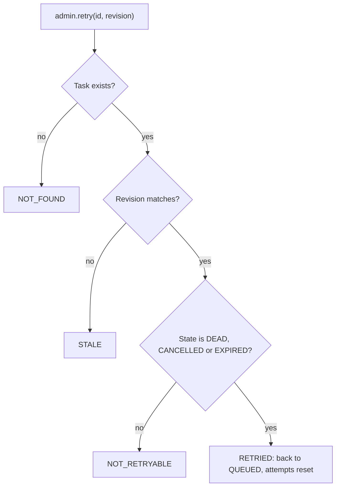
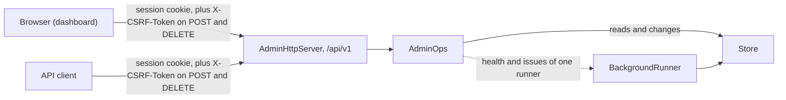
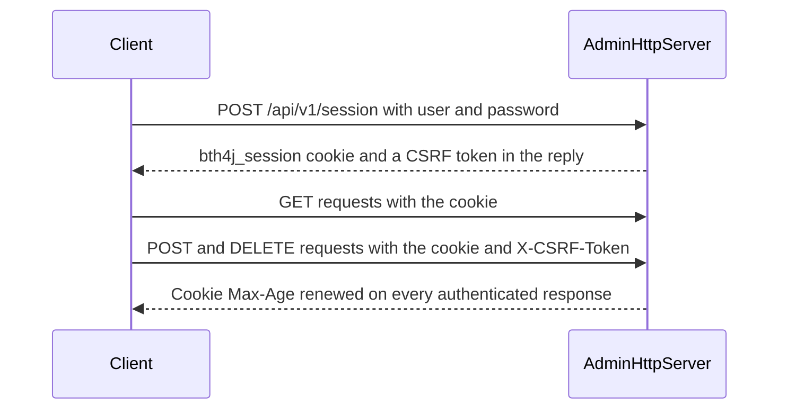
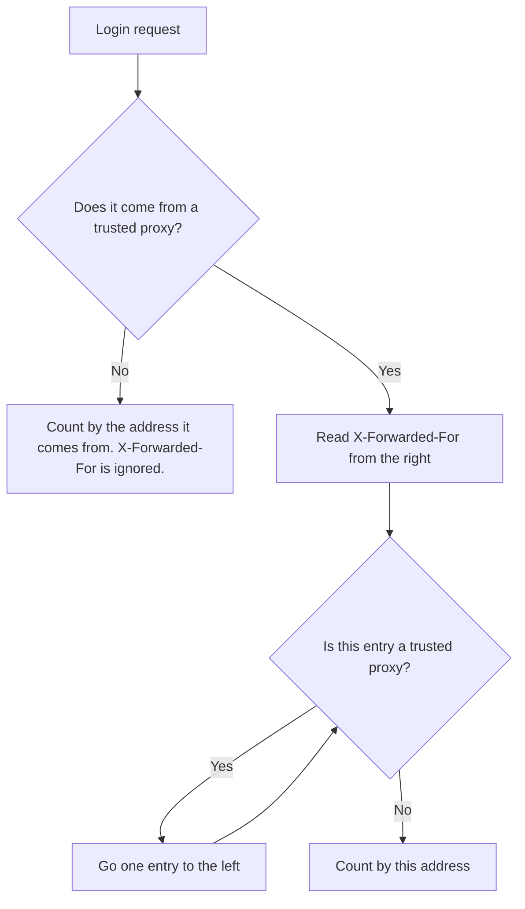

# Admin API and dashboard

`AdminOps` is the operator's view of a store and the set of operations an operator can run on it. `bth4j-admin-http` serves it as a JSON API, and the dashboard is a web app on top of that API. For health, issues and metrics, see [Monitoring](monitoring.md).

## On this page

- [Admin API](#admin-api)
- [Retrying a task](#retrying-a-task)
- [Unique keys after a retry](#unique-keys-after-a-retry)
- [Admin HTTP server](#admin-http-server)
- [Server settings](#server-settings)
- [Roles](#roles)
- [Signing in and sessions](#signing-in-and-sessions)
- [Failed logins](#failed-logins)
- [Endpoints](#endpoints)
- [Errors](#errors)
- [Transport and cross-origin calls](#transport-and-cross-origin-calls)
- [The dashboard](#the-dashboard)

## Admin API

`AdminOps` is the operator's view and set of operations over one store. `runner.admin()` also reports that runner's health and issues. `client.admin()` works in a process without a runner, where `health()` is empty and `issues()` is an empty list.

```java
AdminOps admin = runner.admin();

admin.counts();                                    // Map<queue name, StateCounts>
admin.queues();                                    // id, name, paused
admin.tasks(TaskState.DEAD, "mail", cursor, 100);  // oldest state change first, QUEUED and SCHEDULED earliest due; TaskViewPage(items, next); cursor null starts, next null ends
admin.tasks(TaskState.DEAD, cursor, 100);          // the same over every queue
admin.task(id);                                    // Optional<TaskView>
admin.taskByKey("welcome-42");                     // the task holding that unique key, Optional<TaskView>
admin.retry(id, revision);                         // DEAD, CANCELLED or EXPIRED back to QUEUED, attempts reset
admin.cancel(id, revision, "reason");              // CANCELLED, REQUESTED, NOT_FOUND, STALE or FINISHED
admin.cancelByKey("welcome-42", "reason");         // the holder of the key: the outcomes of cancel, with NOT_FOUND also for a removed holder
admin.delete(id, revision);                        // any state but LEASED: DELETED, NOT_FOUND, STALE or LEASED
admin.pauseQueue("mail", true);
admin.schedules();                                 // ScheduleView: cron, zone id, misfire, fixed delay, paused, next fire
admin.pauseSchedule("poll-feed", false);           // resume a paused one; a fixed-delay definition is re-armed one delay from now
admin.triggerSchedule("nightly-report");           // fires at the next recurring check
admin.deleteSchedule("nightly-report");
admin.runners();
admin.unservedWork();
admin.purgeStaleRunners(Duration.ofMinutes(10));
```

The queue of `tasks(state, queue, cursor, limit)` and `pauseQueue(queue, paused)` must be a known queue name. A null or blank queue is a `TaskValidationException`; to list every queue, call `tasks(state, cursor, limit)`.

Every change to a task takes the revision the operator saw. A refusal changes nothing and says why. The store decides in the same atomic step as the change, and answers the first reason that applies, in this order:

| Order | Outcome | Meaning |
|---|---|---|
| 1 | `NOT_FOUND` | No task has this id, whatever the revision. |
| 2 | `STALE` | The revision is not the task's current one. The task changed since the operator loaded it. |
| 3 | `FINISHED`, `NOT_RETRYABLE` or `LEASED` | The task's state does not allow the change. |

| Call | Possible results |
|---|---|
| `retry(id, revision)` | `RetryOutcome.RETRIED`, or `NOT_FOUND`, `STALE` or `NOT_RETRYABLE` (the task is not DEAD, CANCELLED or EXPIRED). |
| `cancel(id, revision, reason)` | `CancelOutcome.CANCELLED` or `REQUESTED`, or `NOT_FOUND`, `STALE` or `FINISHED` (the task is already in a final state). See [Cancelling tasks](retries-and-cancelling.md#cancelling-tasks). |
| `cancelByKey(key, reason)` | `NOT_FOUND` when no task holds the key (also when the holder was removed), `FINISHED` when the holder has finished, else the outcome of `cancel` for the holder. `STALE` only when the holder changed between the read and the cancel. |
| `delete(id, revision)` | `DeleteOutcome.DELETED`, or `NOT_FOUND`, `STALE` or `LEASED` (a running task cannot be deleted). |

## Retrying a task

`AdminOps.retry` sends a DEAD, CANCELLED or EXPIRED task back to QUEUED.



A retried task:

- keeps its failures and steps,
- resets its attempts to zero,
- loses its `startBy`, so a retried expired task does not expire again.

Inside a `keepFor` window the task retains its unique key without expiry while it is open.

- `taskByKey` and `cancelByKey` still reach it.
- A same-key enqueue answers `Duplicate` with its id.
- The `keepFor` setting is kept, so a fresh keep window starts when the retried task finishes.
- If another task holds the retained key, which only damaged stored data can cause, retry throws `TaskStoreException` and changes nothing. It never takes the key from the other task. The admin HTTP route answers it as a store error.

## Unique keys after a retry

A key is released at some point. A retry after that release runs the task without a key.

| Key | Released when | A retry after the release |
|---|---|---|
| Default until-done key | The task finishes. | Runs the task **without a key**. |
| `keepFor` key | Its window passes. | Runs the task **without a key**. |

After the release, one of two things is true:

- If the key is free, an enqueue with that key is accepted and starts a second task.
- If another task has taken it, that task remains the holder.

## Admin HTTP server

`bth4j-admin-http` serves `AdminOps` as a JSON API under `/api/v1` on the JDK HTTP server. A browser (the dashboard) or any API client talks to the server. The server calls `AdminOps`, which works on the store.



```java
var server = AdminHttpServer.builder()
        .admin(runner.admin())
        .bind("127.0.0.1", 8787)                          // the default
        .user("ops", System.getenv("BTH4J_OPS_PASSWORD"), Role.ADMIN)
        .user("support", System.getenv("BTH4J_SUPPORT_PASSWORD"), Role.VIEWER)
        .staticDir(Path.of("dashboard"))                  // serves the dashboard at http://127.0.0.1:8787/
        .build();
server.start();
// on shutdown: server.stop();
```

`start()` and `stop()` follow the rules of the runner: `start()` on a started server does nothing, `stop()` can come before `start()` and can be repeated, and a stopped server cannot be started again (`IllegalStateException`). `close()` is `stop()`, so the server works in try-with-resources.

At least one user is required. A server runs once: `start()` after `stop()` throws, so build a new one.

### Server settings

| Setting | What it does |
|---|---|
| `admin(AdminOps)` | The `AdminOps` the server exposes. |
| `bind(host, port)` | Where the server listens. The default is `127.0.0.1` and `8787`. |
| `user(name, password, role)` | Adds a user with a [role](#roles). At least one user is required. |
| `staticDir(path)` | Serves the dashboard from that directory at the server's address. |
| `sessionTtl` | How long a session lasts, counted from the sign-in. The default is 12 hours. |
| `https(SSLContext)` | Makes the server speak HTTPS and marks the cookie `Secure`. |
| `secureCookie(true)` | Marks the cookie `Secure` when the server itself speaks plain HTTP. |
| `trustedProxies(addresses)` | Names the reverse proxies in front of the server, so that failed logins are counted per client and not per proxy. See [Failed logins](#failed-logins). |
| `corsOrigin(origin)` | Lets a browser app on another origin call the API with credentials. |

### Roles

| Role | Can read | Can change |
|---|---|---|
| `Role.ADMIN` | Yes | Yes |
| `Role.VIEWER` | Everything, including task payloads | No. Every mutation answers 403. |

Every signed-in user, a viewer too, reads what the tasks carry. Give an account only to people who may see that data.

| Shown | Where it comes from | How to keep it out |
|---|---|---|
| Payload, headers, step results, progress, cancel reason | what the application put into the task | do not put it into the task; store a reference instead |
| Failure message and stack of the last 20 attempts | the exceptions the processors threw. A message can quote data the processor read while it ran: a database error that names the duplicate value, a parse error that quotes its input, an HTTP error that quotes the URL | [`failureDetail(FailureDetail.CLASS_NAME_ONLY)`](configuration.md#what-failuredetail-covers) on the runner records the class name only, in the store, the logs and the events |

A failure stays as long as its task does: 90 days for a dead task by default (`deadRetention`).

### Signing in and sessions

A client signs in with `POST /api/v1/session` and `{"user", "password"}`. The reply sets the `bth4j_session` cookie and carries a CSRF token. The client sends the token as `X-CSRF-Token` on every POST and DELETE. `GET /api/v1/me` returns the token again, so a second browser tab that shares the cookie can ask for it.



| What | How it works |
|---|---|
| Cookie | `bth4j_session`, `HttpOnly`, `SameSite=Strict`. |
| Storage | Sessions are kept in memory and end when the server stops. |
| Lifetime | A session ends 12 hours after the sign-in (`sessionTtl`), also while it is used. The dashboard then asks for the sign-in again. |
| Cookie expiry | The sign-in sets the cookie with `Max-Age` equal to `sessionTtl`. Later responses do not set it again, so the browser drops the cookie when the server ends the session. |
| Sessions per user | At most 20. A login past that ends that user's oldest session. |
| Failed logins | Counted by address and by user name. The fifth failure blocks for 10 seconds (HTTP 429). See [Failed logins](#failed-logins). |

### Failed logins

The server counts a failed login twice, and either count can block the next login:

| Counted by | What the fifth failure blocks | Notes |
|---|---|---|
| Where the login comes from | Logins from there, for 10 seconds | An IPv4 address counts by itself. An IPv6 address counts by its /64 network, because one client usually owns the whole network. |
| The user name it gives | Logins with that name from anywhere, for 10 seconds | Every name is counted, also one that does not exist, so a block does not show which users exist. |

These rules apply to both counts:

- A blocked login is answered 429 with `Retry-After`. It is not counted and its password is not looked at.
- A successful login takes back only its own attempt. It does not clear the failures counted before it.
- Failures are forgotten when no attempt followed them for 10 minutes.
- Someone who knows a user name can keep that user out by sending five wrong passwords every 10 seconds. Keep the server off networks where that is a concern.

#### Behind a reverse proxy

The server sees the proxy's address on every request. Name the proxy with `trustedProxies`, and the server counts by the client address the proxy reports in `X-Forwarded-For`:

```java
AdminHttpServer.builder()
        .trustedProxies("10.0.0.5")            // one address, or a range such as "10.0.0.0/8"
        .secureCookie(true)
        // ...
```



| Point | What to know |
|---|---|
| Without `trustedProxies` | The header is ignored and all clients behind the proxy count as one address: five failures from anyone block every login for 10 seconds. The server logs one warning when a login carries the header from an address that is not trusted. |
| What the proxy must do | Set `X-Forwarded-For` itself, or append the address it saw to the header it received. A proxy that passes a client's header on unchanged lets the client choose the address it is counted by. |
| What to name | Only proxies. A request from a trusted address can state any client address, so a range must not include clients. |
| An entry that is not an IP address | It ends the search, and the login counts by the proxy that reported it. An entry may carry a port. |
| Other headers | Only `X-Forwarded-For` is read, not `Forwarded`. |

### Endpoints

Task ids and revisions are JSON strings.

| Endpoint | What it offers |
|---|---|
| `me` | The signed-in user, the role and the session's CSRF token. |
| `session` | Sign-in. |
| `health` | The runner's health. |
| `overview` | The overview. |
| `queues` | The queues, with `pause` and `resume`. |
| `tasks` | A list with `state`, `queue`, `cursor` and `limit` (up to 200). One task, its `payload`, `retry`, `cancel` and delete. |
| `tasks/by-key?key=` | Reads the task that holds a unique key. |
| `tasks/by-key/cancel?key=` | Cancels the task that holds the key, with a body of `{"reason"}` and no revision. |
| `schedules` | The schedules, with `pause`, `resume`, `trigger` and delete. |
| `runners` | The runners. |
| `unserved` | Queued work that no live accepting runner can process. |
| `issues` | The runner's issues. |

Viewers may read, and admins may also change (see [Roles](#roles)).

#### Listing tasks

`GET /api/v1/tasks` answers `{"items": [...], "next": "<cursor>" | null}`.

- Pass `next` as `cursor` for the following page. `next` is null after the last page.
- A missing or empty `cursor` starts at the beginning.
- A malformed `cursor` is answered 400.

#### Tasks by key

- Viewers may read a task by key. Admins may cancel it.
- A blank key or one over 256 characters is answered 400.
- A read answers 404 when no task holds the key.
- A cancel answers 404 when no task holds the key, and 409 when the holder is already finished or changed between the read and the cancel.

#### Runners and unserved work

- `GET /api/v1/runners` includes `queues` and `types` as name lists and the boolean `accepting`.
- `GET /api/v1/unserved` returns a list of `{"queue", "type", "waiting"}`, using the one-minute heartbeat window. A null type means the whole queue is unserved and `waiting` is its queued count. Otherwise `waiting` is the exact queued count of that type. For what counts as unserved, see [Unserved work](monitoring.md#unserved-work).
- Both endpoints are available to viewers.

### Errors

| Status | When |
|---|---|
| 400 | A malformed `cursor`. An unknown queue name in the tasks filter. A missing or blank by-key key, or one over 256 characters. |
| 403 | A viewer sent a mutation. |
| 404 | An unknown id. An unknown queue name on pause and resume. No task holds the key on a by-key read or cancel. A retry, cancel or delete of a task that does not exist answers `{"code":"NOT_FOUND", ...}`. |
| 409 | A retry, cancel or delete the task's revision or state refuses, with a `code` that says which, as listed below. |
| 422 | A task whose stored value cannot be read, with `code: "UNREADABLE_TASK"`. |
| 429 | Too many failed logins from one address or for one user name. |

A retry, cancel or delete that is refused answers the code the store decided on, without a second lookup:

| Outcome | Status | `code` | The message says |
|---|---|---|---|
| `NOT_FOUND` | 404 | `NOT_FOUND` | There is no such task. |
| `STALE` | 409 | `STALE` | The task changed since it was loaded. |
| `FINISHED`, `NOT_RETRYABLE`, `LEASED` | 409 | `WRONG_STATE` | Which state rule refused it. |

On the wire an empty or missing `queue` on `GET /api/v1/tasks` still lists every queue.

### Transport and cross-origin calls

| Case | What to do |
|---|---|
| Default | The server speaks plain HTTP unless `https(SSLContext)` is set. Keep it on the loopback interface or behind TLS. |
| TLS in the server | Set `https(SSLContext)`. It also marks the cookie `Secure`. |
| A TLS-terminating proxy in front | The server itself speaks plain HTTP, so set `secureCookie(true)` to mark the cookie `Secure`. Also set `trustedProxies`, so that [failed logins](#failed-logins) are counted per client. |
| A browser app on another origin calls the API | Set `corsOrigin("https://dashboard.example.com")`. It lets that app call the API with credentials. |

## The dashboard

The dashboard is the static Vue 3 app in `dashboard/`. It has no build step. It ships its pinned Vue runtime in `dashboard/vendor/` and loads nothing from the network.

| Page | What it shows |
|---|---|
| Overview | The overview, and unserved work. |
| Queues | The queues. |
| Tasks | Tasks with filters, and a detail view: timeline, steps, failures and the payload. |
| Dead tasks | The dead tasks. |
| Schedules | The schedules. |
| Runners | The runners, with coverage and quiet status. |
| Issues | The issues. |

Admins can also retry, cancel (with a reason), delete, pause and trigger.

The files come from the repository checkout. You can serve them in two ways:

| Way | How |
|---|---|
| From the admin server | Point `staticDir` at the `dashboard` directory. |
| From your own static host | Copy the directory to your static host and set `window.BTH4J_API` in `index.html`. The dashboard and API hosts must then share a registrable domain, because of the `SameSite=Strict` cookie. The admin server must also allow the dashboard's origin, for example `.corsOrigin("https://dashboard.example.com")` (see [Transport and cross-origin calls](#transport-and-cross-origin-calls)). |

Details are in [dashboard/README.md](../dashboard/README.md). `dashboard/dev/fake-api.py` serves sample data without Java.
