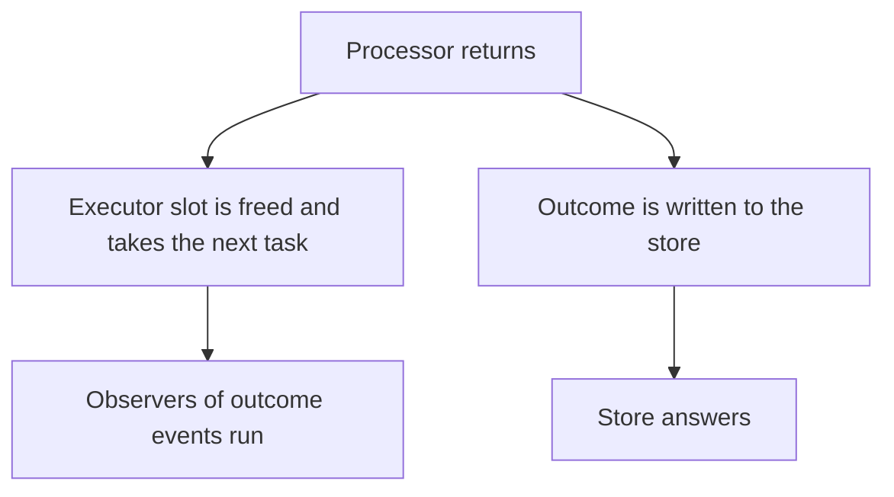

# Configuration

This page is the reference for every runner setting, grouped by topic. Each table gives the setting, its default and what it does, and each group links to the guide page that explains the topic. It also describes how a runner starts, stops and writes the outcome of a task.

All settings are on `BackgroundRunner.builder()`.

**On this page**

- [Runner](#runner)
- [Executor and concurrency](#executor-and-concurrency)
- [Queues](#queues)
- [Retries and attempts](#retries-and-attempts)
- [Leases and timing](#leases-and-timing)
- [Retention and purge](#retention-and-purge)
- [Task ids](#task-ids)
- [Events and failure detail](#events-and-failure-detail)
- [Starting and stopping](#starting-and-stopping)
- [How outcomes are written](#how-outcomes-are-written)
- [A process that only produces tasks](#a-process-that-only-produces-tasks)

## Runner

How the runner finds its store, its processors and its JSON mapping, and how it names itself. See [How it works](how-it-works.md), [Task types and processors](tasks.md) and [Stores](stores.md).

| Setting | Default | Meaning |
|---|---|---|
| `store` | required | `new RedisTaskStore(jedis, "namespace")`, `new PostgresTaskStore(dataSource, "prefix")`, `new SqliteTaskStore(dataSource, "prefix")` or `new InMemoryStore()` |
| `registry` | new registry | the processor registry; by default created by the runner and reached with `runner.registry()` |
| `jsonMapper` | none | payloads and step results as JSON; needed unless every task type has its own codec |
| `clock` | `Clock.systemUTC()` | clock for client-side instants (`createdAt`, delays, retry times) |
| `workerLabel` | JVM name (`pid@host`) | identifies this process in the worker registry; 1 to 128 characters |
| `threadGroupName` | `bgr` | name of the runner's thread group |

## Executor and concurrency

How many tasks a runner runs at once. See [Concurrency](queues-and-concurrency.md#concurrency).

| Setting | Default | Meaning |
|---|---|---|
| `concurrency` | `Concurrency.fixed(max(2, 2 x processors))` | how many tasks run at once; `fixed(n)` or `adaptive(min, max[, cpuTarget, memoryTarget])`; adaptive defaults: CPU 0.90, memory 0.80, `HEAP` |
| `taskExecutor` | built from `concurrency` | a custom `BackgroundExecutor`; the runner shuts it down |

## Queues

Which queues exist, which ones this instance processes and how it shares its slots between them. See [Queues](queues-and-concurrency.md#queues) and [Queue policies and pausing](queues-and-concurrency.md#queue-policies-and-pausing).

| Setting | Default | Meaning |
|---|---|---|
| `configureQueues` | `Q:DEF`, `Q:LOW`, `Q:MED`, `Q:HIGH`; default queue `Q:DEF` | available queues, queues this instance processes (round robin), default queue |
| `queue(name, QueuePolicy)` | `QueuePolicy.DEFAULT` (weight 1, no limit) | share of free slots and concurrency limit of a queue on this runner |

## Retries and attempts

How long a task waits after a failed attempt and how many attempts it gets. See [Retries](retries-and-cancelling.md#retries).

| Setting | Default | Meaning |
|---|---|---|
| `retryPolicy` | exponential, 1 s doubling, capped at 1 h, 20 % jitter | delay after a failed attempt |
| `retryPolicy(name, policy)` | none | adds a named policy that requests choose with `TaskRequest.retryPolicy(name)`; name 1 to 64 characters; may be called several times |
| `defaultMaxAttempts` | 10 (1 to 32767) | attempts for requests that do not set `maxAttempts` |

## Leases and timing

How long a claimed task is leased, how often the runner polls and how often each service runs. See [How it works](how-it-works.md) for the services, [Recurring tasks](recurring-tasks.md) for `recurringTasksCheckInterval` and the misfire threshold, and [Cancelling tasks](retries-and-cancelling.md#cancelling-tasks) for how a cancel request reaches a running task through lease renewal.

| Setting | Default | Meaning |
|---|---|---|
| `leaseDuration` | 60 s (1 s to 100 years) | how long a claimed task stays leased without renewal; renewed every third of its length while running. A lapsed lease cannot be renewed any more, so keep it well above the worst pause (GC, container freeze, slow store round trip); a few seconds is fragile |
| `idlePollInterval` | 500 ms (at least 10 ms) | sleep after a claim that found nothing (cut short when a queue at its `maxConcurrent` frees a slot), and the wait for a free executor slot |
| `claimBatchSize` | 32 | most tasks claimed in one call, bounded by free executor slots |
| `shutdownTimeout` | 30 s | how long `stop()` takes at most, waiting for services and running tasks |
| `serviceCheckInterval` | 10 s | how often a dead service thread is restarted |
| `maintenanceCheckInterval` | 5 s (at least 1 s) | how often expired leases are looked for, tasks past `startBy` are expired and the worker heartbeat is written |
| `scheduledTasksCheckInterval` | 1 s (at least 10 ms) | upper bound of the wait between promotions of due scheduled tasks; it wakes earlier for the next due task |
| `recurringTasksCheckInterval` | 10 s | how often recurring definitions are checked; twice this value (at least 1 minute) is the misfire threshold |

## Retention and purge

How long finished tasks stay readable and how the purge removes them. See [Retention](how-it-works.md#retention).

| Setting | Default | Meaning |
|---|---|---|
| `succeededRetention` | 10 minutes (at most 100 years) | how long succeeded tasks are kept; zero removes them at once |
| `deadRetention` | 90 days (at most 100 years) | how long dead tasks are kept; zero removes them at once |
| `cancelledRetention` | 48 hours (at most 100 years) | how long cancelled and expired tasks are kept |
| `keepSucceededPayload` | false | keep the payload of succeeded tasks (dropped on success by default) |
| `purgeInterval` | 1 minute | time between purge runs |
| `purgeBatchSize` | 500 | tasks removed per purge call; the purge loops until a call removes fewer |
| `workerStaleAfter` | 10 minutes (at most 100 years) | worker registry rows without a heartbeat for this long are deleted by the purge |

## Task ids

How many task ids a client reserves at a time. See [Enqueueing](enqueueing.md).

| Setting | Default | Meaning |
|---|---|---|
| `idBlockSize` | 64 (1 to 100000) | task ids the client reserves per store call; prefer more than 1 for busy producers (see below) |

With `idBlockSize(1)` every enqueue reserves its id with a store call. On PostgreSQL that call takes the lock that keeps block allocation contiguous, so busy producers serialise on it. In a contention measurement on PostgreSQL, size 1 reached about one third of the enqueue rate of a larger block:

| Block size | Enqueues in 60 s (PostgreSQL) |
|---|---|
| 1 | 10,743 |
| a larger block | 32,379 |

## Events and failure detail

What the runner reports about tasks and how much of a failure it records. See [Monitoring](monitoring.md) and [Admin API](admin.md).

| Setting | Default | Meaning |
|---|---|---|
| `observer` | none | receives every `TaskEvent` |
| `failureDetail` | `FailureDetail.FULL` | `FULL` records the class name, message and stack of a failure; `CLASS_NAME_ONLY` keeps only the class name, the attempt and the time (see below) |

### What `failureDetail` covers

| Text or output | With `CLASS_NAME_ONLY` |
|---|---|
| The stored failure | carries no message and no stack |
| The `TaskEvent` error (a `RedactedFailure` that has the class name as `toString()`) | carries no message and no stack |
| The runner issues | carry no message and no stack |
| The runner's log lines | carry no message and no stack |
| A rethrown `VirtualMachineError` | not covered: it reaches the thread's uncaught exception handler with its message and stack |
| The message of a `TaskCancelledException` | not stored as the cancel reason; the operator's reason or "cancel requested" is |
| Progress text and messages that your own retry policy returns | not touched |
| An operator's cancel reason, `ctx.progress` text and a `RetryPolicy.Decision.dead(reason)` reason | not covered: stored, shown by the admin API and logged as given |

Application text is not covered, so hosts must keep personal data out of it.

## Starting and stopping

| Call | What happens |
|---|---|
| `start()` | Fails with `TaskConfigurationException` when no processor is registered. A `start()` that fails later, for example because the store cannot be reached, stops what it started and can be called again. |
| `quiet()` | Stops claiming while running tasks finish. |
| `resume()` | Claims again. |
| `stop()` | Stops the services and waits up to `shutdownTimeout` in total, also when a service is stuck in a store call. It keeps renewing leases of running tasks meanwhile. Tasks still running afterwards are retried when their lease expires. |

A lease that has lapsed is not revived by a later renewal, so `leaseDuration` must sit well above the worst pause of a worker (GC, container freeze, slow store round trip).

## How outcomes are written

A runner acknowledges successful tasks in batches without a timer. A task that finishes while no batch is on its way is acknowledged at once. Tasks that finish while one is on its way go together in the next. This is `ExecutionStore.ackAll`: one script on Redis, one statement on PostgreSQL.

A succeeded occurrence of a fixed-delay schedule keeps its own call, because its re-arm is part of the same write. See [Recurring tasks](recurring-tasks.md#fixed-delay-definitions).

What this means in practice:

- A task's executor slot is freed when its processor returns, so the slot takes the next task while the outcome is written.
- The task keeps its lease renewed until the store answers, and its queue's `maxConcurrent` counts it until then.
- The built-in executors let at most twice their current limit run or write their outcome at once, so a slow store holds back claims.
- Adaptive concurrency counts the slots this bound holds back as occupied.
- `runningTasks` and `bth4j.runner.running` count a task until its outcome is written, so they can reach twice the limit.
- Observers of outcome events run after the slot is freed.
- A custom `BackgroundExecutor` keeps the slot until the task ends unless it overrides `executeWithSlot`.

## A process that only produces tasks

A process that only produces tasks can use `TaskClient.builder().store(store).jsonMapper(mapper).build()`. See [Enqueueing](enqueueing.md).
