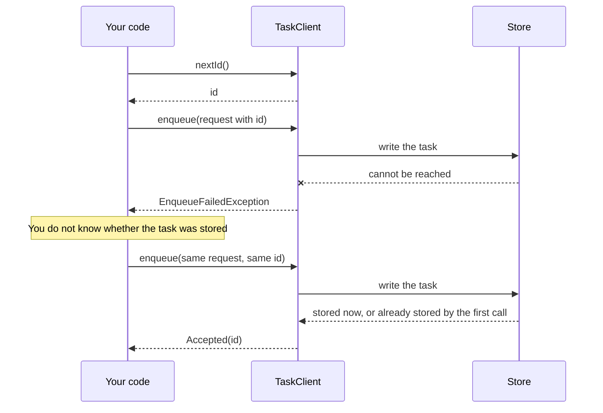
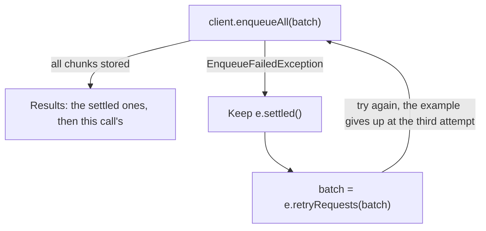

# Enqueueing

This page shows how to put a task on a queue: the request options, what `enqueue` answers, the limits on what you send,
unique keys, enqueueing inside your own database transaction, and how to resend safely when the store cannot be reached.

## On this page

- [Request options](#request-options)
- [Results](#results)
- [Limits](#limits)
- [Unique keys](#unique-keys)
- [Enqueue inside your own transaction](#enqueue-inside-your-own-transaction)
- [When the store cannot be reached](#when-the-store-cannot-be-reached)
  - [Resend with a caller-allocated id](#resend-with-a-caller-allocated-id)
  - [Rules for caller ids](#rules-for-caller-ids)
  - [What `EnqueueFailedException` carries](#what-enqueuefailedexception-carries)
  - [Retrying a failed batch](#retrying-a-failed-batch)
  - [Ids that were not stored](#ids-that-were-not-stored)
  - [Ids that collide](#ids-that-collide)
- [Inside the id check (PostgreSQL)](#inside-the-id-check-postgresql)

## Request options

`TaskRequest.of(type, payload)` takes these options:

| Option | Meaning |
|---|---|
| `queue(name)` | target queue; the default queue when absent |
| `delay(duration)` / `at(instant)` | run later; the last one set wins; at most 100 years from now |
| `uniqueKey(key)` / `uniqueKey(key, Uniqueness.keepFor(d))` | at most one task holds the key, see [Unique keys](#unique-keys) |
| `maxAttempts(n)` | attempts before the task is dead; the runner default when absent |
| `startBy(instant)` | the task expires if it has not started by then, see [Cancelling tasks](retries-and-cancelling.md#expiring-a-task-that-did-not-start); must not be before the run time; at most 100 years from now |
| `maxRunTime(duration)` | an attempt running longer is asked to stop, see [Cancelling tasks](retries-and-cancelling.md#maximum-run-time) |
| `retryPolicy(name)` | a retry policy registered on the runner with that name, see [Retries](retries-and-cancelling.md#retries) |
| `account(text)`, `header(name, value)` | application labels, stored with the task (`account` at most 128 characters, `TaskRequest.MAX_ACCOUNT_LENGTH`; 8 KiB of headers) |
| `id(id)` | an id the client allocated (`client.nextId()` or a retry prepared with `EnqueueFailedException.retryRequests(...)`), see [Resend with a caller-allocated id](#resend-with-a-caller-allocated-id) |

`enqueueAll` stores many requests in chunks.

## Results

`enqueue` returns `Accepted(id)` or `Duplicate(existingId)`. A few cases throw instead:

| Result | When |
|---|---|
| `Accepted(id)` | The task is stored. With an existing id and matching content, `Accepted` only confirms that the record exists. It never starts another run, even when the task is DEAD. Use `AdminOps.retry` to run a dead task again. |
| `Duplicate(existingId)` | A task holds the request's unique key. A DEAD holder inside the `keepFor` window still answers `Duplicate` with its id. A running task holds its key until it ends. |
| `EnqueueFailedException` (thrown) | The store cannot be reached, and the caller does not know whether the task was stored. See [When the store cannot be reached](#when-the-store-cannot-be-reached). |
| `TaskValidationException` (thrown) | The request carries an id that was never allocated. |
| `TaskIdReusedException` (thrown) | The request carries an id that already belongs to a task, and the request is not the same request. |

## Limits

| What | Limit |
|---|---|
| Payload | at most 256 KiB |
| Headers | 8 KiB |
| An account | at most 128 characters (`TaskRequest.MAX_ACCOUNT_LENGTH`) |
| A unique key | 1 to 256 characters, not blank, without U+0000 |
| The key you pass to `taskByKey` and `cancelByKey` | without U+0000; a blank or longer key finds no task |

### Text with U+0000

No text the library stores may contain U+0000, which PostgreSQL cannot keep. The rule is the same on every store:

| Text | What happens to U+0000 |
|---|---|
| A request, a schedule, a name or a cancel reason | The client refuses it. |
| Text from processor code (failure message and stack, progress, step results) | It is recorded with U+FFFD in its place. |

### Time limits

Times follow one rule, `TaskRequest.MAX_TIME_FROM_NOW` (100 years), so that every store can keep them:

| What | Rule |
|---|---|
| `at` or `startBy` | The library refuses a value further than 100 years from now, either way. |
| `delay`, `keepFor`, fixed delay, lease, retention or worker stale-after | The library refuses a longer value. |
| A retry policy or a `TaskRescheduleException` that asks for a longer wait | It gets 100 years. |

## Unique keys

A unique key makes sure at most one task holds it. How long the task holds it depends on how you set the key:

| Situation | What happens to the key |
|---|---|
| `uniqueKey(key)` | It is held until the task finishes, and free as soon as the task finishes. |
| `uniqueKey(key, Uniqueness.keepFor(d))` | It is held until `d` (at most 100 years) after the task finishes, also when the task itself was removed sooner (see [Retention](how-it-works.md#retention)). An operator retry within `d` keeps it. |
| A later enqueue with the same key and a shorter `keepFor` | It does not shorten the holder's window. |
| `AdminOps.cancel` on a DEAD task | It answers `STALE` and leaves the key held for the window. |
| A successful `AdminOps.delete` | It frees the key at once and removes the task and its failure history. |
| A task that is running | It holds its key until it ends. |

### Reading and cancelling by key

| Call | What it does |
|---|---|
| `client.taskByKey(key)` and `admin.taskByKey(key)` | Reads the task that holds a unique key now, open or finished inside its `keepFor` window, without writing. It is empty when no task holds the key, and also when the holder was removed by its retention and only its key stays taken. |
| `admin.cancelByKey(key, reason)` | Cancels that task. Cancelling a waiting fixed-delay occurrence (key `sched:<schedule id>`) pauses its schedule, as cancelling it by id does. |

A key you pass to these calls follows the same rule as `uniqueKey`, see [Limits](#limits).

### Keeping a key for a repair sweep

A repair sweep re-enqueues work after a crash. The default until-done key is free as soon as the task finishes, so a late
enqueue can run the job again.

To prevent another enqueue from starting a second task after SUCCEEDED, DEAD or CANCELLED, use `keepFor` longer than the
window in which a retry or sweep can still happen. A DEAD holder inside that window still answers `Duplicate` with its id.
Inspect it with `taskByKey` while its retention keeps it.

### Enqueueing a successor from a processor

A running task holds its key until it ends. A successor enqueued with that key from inside its processor answers
`Duplicate`. You have two choices:

- Enqueue the successor after the task ends (and any keep window passes).
- Give the successor a different key.

A processor uses its own `TaskClient` to enqueue. `TaskContext` has no enqueue method.

### A key does not stop a running body

A unique key protects task records, not running bodies.

- After lease loss, the old body can overlap a replacement until its next check or, for types using `interruptOnCancel()`,
  an interruptible blocking call after the runner detects the loss.
- Interrupts are cooperative too.
- Fence side effects with the task revision or an idempotent target.
- Use [steps](tasks.md#steps) to checkpoint completed work, but keep each step safe to repeat.

## Enqueue inside your own transaction

`client.prepare(request)` validates and encodes a request into a `TaskRecord` with its id allocated, without writing it.

With PostgreSQL, `PostgresTaskStore.enqueue(Connection, TaskRecord)` stores that record on your own connection and does
not commit, so the task exists only if your transaction commits. This path skips the checks of caller-id allocation and
stored content that `TaskClient.enqueue` and `enqueueAll` make. Handle the store's raw `EnqueueOutcome`, including
`Exists`, yourself:

```java
TaskRecord record = client.prepare(TaskRequest.of(SEND_MAIL, mail).build());
try (Connection c = dataSource.getConnection()) {
    c.setAutoCommit(false);
    // ... your own writes on c ...
    postgresStore.enqueue(c, record);
    c.commit();
}
```

An insert with the same unique key as another open transaction waits until that transaction ends. To avoid a lock-order
cycle, enqueue last, after taking your own row locks, or outside the transaction.

`SqliteTaskStore.enqueue(Connection, TaskRecord)` works the same way. For its locking, see [SQLite](stores/sqlite.md#enqueue-in-your-own-transaction).

For Redis, or when the task tables are in another database, you cannot join your transaction. The outbox steps for that
case are in [Enqueue inside your own transaction](stores.md#enqueue-inside-your-own-transaction).

## When the store cannot be reached

If the store cannot be reached, `enqueue` throws `EnqueueFailedException` and the caller does not know whether the task was
stored.

### Resend with a caller-allocated id

Ids are allocated by the client before the write, so the retry is safe:



In code:

```java
long id = client.nextId();
var request = TaskRequest.of(SEND_MAIL, mail).id(id).build();
try {
    client.enqueue(request);
} catch (EnqueueFailedException e) {
    client.enqueue(request);        // same id: stored once, answered Accepted either way
}
```

### Rules for caller ids

Ids must be allocated by a client of this namespace: `client.nextId()` or an exception id outside its `notStored()`
positions.

| Case | Result |
|---|---|
| An id from `client.nextId()`, or an exception id outside its `notStored()` positions | Allowed. |
| An id that was never allocated | Rejected with a `TaskValidationException`. |
| An id that already belongs to a task, with the same request encoded identically | Accepted again. `Accepted` only confirms that the record exists; it never starts another run, even when the task is DEAD. Use `AdminOps.retry` to run a dead task again. |
| An id that already belongs to a task, with any other difference | `TaskIdReusedException`. |
| A caller id taken by another writer after the preflight | `EnqueueFailedException` carrying a `TaskIdReusedException` cause. Such caller-id reuse still requires caller correction. |

A Redis failover that rolls the id counter back can make an allocated id look unallocated.

"The same request" means the stored task is compared with the new request on these fields:

| Compared | Not compared |
|---|---|
| Type | Headers |
| Queue | Account |
| The payload as stored text (when the task still has it; a finished task may have dropped it) | Attempts |
| The unique key (only while the stored task holds one, even after an operator retry) | Retry policy |
| | `startBy`, `maxRunTime` |
| | Delay, `at(...)` |
| | The `keepFor` duration |
| | Payload version |

Before writing, `enqueueAll` runs these checks:

- It rejects duplicate caller ids.
- It checks the high-water mark before reserving fresh ids.
- It rejects caller ids inside that fresh range.
- It compares every caller id with its stored task.

These checks add no store reads for requests without caller ids. Caller ids below the end of this client's own allocated
block also skip the high-water read.

### What `EnqueueFailedException` carries

An empty `EnqueueFailedException.ids()` means nothing was written by this call. Resend the **same requests unchanged**,
keeping any ids you set yourself.

| Call that failed | What `ids()` holds |
|---|---|
| A batch, failure during the high-water read or the initial reservation | Empty. |
| A batch, failure after the reservation | Every request's last assigned id, in request order. |
| A single `enqueue`, the high-water read fails | The caller id is retained. |
| A single `enqueue` with a generated id | The generated id, only once the call tried to write it. |

### Retrying a failed batch

For a failed batch, `settled()` holds the results of the chunks that completed. `retryRequests`, called with the list that
just failed in the same order, returns the requests after them.

- The settled requests are not sent again, so a settled `Duplicate` cannot start a task once its key's holder has finished.
- If the retry fails too, prepare the next one from the retry list, not the original. Otherwise the ids of tasks the first
  call may have stored are lost and those tasks are stored twice.
- The batch's results are the settled ones followed by the retry's.



```java
var results = new ArrayList<EnqueueResult>();
List<? extends TaskRequest<?>> batch = requests;
for (int attempt = 1; ; attempt++) {
    try {
        results.addAll(client.enqueueAll(batch));
        break;
    } catch (EnqueueFailedException e) {
        if (attempt == 3) throw e;
        results.addAll(e.settled());
        batch = e.retryRequests(batch);
    }
}
// results has one entry per request, in order
```

### Ids that were not stored

`notStored()` contains zero-based positions of generated-id requests this call knows it did not write: confirmed
collisions and requests in unattempted chunks, including failures before the first write.

**Do not reuse the ids at those positions:** they may belong to other tasks, even with identical content.

`retryRequests` treats each position like this:

| Position | What `retryRequests` does |
|---|---|
| In `notStored()` | Leaves the request without an id, so the client generates fresh ids. |
| Any other position, including writes whose replies were lost | Sets the last assigned id. |
| A caller-set id | Always preserves it. |
| `ids()` is empty | Returns every request unchanged. |

Two limits apply to a retry:

- Retries must encode identically. They prevent duplicates only while the original tasks are retained. After a purge, the
  same allocated id stores a new task.
- One case stays open. When a write's reply is lost, the client cannot tell whether its generated id was free, so a retry
  keeps that id. If another task with identical content already held it, the retry answers accepted for that task and this
  one is not stored.

### Ids that collide

Generated ids answered "exists" abandon the client's current id block. They are retried from a newly allocated block, at
most three writes per request.

Three cases leave the colliding positions marked in `notStored()`:

- exhaustion of the three writes (it does not reserve more replacement ids)
- failure to allocate a replacement
- overlap of a replacement with a caller id

A caller id taken by another writer after the preflight also fails with `EnqueueFailedException`, carrying a
`TaskIdReusedException` cause. Such caller-id reuse still requires caller correction. See
[Rules for caller ids](#rules-for-caller-ids).

## Inside the id check (PostgreSQL)

On PostgreSQL the id check reads the id sequence with `pg_sequence_last_value`. It needs only the USAGE privilege on
`<prefix>_task_id`, which `allocateIds` already uses.
