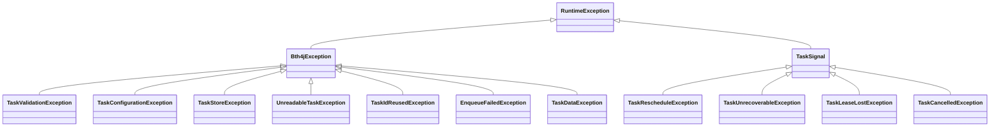

# Exceptions

This page lists what bth4j throws, when, and what to do about it. Everything bth4j throws to refuse a call or to report
a failure of its own extends `Bth4jException`, so one `catch (Bth4jException e)` covers it. All of them are unchecked
and live in the package `today.bonfire.oss.bth4j.exceptions`.

## On this page

- [The exceptions](#the-exceptions)
- [What stays outside](#what-stays-outside)
- [Which one a mistake throws](#which-one-a-mistake-throws)
- [A stored task that cannot be read](#a-stored-task-that-cannot-be-read)

## The exceptions

| Exception | Thrown for | What to do |
|---|---|---|
| `TaskValidationException` | Data that is sent or stored: a request, a schedule definition, an argument of an admin call, a listing cursor. | Correct the value. Sending the same one again fails the same way. |
| `TaskConfigurationException` | A setting of a runtime object: a builder, a store, an executor, a policy, the admin HTTP server, the metrics binder. | Correct the setup. It is thrown when the setting is made, when the object is built, or at `start()`. |
| `TaskStoreException` | A store that cannot be reached, or one that refuses: another schema version at `init`, no queue or type ids left. | Try again later when the store cannot be reached. The runner does that by itself on its next cycle. |
| `UnreadableTaskException` | A stored task with a value that cannot be read, such as a hand-edited row. `taskId()` names the task. | Repair or delete that task. The store works, so the same call fails the same way until then. See [below](#a-stored-task-that-cannot-be-read). |
| `TaskIdReusedException` | A request with a caller id that belongs to a task with other content. | Correct the caller: an id stands for one request. See [Rules for caller ids](enqueueing.md#rules-for-caller-ids). |
| `EnqueueFailedException` | An enqueue that could not complete. It carries how much was written (`ids()`, `settled()`, `notStored()`), and its cause tells what failed. | Resend with `retryRequests(...)`. See [When the store cannot be reached](enqueueing.md#when-the-store-cannot-be-reached). |
| `TaskDataException` | A payload or a step result that cannot be converted. | Correct the payload class or the codec. A task whose payload cannot be decoded ends DEAD without a retry. |

## What stays outside

Two kinds of exception are not a `Bth4jException`, on purpose.

| Kind | Why |
|---|---|
| The signals a processor throws to steer the runner (`TaskSignal`): `TaskRescheduleException`, `TaskUnrecoverableException`, `TaskLeaseLostException`, `TaskCancelledException` | They are not failures of bth4j. A `catch (Bth4jException e)` inside a processor must not swallow them. See [Retries and cancelling](retries-and-cancelling.md). |
| `IllegalStateException` for an object used in a state it is not in, such as `start()` on a stopped runner or `port()` on an HTTP server that is not started | Nothing about the values is wrong; the call came at the wrong time. See [Starting and stopping](configuration.md#starting-and-stopping). |

## Which one a mistake throws

The rule is what the value belongs to, not where the check runs.

| Mistake | Throws |
|---|---|
| `TaskRequest` with a negative delay, a unique key that is too long, an id that was never allocated | `TaskValidationException` |
| `Uniqueness.keepFor(Duration.ZERO)`, `Misfire.catchUp(0)` | `TaskValidationException` |
| A cron expression that cannot be parsed, a cron schedule without an overlap rule | `TaskValidationException` |
| A malformed listing cursor, a `limit` below 1, an unknown queue name in an admin call | `TaskValidationException` |
| `new TaskRescheduleException(Duration.ofSeconds(-1))` | `TaskValidationException` |
| A runner interval below its shortest value, `concurrency` together with `taskExecutor`, a blank queue name | `TaskConfigurationException` |
| `new PostgresTaskStore(null, "x")`, `new FixedExecutor(0)` | `TaskConfigurationException` |
| `AdminHttpServer.builder().build()` without a user, a trusted proxy that is not an address | `TaskConfigurationException` |
| A second `MicrometerRunnerMetrics.bind` with the same tags on one registry | `TaskConfigurationException` |
| A runner started without a processor, or with a JSON task type and no `jsonMapper` | `TaskConfigurationException` |

## A stored task that cannot be read

An `UnreadableTaskException` is not a `TaskStoreException`. A store failure passes when the store is back; an unreadable
task stays unreadable until someone repairs or deletes it. What bth4j does when it meets one:

| Where | What happens |
|---|---|
| `client.task(id)`, `admin.task(id)` | The call throws `UnreadableTaskException` (422 over the [admin HTTP API](admin.md#errors)). |
| `client.enqueue` with a caller id that belongs to such a task | The call throws `UnreadableTaskException`. Nothing was written. |
| `client.enqueueAll`, in the check before the first write | The call throws `UnreadableTaskException`. Nothing was written. |
| `client.enqueueAll`, after the first write | The call throws `EnqueueFailedException` with the `UnreadableTaskException` as its cause, so the results of the chunks that were written are kept. |
| The runner | Claims leave the task out, and maintenance ends it DEAD. See [Corrupt tasks](monitoring.md#corrupt-tasks). |
