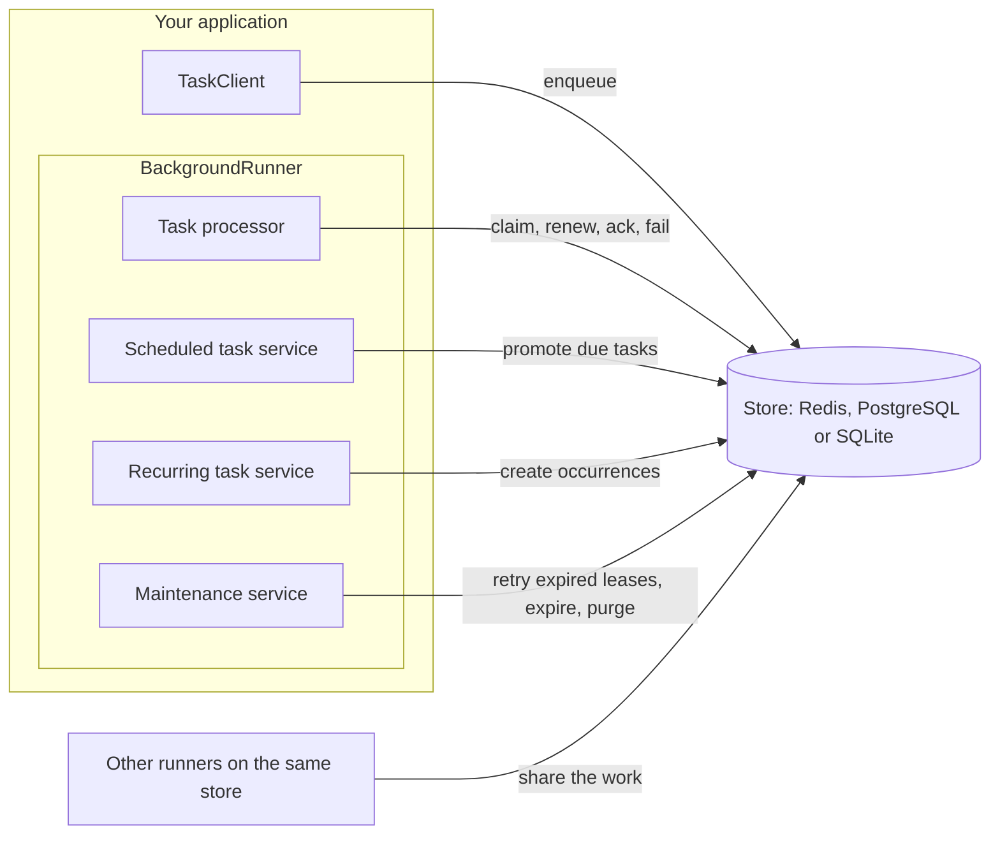
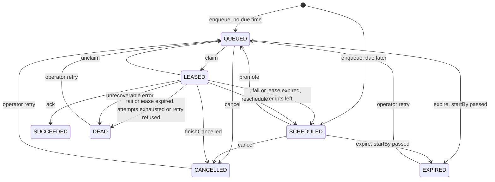
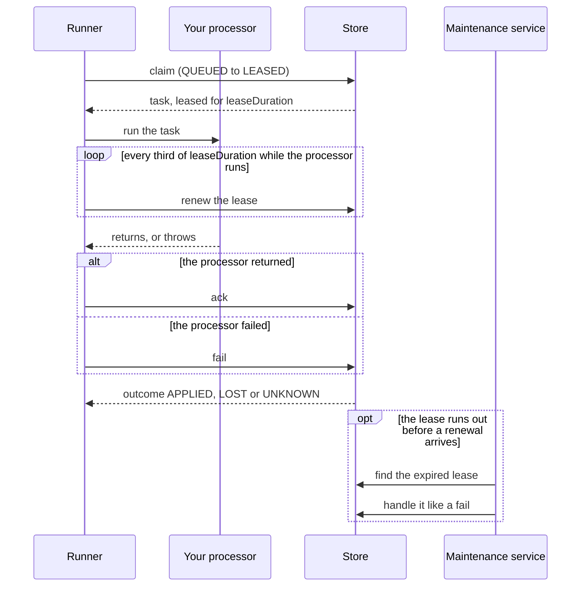

# How it works

This page shows how the parts of bth4j fit together: your application, the store and the runner. It follows one
task through its seven states and through a single attempt, lists what the four runner services do, and says how
long finished tasks are kept.

## On this page

- [The pieces](#the-pieces)
- [Task states and transitions](#task-states-and-transitions)
- [One attempt](#one-attempt)
- [The four runner services](#the-four-runner-services)
- [Retention](#retention)

## The pieces

Your application enqueues tasks with a `TaskClient`. The store keeps them. A `BackgroundRunner` claims them from
the store and runs them with four services. Several runners can work on the same store.

| Piece | Role |
|---|---|
| `TaskClient` | Your application uses it to enqueue tasks. A process that only produces tasks can use a client without a runner. |
| Store | Holds every task and decides every state change. The stores are Redis, PostgreSQL and SQLite. `InMemoryStore` from `bth4j-testing` is for tests. See [Stores](stores.md). |
| `BackgroundRunner` | Runs the tasks. It is made of four services, described in [The four runner services](#the-four-runner-services). |

## Task states and transitions

A task is in exactly one state at a time: QUEUED, SCHEDULED, LEASED, SUCCEEDED, DEAD, CANCELLED or EXPIRED. Each
arrow below is one transition.

### The states

| State | Meaning | Finished |
|---|---|---|
| QUEUED | Waiting in its queue and runnable now. | No |
| SCHEDULED | Waiting for its due time: a delayed enqueue, a retry after a failure, a reschedule or a recurring occurrence. | No |
| LEASED | Claimed by a runner that holds the lease. | No |
| SUCCEEDED | The processor finished without an error. | Yes |
| DEAD | The attempts are used up, the retry policy gave up, or the processor threw `TaskUnrecoverableException`. | Yes |
| CANCELLED | An operator cancelled it, its processor threw `TaskCancelledException`, or it ran past its `maxRunTime`. | Yes |
| EXPIRED | Its `startBy` passed before it could start. | Yes |

From DEAD, CANCELLED or EXPIRED an operator can send the task back to QUEUED with `AdminOps.retry`.

### The transitions

| Transition | From | To | What triggers it |
|---|---|---|---|
| enqueue | new task | QUEUED, or SCHEDULED when it has a due time | Your application enqueues the task. |
| promote | SCHEDULED | QUEUED | The due time has passed. The scheduled task service does it. |
| claim | QUEUED | LEASED | The task processor takes the task and leases it. |
| ack | LEASED | SUCCEEDED | The processor returned without an error. |
| fail, attempts left | LEASED | SCHEDULED | The attempt failed and the retry policy gives a delay. The task runs again at the retry time. See [Retries](retries-and-cancelling.md#retries). |
| fail, exhausted | LEASED | DEAD | The attempt failed and the attempts are used up, or the retry policy returned `Dead(reason)`. A processor that throws `TaskUnrecoverableException` ends the task DEAD at once. |
| lease expired | LEASED | SCHEDULED or DEAD | The runner crashed or stopped renewing the lease. Maintenance handles the task like a failed attempt. |
| reschedule | LEASED | SCHEDULED | The processor threw `TaskRescheduleException(delay)`. The task runs again later without spending an attempt. |
| unclaim | LEASED | QUEUED | The runner gives a claimed task back to its queue, for example when the executor rejected it. |
| cancel | QUEUED or SCHEDULED | CANCELLED | An operator cancels the task. It happens at once. A LEASED task only gets a cancel request. |
| finishCancelled | LEASED | CANCELLED | A cancel was requested and the processor stopped. Also used when a runner died with a cancel pending and its lease expired. |
| expire | QUEUED or SCHEDULED | EXPIRED | The `startBy` time passed before the task started. Maintenance does it. |
| operator retry | DEAD, CANCELLED or EXPIRED | QUEUED | An operator calls `AdminOps.retry`. |

Cancelling is described in [Cancelling tasks](retries-and-cancelling.md#cancelling-tasks).

A claim never returns a task whose `startBy` has passed. What it does with such a task depends on the store:

| Store | A claim that meets a task past its `startBy` |
|---|---|
| PostgreSQL | Skips it. |
| SQLite | Skips it. |
| Redis | Leaves it in the queue for maintenance to expire. |

The in-memory store skips such tasks like PostgreSQL and SQLite. The Redis limit is in
[Claims behind tasks past `startBy`](stores/redis.md#claims-behind-tasks-past-startby).

### How a transition stays safe

Every transition is one atomic call on the store. The call checks the task's revision. So a task runs again only
when the runner holding it crashed, lost its lease or failed the attempt. Several runners on the same store share
the work without locks.

| Store | How one transition is atomic |
|---|---|
| Redis | One Lua script per transition. |
| PostgreSQL | One SQL statement per transition, with `FOR UPDATE SKIP LOCKED` for claims. |
| SQLite | Every write runs in a `BEGIN IMMEDIATE` transaction. A claim is several statements in one such transaction. |

Each store page describes its storage layout: [Redis](stores/redis.md#inside-the-redis-store),
[PostgreSQL](stores/postgresql.md#inside-the-postgresql-store) and [SQLite](stores/sqlite.md#inside-the-sqlite-store). The design, the
record layout and the store contract as they were decided for 3.0 are in [design-3.0.md](design-3.0.md); where
that page and a guide differ, the guide is current.

## One attempt

This is one attempt of one task, from the claim to the outcome.

1. The task processor claims the task. The store leases it for `leaseDuration` (60 seconds by default).
2. While the processor runs, the runner renews the lease every third of `leaseDuration`.
3. When the processor returns, the runner writes `ack`. When it throws, the runner writes `fail`.
4. The store answers with an outcome.

Events that end an attempt carry the outcome. The observer receives it after the outcome was applied (see
[Observing task events](monitoring.md#observing-task-events)).

| Outcome | Meaning |
|---|---|
| `APPLIED` | The store made the change. |
| `LOST` | The store rejected the change because the lease had moved on. |
| `UNKNOWN` | The store call failed, so the change may or may not have been made. If it was not, the lease expires and the task runs again. |

A lease that is not renewed expires. This happens when the runner crashed, or when it paused for longer than the
lease. Maintenance then handles the task like a failed attempt: it retries the task, or ends it DEAD when the
attempts are used up. When a cancel was pending, maintenance ends the task CANCELLED instead of retrying it. A
lease that has lapsed is not revived by a later renewal. See `leaseDuration` in
[Configuration](configuration.md) for how long to make it.

## The four runner services

A runner is made of four services. A monitor restarts a service whose thread died, every `serviceCheckInterval`
(10 seconds by default). The settings are on `BackgroundRunner.builder()`; see [Configuration](configuration.md).

| Service | What it does | How often |
|---|---|---|
| Task processor | Claims tasks in batches, runs them and renews their leases. | Claims at most `claimBatchSize` tasks (32) per call, bounded by the free executor slots. After a claim that found nothing it sleeps `idlePollInterval` (500 ms). Renews leases every third of `leaseDuration`. |
| Scheduled task service | Promotes due SCHEDULED tasks to QUEUED. | At most `scheduledTasksCheckInterval` (1 second) between promotions. It wakes earlier for the next due task. |
| Recurring task service | Creates the occurrences of recurring definitions. See [Recurring tasks](recurring-tasks.md). | Every `recurringTasksCheckInterval` (10 seconds). |
| Maintenance service | Retries expired leases, expires tasks past their `startBy` and writes the runner heartbeat. | Every `maintenanceCheckInterval` (5 seconds). |
| Maintenance service, purge | Purges finished tasks, releases unique keys and removes stale runners. | Every `purgeInterval` (1 minute). Runners without a heartbeat for `runnerStaleTimeout` (10 minutes) are removed. |

## Retention

Finished tasks are kept for inspection, then purged by the maintenance service.

| State | Kept for | Setting |
|---|---|---|
| SUCCEEDED | 10 minutes. The payload is dropped unless you set `keepSucceededPayload(true)`. | `succeededRetention` |
| DEAD | 90 days | `deadRetention` |
| CANCELLED and EXPIRED | 48 hours | `cancelledRetention` |

A retention of `Duration.ZERO` removes a SUCCEEDED or DEAD task at the transition instead. A CANCELLED or EXPIRED task with a zero `cancelledRetention` is removed at the next purge run (`purgeInterval`).

Retention and the key window are independent:

| What | Decides | Set by |
|---|---|---|
| Retention | How long the task stays readable. | The retention settings above. |
| Key window | How long the task's unique key blocks a same-key enqueue. | `keepFor` on the request. See [Enqueueing](enqueueing.md). |

A task can be removed inside its key window, either with retention zero at the transition or when it is purged
after its retention. It is then gone from every read. Its key still answers a same-key enqueue with `Duplicate`
and the removed task's id until the window ends.
