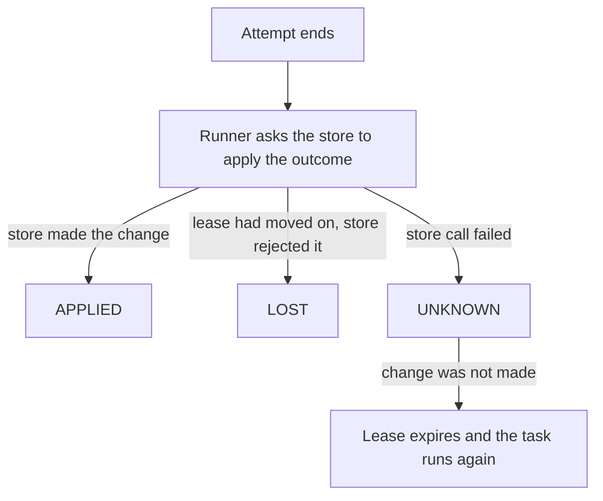

# Monitoring

This page shows how to watch a running system. It covers task events, logging, task inspection, runner health, issues, worker heartbeats, unserved work and Micrometer metrics. For the operator view and the operations an operator can run, see [Admin API and dashboard](admin.md).

## On this page

- [Observing task events](#observing-task-events)
- [Logging](#logging)
- [Inspection](#inspection)
- [Health](#health)
- [Issues](#issues)
- [Workers and heartbeats](#workers-and-heartbeats)
- [Unserved work](#unserved-work)
- [Metrics](#metrics)

## Observing task events

A `TaskObserver` receives `TaskEvent`s. It runs on the thread that produced the event, after the outcome was applied. An exception in an observer never changes a task.

### Events

| Event | When the runner sends it | Carries an `outcome` |
|---|---|---|
| `Started` | A task was claimed and its processor is about to run. | No |
| `Succeeded` | The processor returned normally. | Yes |
| `Retrying` | The processor failed and the task will run again. | Yes |
| `Died` | The task ended as dead: attempts used up, an unrecoverable error, or the retry policy said so. | Yes |
| `Rescheduled` | The processor asked to run again later without counting the attempt. | Yes |
| `Cancelled` | The task ended as cancelled. | Yes |
| `Expired` | A task passed its `startBy` before it could run and was moved to EXPIRED. | No |
| `LeaseExpired` | Maintenance found an expired lease, and the task was retried or died. | No |
| `Deferred` | A claimed task could not be run (no processor, undecodable payload) and was put back. | No |
| `ScheduleFired` | An occurrence of a recurring definition was created. | No |
| `Purged` | Maintenance removed finished tasks that were past their retention. | No |

### Event outcomes

Events that end an attempt carry an `outcome`. It tells you whether the store applied the change.

| Outcome | Meaning |
|---|---|
| `APPLIED` | The store made the change. |
| `LOST` | The store rejected the change because the lease had moved on. |
| `UNKNOWN` | The store call failed, so the change may or may not have been made. If it was not, the lease expires and the task runs again. |



The example below sends an alert when a task dies and logs a warning when a task retries:

```java
BackgroundRunner.builder()
        .observer(event -> {
            switch (event) {
                case TaskEvent.Died d -> alerts.send(d.task() + ": " + d.reason());
                case TaskEvent.Retrying r -> log.warn("{} retries at {}", r.task(), r.retryAt());
                default -> { }
            }
        })
```

## Logging

`new LoggingTaskObserver()` is a ready observer. It writes one SLF4J line per event to the logger `bth4j.tasks` and puts `bth4j.task`, `bth4j.type` and `bth4j.queue` in the MDC. Pass your own `Logger` to use another name.

The runner's own log lines go to the logger names in `Loggers`:

| `Loggers` constant | What it logs |
|---|---|
| `ROOT` | The prefix `today.bonfire.oss.bth4j` of every name below except `TASKS`. |
| `RUNNER` | Runner start, stop, quiet and resume, and the restart of a service thread that died. |
| `CLIENT` | Schedule registration and generated ids found in use. |
| `PROCESSOR` | Claims, executor rejections, lease renewal and the maximum run time. |
| `ATTEMPT` | One attempt of a task: failures, retries, cancellation, rescheduling, deferral and lost leases. |
| `MAINTENANCE` | Expired leases, start-by expiry, purge, worker heartbeats and stale workers. |
| `RECURRING` | Recurring schedules: queued occurrences, skipped definitions and definitions that never fire again. |
| `PROMOTION` | Promotion of delayed tasks that became due. |
| `EXECUTOR` | `DefaultVtExecutor`, the adaptive executor (see [Concurrency](queues-and-concurrency.md#concurrency)). |
| `OBSERVERS` | A `TaskObserver` that threw. |
| `REDIS_STORE` | A Redis setting that `init` could not check. |
| `TASKS` | `bth4j.tasks`, the default logger of `LoggingTaskObserver`. |

The names follow the class names below `Loggers.ROOT` (`today.bonfire.oss.bth4j`). A level set on that prefix covers all of them except `TASKS`. The names do not change when an internal class moves.

## Inspection

These calls read tasks through a client:

```java
client.task(id);                                  // Optional<TaskView>, any state
client.counts();                                  // per queue name: counts per state
TaskViewPage page = client.tasks(TaskState.DEAD, "mail", null, 100);   // oldest state change first (QUEUED and SCHEDULED: earliest due); null cursor starts
client.tasks(TaskState.DEAD, "mail", page.next(), 100);   // next is null after the last page
```

A listing returns a `TaskViewPage`. Its `next` is an opaque position in the listing, so the walk does not depend on the last task of the previous page.

- A task whose own position moves while the walk runs (for example a deferral) can still be seen twice (moved later) or missed (moved earlier).
- A malformed cursor throws `IllegalArgumentException`.
- A task whose stored value cannot be read is left out. A page can then hold fewer tasks than asked for while `next` is not null. `counts()` still counts that task.

A `TaskView` carries state, attempts, due time, the last failures, completed steps and progress.

## Health

These calls report on one runner, and the last one drains it:

```java
RunnerHealth health = runner.health();     // status NEW, RUNNING, QUIET or STOPPED; workerId, runningTasks,
                                           // abandonedAttempts, lastClaimAt, lastMaintenanceAt, lastStoreErrorAt,
                                           // lastStoreError, issueCount
List<Issue> issues = runner.issues();      // the last 100 things an operator should look at, oldest first
boolean drained = runner.drain(Duration.ofSeconds(30));   // quiet, then wait for the running tasks
```

`drain` works like this:

- It leaves the runner quiet. Call `resume()` to claim again, or `stop()`.
- It returns whether every running task finished in time. Use it before a rolling restart.
- It returns true only when no claim that started before the runner went quiet is still in progress and no attempt is unfinished.

## Issues

An `Issue` has a time, a kind, a detail and the task id when there is one. Issues live in the memory of the runner that saw them.

| Kind | What it records | More |
|---|---|---|
| `unknown-type` | A claimed task has no processor on this runner and was deferred. | |
| `store-error` | A store call failed. Repeats with the same text are one issue: its detail carries the count and its time is the latest. | |
| `lease-lost` | A lease was not renewed, or an outcome was refused because the task was taken over. | |
| `attempt-abandoned` | An attempt ran past its maximum run time and did not stop. | [Cancelling tasks](retries-and-cancelling.md#cancelling-tasks) |
| `retry-policy` | A task names a retry policy the runner does not have, or a policy threw. | [Retries](retries-and-cancelling.md#retries) |
| `executor-rejected` | The executor refused a claimed task, and it went back to its queue. | |
| `schedule-misfire` | A recurring fire was late and its misfire policy was applied. | [Recurring tasks](recurring-tasks.md#recurring-tasks) |
| `schedule-overlap` | A recurring fire was skipped because the previous occurrence is still running. | [Recurring tasks](recurring-tasks.md#recurring-tasks) |
| `schedule-paused` | A fixed-delay definition was paused because its occurrence did not succeed. | [Recurring tasks](recurring-tasks.md#recurring-tasks) |
| `schedule-rearm` | A fixed-delay definition was not re-armed because its delay header cannot be read. | |
| `schedule-broken` | A recurring definition cannot be evaluated, and its next fire was moved ahead. | [Recurring tasks](recurring-tasks.md#recurring-tasks) |
| `corrupt-task` | A task has a stored value the store cannot read (see below). | |
| `resource-signal-unavailable` | The adaptive executor could not read the CPU or memory signal. | [Concurrency](queues-and-concurrency.md#concurrency) |

### Corrupt tasks

A `corrupt-task` is a task with a stored value the store cannot read, such as a hand-edited row. This is what happens to it:

| Where | What happens |
|---|---|
| Claim | The claim leaves it out and ends its lease. |
| Maintenance | It ends the task DEAD with the failure `unreadable-record` within one check interval. |
| Purge | It removes the task after `deadRetention`, like any dead task (see [Retention](how-it-works.md#retention)). |
| Listings | They leave it out. |
| Reading it | The call answers `UnreadableTaskException` (422 over the [admin HTTP API](admin.md#errors)). |
| `AdminOps.cancel` and `delete` | They still work on it, given its id and revision. A corrupt fixed-delay occurrence is then not treated as one, so the cancel or delete neither pauses nor re-arms its definition. |

## Workers and heartbeats

Each runner writes a heartbeat to the worker registry every `maintenanceCheckInterval` (see [Configuration](configuration.md)). The heartbeat holds the last seen time, the running tasks and whether the runner is accepting work.

| Call | Effect on accepting work |
|---|---|
| (a new worker) | A new worker accepts work. |
| `quiet()` | The worker stops accepting. |
| `drain()` | The worker stops accepting. |
| `resume()` | The worker accepts again. |

`quiet()` and `resume()` request an immediate heartbeat on the maintenance thread. They do not block the caller on the store.

- Maintenance deletes workers that were silent for `workerStaleAfter` (10 minutes by default).
- `admin.workers()` lists the workers. It includes `accepting`, the queue ids they process and their registered task type ids, recorded at startup.
- A runner that is still alive writes its row again with its next heartbeat. An example is a runner that could not reach the store for longer than `workerStaleAfter`. The row has the same id and the runner's label, queues and types. Its start time is then the time it was written again.

## Unserved work

`admin.unservedWork()` finds queued work that no worker seen within the last minute can process. `admin.unservedWork(Duration)` chooses another heartbeat window, using the admin clock.

| Queue situation | Result |
|---|---|
| The queue is paused. | It is skipped. |
| A worker is not accepting work. | That worker does not contribute coverage. |
| No live accepting worker for the queue. | `UnservedWork(queue, null, waiting)` with the full queued count. |
| Live accepting workers, but a type none of them handles. | `UnservedWork(queue, type, waiting)` with the exact queued count of that type, one entry per unhandled type. |

Both results come from `InspectionStore.queuedByType()` at the time of that read. A worker's last seen time is the store's clock, and the window is measured on the admin clock. A skew between them shifts the window by that much.

## Metrics

`bth4j-micrometer` needs `micrometer-core` on the classpath. Register the observer for events and bind the gauges for state:

```java
MeterRegistry registry = ...;                      // your Micrometer registry

var runner = BackgroundRunner.builder()
        .store(store)
        .observer(new MicrometerTaskObserver(registry, Tags.of("app", "billing")))
        .build();
...
runner.start();
MicrometerRunnerMetrics metrics = MicrometerRunnerMetrics.bind(runner, registry, Duration.ofSeconds(15));
// on shutdown: metrics.close();
```

### Counters and timers

| Meter | Type | Tags |
|---|---|---|
| `bth4j.tasks` | counter | `type`, `queue`, `result`, `outcome` |
| `bth4j.task.duration` | timer | `type`, `queue` |
| `bth4j.deferred` | counter | `type` |
| `bth4j.schedule.fired` | counter | none |
| `bth4j.purged` | counter | `state` |

| Tag on `bth4j.tasks` | Values |
|---|---|
| `result` | `succeeded`, `retried`, `died`, `rescheduled`, `cancelled`, `expired`, `lease_lost` |
| `outcome` | `applied`, `lost`, `unknown` |

`expired` and `lease_lost` are counted with `type` and `queue` set to `unknown`.

The observer's tags are only names and results, never ids or messages, so the number of meters stays bounded.

### Gauges

| Meter | Type | Tags | Notes |
|---|---|---|---|
| `bth4j.runner.running` | gauge | none | Includes tasks whose outcome is still being written, up to twice the concurrency limit with the built-in executors. |
| `bth4j.runner.abandoned` | gauge | none | Attempts past their maximum run time that still hold a slot. |
| `bth4j.runner.up` | gauge | none | 1 while the runner is RUNNING. |
| `bth4j.runner.concurrency.limit` | gauge | none | The executor's concurrency limit. It is registered only when the executor exposes a limit. |
| `bth4j.tasks.state` | gauge | `state`, `queue` | |

One daemon thread refreshes the gauges every `refresh`, so a scrape never reads the store.
