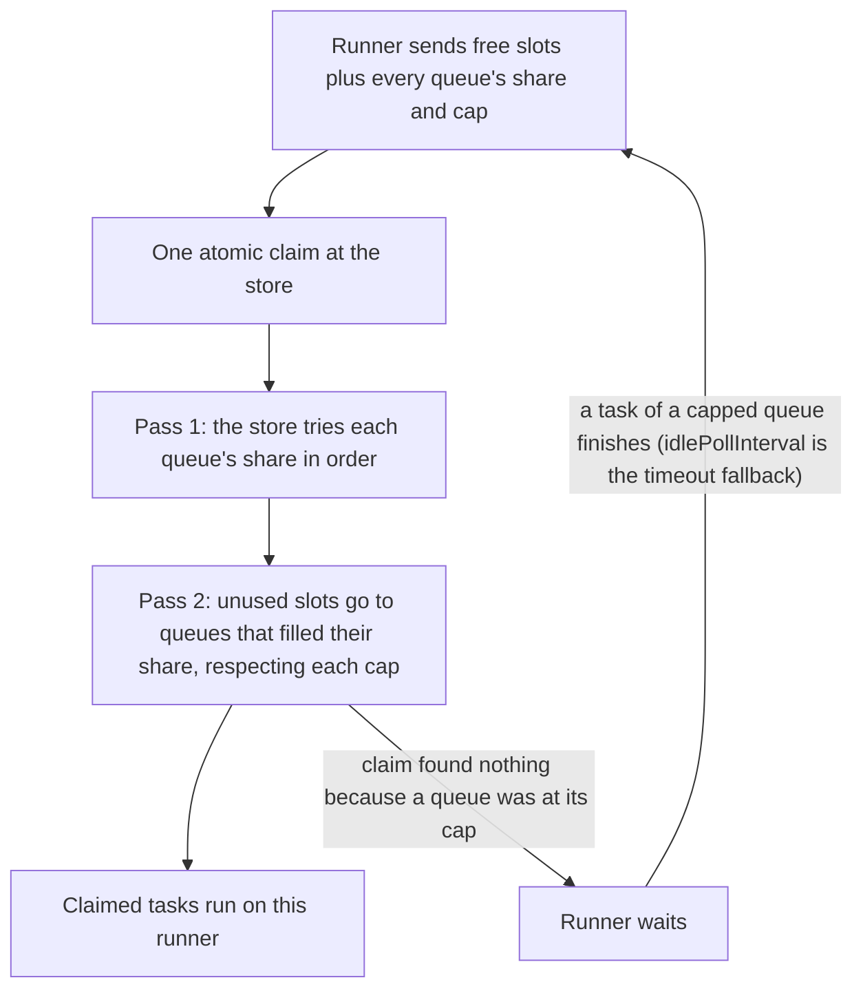
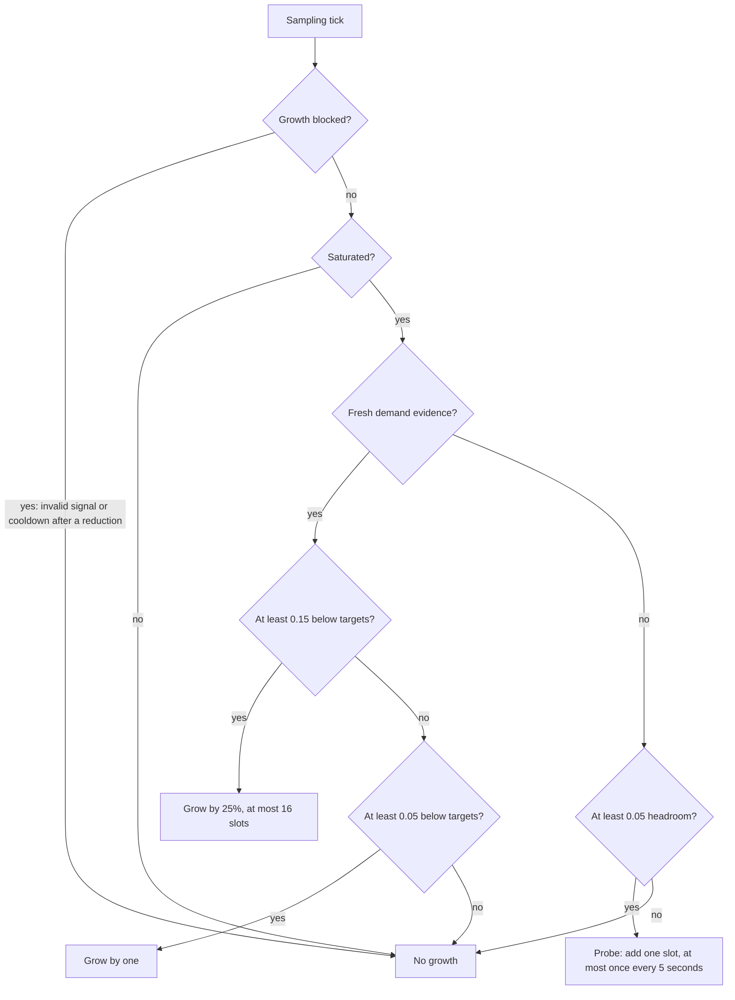

# Queues and concurrency

A runner serves its queues in turn. A queue policy shares a runner's free executor slots between its queues, and an operator can pause a queue. Concurrency sets how many tasks a runner runs at once, either fixed or adjusted to the CPU and memory of the machine.

**On this page**

- [Queues](#queues)
- [Queue policies and pausing](#queue-policies-and-pausing)
- [Concurrency](#concurrency)
- [Adaptive concurrency](#adaptive-concurrency)
- [Related pages](#related-pages)

## Queues

A runner processes its queues round robin, one claim covering all of them. A queue listed twice gets two turns, unless a queue has a [queue policy](#queue-policies): then every queue counts once and its weight sets its share.

An application that configures nothing has one queue, named `general` (`Queues.GENERAL`).

Name your own queues with one `Queues` value, and give that same value to every runner and every separate `TaskClient` of the application:

```java
static final Queues QUEUES = Queues.of("general", "mail", "reports");    // the first one is the default queue

BackgroundRunner.builder()
        .queues(QUEUES)                            // processes all three
        // .processQueues(List.of("mail"))         // or only some of them

TaskClient.builder()                               // a process that only produces tasks
        .queues(QUEUES)
```

| Call | Meaning |
|---|---|
| `Queues.of(first, more...)` or `Queues.of(list)` | the queues tasks can be enqueued to; a request that names another queue is refused |
| `.withDefault(name)` | the queue of requests that name none; without it, the first queue |
| `BackgroundRunner.Builder.processQueues(list)` | the queues this runner processes; without it, all of them. A queue listed twice gets two turns |

A queue name is free text of 1 to 128 characters. A name does not give a queue priority: the runner serves its queues in turn unless a [queue policy](#queue-policies) says otherwise.

The default queue belongs to the `Queues` value, not to the runner, so a producer and a runner that were given the same value always agree on it. Nothing checks that some runner processes every queue: a runner with `processQueues(List.of("mail"))` leaves tasks in `general` waiting until another runner takes them. [`unservedWork()`](monitoring.md) lists queued work that no live runner processes.

## Queue policies and pausing

### Queue policies

A `QueuePolicy(weight, maxConcurrent)` shares a runner's free executor slots between its queues.

| Field | Meaning |
|---|---|
| `weight` | Free slots are divided in proportion to the weights. The default is 1. |
| `maxConcurrent` | Each queue is capped at this many tasks of that queue running on this runner at once. 0 means no limit. |

These rules apply:

- A queue that cannot fill its share lets the others use it.
- Queues without a policy have weight 1 and no limit.
- Limits are per runner, not per fleet.

### How a claim uses the policies

All queues' shares and caps go to the store in one atomic claim per cycle. The store first tries each share in order. It then offers unused slots to queues that filled their share, respecting each cap.



When a claim found nothing because a queue was at its cap, the runner claims again as soon as a task of a capped queue finishes. This wake-up survives a processor restart. `idlePollInterval` remains the timeout fallback.

The code shows three ways to build a policy:

```java
BackgroundRunner.builder()
        .queues(Queues.of("default", "mail", "reports"))
        .addQueuePolicy("mail", QueuePolicy.ofWeight(3))        // three times the share of the others
        .addQueuePolicy("reports", QueuePolicy.ofMaxConcurrent(2))   // never more than two reports at once here
        .addQueuePolicy("default", new QueuePolicy(2, 0))
```

### Pausing a queue

| Call | Effect |
|---|---|
| `admin.pauseQueue("mail", true)` | makes every runner stop claiming from that queue |
| `admin.pauseQueue("mail", false)` | resumes it |

Enqueueing to a paused queue still works. A runner notices the change on its next claim. See [Admin API](admin.md#admin-api) for the other operator calls.

## Concurrency

A runner limits how many tasks it runs at once. Set the limit with `concurrency(...)`.

| Mode | How to set it | What it does |
|---|---|---|
| Default | nothing to set (`Concurrency.fixed(max(2, 2 x processors))`) | runs twice as many tasks at once as there are processors, and at least 2, each on a virtual thread |
| Fixed | `concurrency(Concurrency.fixed(n))` | runs `n` tasks at once, another limit than the default |
| Adaptive | `concurrency(Concurrency.adaptive(min, max[, cpuTarget, memoryTarget]))` | starts at `min` and stays within `[min, max]`, targeting whole-machine CPU and memory usage |

```java
Concurrency.adaptive(8, 256) // CPU 0.90, memory 0.80, heap only
Concurrency.adaptive(8, 256, 0.75, 0.70).withMemorySignal(MemorySignal.HEAP_AND_SYSTEM)
```

| Adaptive argument | Default |
|---|---|
| `cpuTarget` | 0.90 |
| `memoryTarget` | 0.80 |
| memory signal | `HEAP` (heap only); `withMemorySignal(MemorySignal.HEAP_AND_SYSTEM)` changes it |

## Adaptive concurrency

### What it measures

A daemon samples every 500 ms with fixed delay and monotonic time, without catch-up after a pause.

| Signal | How it is read |
|---|---|
| CPU | `OperatingSystemMXBean.getCpuLoad()` (container-aware on JDK 25), smoothed with EWMA alpha 0.25, without a load-average fallback |
| Heap usage | used / max (committed if max is undefined), taking the lowest reading in the last 2 seconds to smooth the GC sawtooth |
| `HEAP_AND_SYSTEM` | the greater of heap and system usage, each with its own 2-second minimum |

- Reductions use the highest valid component, so an unavailable system reading cannot hide heap pressure.
- Growth requires every configured component to be valid.
- System usage catches native memory such as image buffers.
- System usage can count OS file cache as used and hold the limit low on a long-running host.

### Growing the limit

A claim that fills its executor reservation provides demand evidence for 5 seconds and allows one growth step. The slots a step adds must be filled before the next one. A partial or empty claim clears the evidence.

Growth requires saturation: running plus reserved slots must be at least the current limit, including permit debt after a reduction.

| Case | Condition | Growth |
|---|---|---|
| Fresh evidence, large margin | raw and smoothed CPU and memory at least 0.15 below their targets | the limit grows by 25% (rounded up, at most 16 slots) |
| Fresh evidence, small margin | at least 0.05 below their targets | the limit grows by one |
| No fresh evidence (a probe) | a saturated runner with at least 0.05 headroom | exactly one slot, at most once every 5 seconds |



More rules for growth:

- A full claim restores demand evidence. An empty claim leaves the slot free, which stops growth.
- Probes obey the same resource checks and cooldowns as other growth.
- For targets below 0.2 these margins scale proportionally.
- Each tick makes at most one increase.
- Free slots always prevent growth.
- When queue caps (`maxConcurrent`) keep claims from filling the reservation while work waits, the claims are partial. The limit then grows only by these one-slot probes (see [Queue policies](#queue-policies)).

### Reducing the limit

| Trigger | Effect |
|---|---|
| Memory at or above 0.95 | resets the limit to `min` |
| Memory at its target for 1 second | reduces the limit by 25%, at most once per second, and blocks growth for 5 seconds |
| Smoothed CPU above its target plus 0.03 for 1 second | reduces the limit by 20%, at most once per second, and blocks growth for 2 seconds |

Memory takes priority.

Shrinking never cancels tasks or blocks waiting for them. Permits may remain negative until occupied slots finish. Saturated growth and probes can recover even while those tasks keep running.

### When a signal is unavailable

- Invalid or unavailable CPU, or any configured memory component, blocks growth.
- After 5 seconds without a valid reading for that signal, the limit decays by 25% per second toward `min`.
- Two fresh valid samples of each configured signal are needed before growth resumes.
- The first time a signal goes 5 seconds without a valid reading, the executor logs a WARN and the runner raises the issue `resource-signal-unavailable`.
- A JVM or container that never provides the reading keeps the limit at `min`, where `Concurrency.fixed` fits better.

### When the runner is idle

After 30 seconds without a running task seen at a sampling tick or a nonempty claim, the limit returns to `min`. Reservations, releases and empty polls do not restart that idle timer.

### Reading the limit and custom executors

`runner.concurrencyLimit()` exposes the current limit when supported by the executor. Custom executors can receive demand through `BackgroundExecutor.claimed(reserved, claimed)` and expose their limit through `limit()`. Both have defaults.

Limit changes are logged at DEBUG and holds at TRACE under `Loggers.EXECUTOR`.

## Related pages

- [Configuration](configuration.md) lists the settings with their defaults: `concurrency` and `taskExecutor` under [Executor and concurrency](configuration.md#executor-and-concurrency), `queues`, `processQueues` and `queue(name, QueuePolicy)` under [Queues](configuration.md#queues), and `idlePollInterval` under [Leases and timing](configuration.md#leases-and-timing).
- [Monitoring](monitoring.md#issues) shows how to read issues such as `resource-signal-unavailable`.
