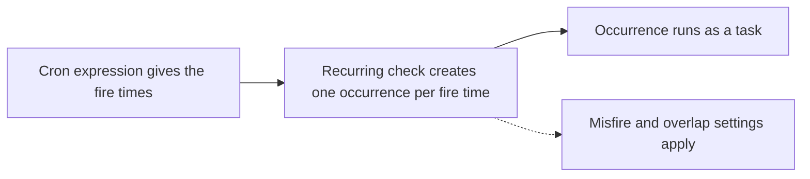
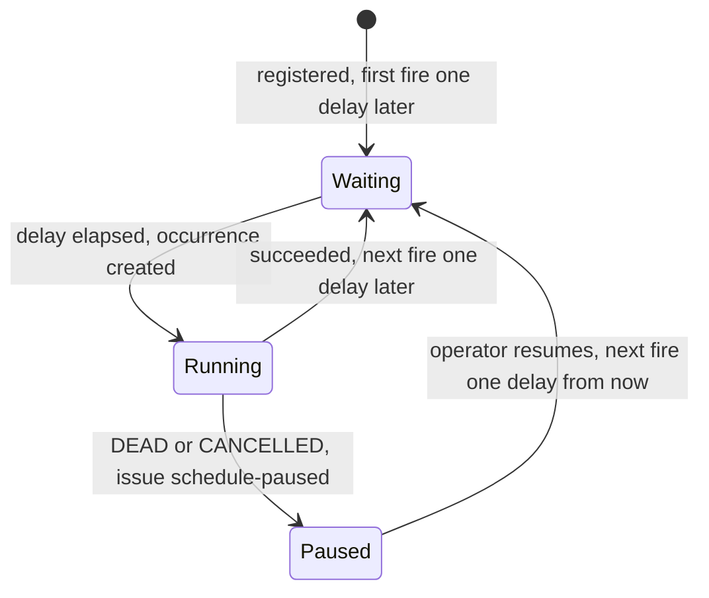

# Recurring tasks

A recurring definition creates one task for each of its fire times, from a cron expression or a fixed delay. This page shows how to register a definition and what happens when fire times are missed or overlap. It also covers how an operator pauses, resumes and triggers a definition.

**On this page**

- [Registering a definition](#registering-a-definition)
- [How a definition fires](#how-a-definition-fires)
- [Cron definitions and time zones](#cron-definitions-and-time-zones)
- [Misfires](#misfires)
- [Overlap](#overlap)
- [Fixed-delay definitions](#fixed-delay-definitions)
- [Pausing, resuming and triggering](#pausing-resuming-and-triggering)
- [Changing a schedule that someone else changed](#changing-a-schedule-that-someone-else-changed)
- [Definitions that cannot be evaluated](#definitions-that-cannot-be-evaluated)
- [Issues recurring tasks record](#issues-recurring-tasks-record)
- [Related pages](#related-pages)

## Registering a definition

`client.putSchedule(ScheduleDefinition.of(id, type, payload, cron, overlap))` creates or replaces a definition. It returns a `PutScheduleResult`: `outcome()` says whether the definition was `CREATED`, `CHANGED` or found `UNCHANGED`, and `nextFireAt()` is the next fire time it has. The cron expression has 5 fields (Unix format). The last argument says what happens to a fire while the previous occurrence has not finished (see [Overlap](#overlap)); a cron definition has no default for it. Each fire time creates one task, exactly once across all instances.

These methods return a copy of the definition with one setting changed:

| Method | What it sets |
|---|---|
| `.withQueue(...)` | the queue |
| `.withAccount(...)` | the account, at most 128 characters, as for a task |
| `.withMaxAttempts(...)` | the maximum attempts |
| `.withMaxRunTime(...)` | the maximum run time |
| `.withZone(...)` | the time zone of a cron expression (see [Cron definitions and time zones](#cron-definitions-and-time-zones)) |
| `.withMisfire(...)` | what happens to missed fire times (see [Misfires](#misfires)) |
| `.withOverlap(...)` | changes the overlap rule; for a fixed-delay definition this is where it is set (see [Overlap](#overlap)) |

`client.deleteSchedule(id)` removes a definition. `client.nextFireTimes()` gives the next fire time of every definition by id, and `admin.schedules()` lists the definitions in full (see [Admin API](admin.md#admin-api)). A definition is not a task and has no state: `tasks(TaskState.SCHEDULED, ...)` lists tasks that wait for their due time, occurrences created ahead of their fire time among them, not definitions.

### Registering the same id again

Registering the same id with the same timing (expression, zone and delay) either keeps or resets the stored next fire time:

| Situation | Next fire time |
|---|---|
| Same timing, and a fixed-delay occurrence is still running | kept |
| Same timing, and the next fire time is not beyond the second fire after now | kept |
| Changed timing | reset |
| Same timing, but the next fire time is beyond the second fire after now and no occurrence is running (a parked or pushed-out definition) | reset |

What the call logs:

| Registration | Log level |
|---|---|
| A definition that is stored already, with its next fire time kept (nothing is written) | DEBUG |
| A new or changed definition | INFO |

## How a definition fires

A cron definition takes its fire times from the expression. A fixed-delay definition fires one delay after the previous occurrence succeeded.

| | Cron definition | Fixed-delay definition |
|---|---|---|
| Created with | `ScheduleDefinition.of(id, type, payload, cron, overlap)` | `ScheduleDefinition.every(...)` |
| Fire times | given by the expression (5 fields, Unix format), in a time zone (UTC by default) | first one delay after registration (the delay is at least 1 second), then one delay after the previous occurrence succeeded |
| While paused | keeps its stored next fire time | resuming sets the next fire one delay from now, or one delay after the task still running succeeds |

The diagram shows a cron definition. Each fire time becomes one occurrence task.



The diagram shows the life of a fixed-delay definition.



## Cron definitions and time zones

A cron expression runs in UTC unless you set a zone. In a zone, the fire times are the wall-clock times that match the expression. Two cases need a rule:

| The zone's clocks | Example in Europe/Berlin | What fires |
|---|---|---|
| Go forward and skip a stretch | 29 March 2026: 02:00 becomes 03:00 | The matches in the skipped stretch fire once together, at the moment of the change. `30 2 * * *` fires at 03:00 that day, and `*/15 2 * * *` fires once at 03:00, not four times. |
| Go back and repeat a stretch | 25 October 2026: 03:00 becomes 02:00 | An expression whose minute or hour field starts with `*` fires in both passes, so `*/15 * * * *` keeps firing every 15 minutes and `0 * * * *` every hour. Every other expression fires in the first pass only: `30 2 * * *` fires once that day. |

The rule for the repeated stretch reads the expression as written: `0 0-23 * * *` names fixed hours, so it does not fire in the second pass, while `0 * * * *` does.

```java
// cron in a time zone (UTC by default)
client.putSchedule(ScheduleDefinition.of("daily-digest", DIGEST, "0 8 * * *", Overlap.ALLOW)
        .withZone(ZoneId.of("Europe/Berlin")));
```

## Misfires

A misfire is a fire time that was missed by more than the misfire threshold. The threshold is twice `scheduleCheckInterval`, at least one minute. The misfire policy decides what happens then.

```java
// misfire: what happens when a fire time was missed by more than the threshold (below)
client.putSchedule(ScheduleDefinition.of("hourly-sync", SYNC, "0 * * * *", Overlap.ALLOW)
        .withMisfire(Misfire.catchUp(3)));          // Misfire.SKIP, Misfire.FIRE_ONCE_NOW (default), Misfire.catchUp(maxFires)
```

| Policy | What it does |
|---|---|
| `SKIP` | creates nothing and continues from now |
| `FIRE_ONCE_NOW` (default) | creates one task now |
| `CATCH_UP` | creates one task per missed fire time, up to `maxFires` (the most recent ones when more were missed), and continues from now |

`CATCH_UP` after a long downtime:

- After a downtime of more than `maxFires` fires, it moves in one step to the last `maxFires` missed fires and creates them from that check on.
- It creates up to about 100 per check, including those late by less than the threshold.
- Beyond 100,000 missed fires it creates one task now, as `FIRE_ONCE_NOW` does.

A misfire is recorded as an issue, except a `CATCH_UP` that creates every missed fire (no more than `maxFires` were missed).

## Overlap

The overlap rule says what happens to a fire while the task of the previous occurrence is not finished. A cron definition has no default: every `ScheduleDefinition.of(...)` names the rule.

| Rule | A fire while the previous occurrence is not finished | Choose it when |
|---|---|---|
| `Overlap.ALLOW` | creates its occurrence, so both run when runners have free slots | runs are independent, for example one report per hour |
| `Overlap.SKIP` | is skipped, and a `schedule-overlap` issue is recorded | two runs must never work at once, or a late run makes the next one pointless |

```java
// no new occurrence while the previous one has not finished
client.putSchedule(ScheduleDefinition.of("nightly-report", NIGHTLY_REPORT, "30 2 * * *", Overlap.SKIP));
```

With `ALLOW`, a job that fires every minute and takes five minutes has up to five runs at once. With `SKIP`, a skipped fire is dropped, not postponed.

A fixed-delay definition fires only after its previous occurrence ended, so the rule matters there only for a fire that an operator triggers while an occurrence runs. It defaults to `ALLOW`; `.withOverlap(Overlap.SKIP)` changes it.

The overlap is decided at the fire time, not ahead of it:

| When the check sees the fire | Previous occurrence | What happens |
|---|---|---|
| up to one `scheduleCheckInterval` before its time | finished | the occurrence is created and starts on time |
| up to one `scheduleCheckInterval` before its time | not finished | nothing yet, the next check looks again |
| at or after its time | finished | the occurrence is created and starts at once, up to one check interval after the fire time |
| at or after its time | not finished | the fire is skipped with a `schedule-overlap` issue |

So a job that fires every minute and takes 55 seconds runs every minute. A queued occurrence, or one that waits for a retry, counts as not finished.

Overlap protection keys only the occurrence (`sched:<id>`). Tasks its processor enqueues are unique only if the application gives them keys.

## Fixed-delay definitions

With a fixed delay, the next occurrence is due one delay after the previous one succeeded.

```java
// fixed delay: the next occurrence is due one delay after the previous one succeeded
client.putSchedule(ScheduleDefinition.every("poll-feed", POLL_FEED, Duration.ofMinutes(5)));
```

- The delay is at least 1 second.
- The definition first fires one delay after registration.
- If an occurrence ends DEAD or CANCELLED, the definition is paused and an issue `schedule-paused` is recorded. This holds whether it ends in its processor, through an expired lease or by an operator cancel.
- A failing job therefore does not run again until an operator resumes it.

## Pausing, resuming and triggering

Pausing, resuming and triggering a definition are `AdminOps` operations (see [Admin API](admin.md#admin-api)).

| Operation | Effect |
|---|---|
| Pause | A paused cron definition keeps its stored next fire time. |
| Resume | Resuming a definition that is not paused changes nothing. Resuming a fixed-delay definition sets its next fire one delay from now. If its task is still running, the next fire comes one delay after that task succeeds instead, so a second task never runs beside it. |
| Trigger | Moves the next fire time to now. The next recurring check creates the task, however late it comes: a triggered fire is never handled as a missed one. A paused definition creates nothing until it is resumed; a paused cron definition then fires the trigger it was given. |

A trigger also forgets the occurrence in flight. When that task ends, it neither re-arms nor pauses the definition.

## Changing a schedule that someone else changed

Every schedule has a revision, which the store assigns and `admin.schedules()` shows. A pause, resume, trigger or delete from the operator names the revision the operator saw, and the store refuses it as `STALE` when the schedule has another one by then. Nothing is changed in that case, and the operator reloads and looks again.

Example: an operator opens `nightly-report`, a deploy replaces its definition with a different cron expression, and the operator clicks delete on what they saw. The delete is refused instead of removing the new definition.

| The revision changes when | The revision stays when |
|---|---|
| `putSchedule` replaces the definition with a different one | `putSchedule` finds the same definition and writes nothing |
| An operator triggers the schedule | An operator pauses it |
| An operator resumes it with a new fire time (a fixed-delay definition) | The runner fires it and moves it to the next fire time |

So the revision protects against a replaced or re-timed definition. It does not protect against a pause or against a runner fire in between: a click on a schedule that fired meanwhile is applied, because the definition the operator looked at is still the one stored. A pause, and pausing a paused schedule, never makes a later click stale.

`TaskClient.deleteSchedule(id)` is the application's own call. It names no revision and removes the definition whatever its revision is.

## Definitions that cannot be evaluated

A definition cannot be evaluated when its cron expression is invalid or its time zone is one the JVM no longer knows. Its next fire is then moved ahead by the greater of one hour and twice the check interval. A `schedule-broken` issue is recorded each time. This way the definition does not hold back the others.

## Issues recurring tasks record

See [Issues](monitoring.md#issues) for how to read issues.

| Issue | Recorded when |
|---|---|
| `schedule-misfire` | a misfire, except a `CATCH_UP` that creates every missed fire |
| `schedule-overlap` | `Overlap.SKIP` skips an occurrence because the previous task is not finished |
| `schedule-paused` | an occurrence of a fixed-delay definition ends DEAD or CANCELLED and the definition is paused |
| `schedule-broken` | a definition cannot be evaluated (each time its next fire is moved ahead) |

## Related pages

- [Configuration](configuration.md#leases-and-timing) for `scheduleCheckInterval`.
- [Enqueueing](enqueueing.md#unique-keys) for unique keys, which the overlap protection uses.
- [Retries and cancelling](retries-and-cancelling.md) for how an occurrence ends DEAD or CANCELLED.
