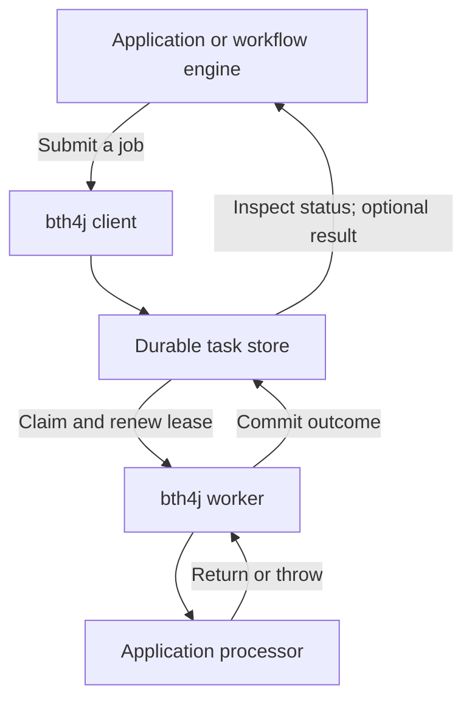
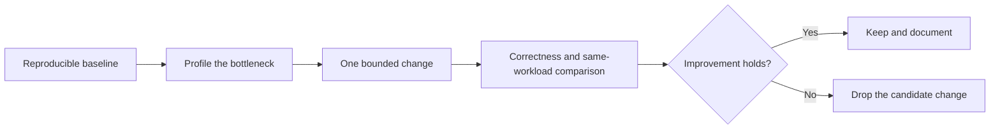

# Reliable job execution roadmap

Updated 2026-11-04. Scope: bth4j is a general-purpose background job runner. Applications own workflows. This is a roadmap, not a claim that the verification or features below are complete.

## 1. Product boundary

Make submitting, executing, recovering, inspecting and operating background jobs dependable and efficient. Keep the API small and the common execution path inexpensive.

The application chooses which jobs to submit and what their results mean. bth4j owns execution attempts, scheduling, leases, retries, recovery, cancellation requests and job inspection. Saved steps remain task-local checkpoints for crash/retry recovery.

No parent/child model, joins, human-input slots, WAITING-for-workflow state, dependency graph, workflow version, root execution budget, compensation engine or workflow-specific cancellation propagation in core. Do not introduce workflow/node IDs as mandatory first-class fields. Existing generic headers and caller-side mappings can carry application correlation.

There is one owner for workflow state: the consuming application. There is one owner for attempts of a dispatched job: bth4j. The application may deliberately submit a new job after terminal failure; it must not race the runner's ongoing retries.

## 2. Build on what is present

| Existing capability | How it supports a small job runner |
|---|---|
| Caller-selected IDs and enqueue retry | Recover a lost enqueue response using the same ID while that job record exists |
| Generic headers/account metadata | Attach caller context without interpreting workflow semantics |
| Redis and PostgreSQL stores | Atomic execution transitions and persistence choices |
| Revision checks and renewable leases | Reject stale transitions after another attempt takes ownership |
| Bounded executor slots and batch claims | Match claimed work to available execution capacity |
| Retry policies, jitter, scheduling and recurring tasks | Handle delayed/repeated work and transient failures |
| Named steps | Reuse completed work on a retry; application effects remain at least once |
| Inspection, metrics, admin controls and retention | Operate jobs without an external workflow engine |
| PostgreSQL enqueue on caller connection | Commit application data and job submission together when they share the same database transaction |

These are current code/documentation facts, not proof of every runtime failure scenario. Ordinary task enqueue, inspection and retry should stay familiar. A workflow-coordination design (children, joins, application inputs, resume) was considered and rejected; none of it is implemented.

## 3. Priority 1: make the execution contract precise and prove it

Audit the existing paths and extend focused contracts only where evidence shows a gap. Fix confirmed failures with the smallest coherent change; do not rewrite the engine in advance.

| Boundary | Required behavior to verify |
|---|---|
| Lost enqueue reply | Same-ID retry resolves the original job while retained; never promise deduplication forever after deletion |
| Concurrent claims | Workers cannot claim the same revision as distinct owners |
| Lost/expired lease and takeover | Stale attempts cannot mutate the new owner's state; old user code may still perform external effects |
| Processor success followed by uncertain acknowledgment | Do not claim durable success until confirmed; reconcile or recover according to the documented at-least-once contract |
| Store outage before/after write | Distinguish definitely rejected, committed and unknown outcomes; preserve recoverability |
| Worker/process crash | Recover eligible work through leases without losing accepted jobs within configured store durability/retention guarantees |
| Retry/cancel/expiry races | Define the winning transition and expose an accurate resulting state |
| Shutdown and executor rejection | Release unused reservations and recover unfinished work without leaked capacity |
| Scheduling/retention concurrency | Preserve due work, uniqueness windows and consistent inspection while maintenance runs |

Be explicit: exactly-once external side effects are not guaranteed. Checkpointing cannot eliminate the gap between an HTTP/database effect and recording its completion. Backing-store persistence/replication settings are part of deployment durability, not something the library can silently guarantee.

Concrete audit lead: `TaskExecution.apply` and `applyFail` currently map store exceptions to LOST, the same outcome used for rejected/stale transitions. Investigate a compatible way to expose uncertainty separately so consumers and metrics do not equate a lost response with a proven lease loss. This is a reporting distinction, not evidence of job loss.

Verification: inventory existing shared store and runner coverage first; add deterministic fault injection around store boundaries and controlled process/connection failures under existing integration-test conventions. Preserve focused unit tests. Do not add a new end-to-end product test suite.

## 4. Priority 2: establish honest performance baselines

The original `ThroughputContract` counted processor callbacks before acknowledgment. The corrected fixture now reports callbacks and confirmed terminal acknowledgments separately, validates every accepted ID, and measures batch-enqueue-return-to-start percentiles. Defaults remain 10,000 empty-payload jobs, concurrency/claim batch 64, a 20 ms idle poll and zero success retention. It is a useful happy-path workload, not a complete durable-throughput or production-capacity benchmark. The integration-test stores are not durable: Testcontainers' `PostgreSQLContainer` starts PostgreSQL with `fsync=off` by default, and the `redis:8.8-alpine` image defaults to `appendonly=no`. A durability workload must override both and record the settings.

Keep callback throughput and durable completion throughput as separate measurements. Measure durable completion without accidentally changing the workload being timed; use retained-state verification or observed committed transitions, and report the overhead/settings of that measurement.

Benchmark each backend separately, then mixed scenarios:

- Single and batched enqueue; sustained and bursty submissions.
- Empty, small and larger payloads; cheap processors, CPU work and simulated I/O.
- One and multiple workers; steady load, saturation, idle-to-busy transitions and noisy queues.
- Normal success retention and zero retention; large retained tables/keyspaces; maintenance and metrics enabled/disabled.
- Delayed tasks, retry storms, lease renewals, shutdown and store recovery.

Record committed jobs/second, enqueue and queue-to-start p50/p95/p99, completion-commit latency, CPU/allocation/heap, store calls/bytes per job, lock/script time, connection usage, backlog and recovery time. For short jobs, queue/store overhead matters; for I/O jobs, latency and useful concurrency matter.

Record exact code revision, JDK, backend version, hardware, network, durability settings, payload, concurrency, polling, batching, retention and instrumentation. Warm up, repeat, and report variation. Do not claim one backend or configuration is universally fastest. Polling latency trades off against idle store traffic.

Set performance acceptance budgets from stable baselines and intended deployment scale. The initial local measurements are available, but do not establish a bottleneck, production capacity or a performance improvement. Idle polling, retention and observer work must not be hidden from published measurements.

## 5. Priority 3: optimize only demonstrated costs

Candidates to profile, not a list of required rewrites:

- Extra round trips in enqueue/claim/renew/finish and opportunities for bounded batching.
- Allocation and serialization on common paths; keep payload/result reads out of lightweight listings where possible.
- Queue fairness and capacity reservations under saturation; bounded memory for all in-flight bookkeeping.
- PostgreSQL query/index behavior as retained data grows, and Redis script duration at supported batch sizes.
- Maintenance, aggregate counts, logging and synchronous observer cost. A slow observer currently executes on the producing thread and can affect throughput.
- Renewal scheduling under JVM pauses/load and shutdown behavior under slow processors.

No fleet-wide concurrency service, wakeup broadcast channel, reactive rewrite, custom scheduler or adaptive-policy redesign unless measured requirements justify it. Existing fixed/adaptive execution choices should be benchmarked before replacement.

Each change must preserve the execution contract, pass affected shared tests on both stores when relevant, and improve the workload it targets without hiding a reliability or tail-latency regression. Ordinary jobs should not pay extra I/O or serialization for disabled optional capabilities; verify this rather than claim literal zero overhead.

## 6. Priority 4: generic results and integration, only where needed

Durable job results are a reasonable optional job-runner feature. They are not prerequisites for reliability tuning, and many jobs need only status or write their output to application storage.

If we add results, design a small opt-in contract:

- Existing void processors remain valid. Avoid ambiguous functional-interface overloads; exact API design is a separate bounded change.
- Bound serialized result size, with explicit codec/version rules and an application-owned reference for larger output.
- Commit success and result atomically. A processor return alone is not proof the result committed.
- Fetch result explicitly by job ID; do not load it on every claim, list or count query.
- Define retention with terminal status. Zero retention means results are unavailable later unless a separate explicitly enabled retention mechanism exists. Do not silently retain everything forever.
- Distinguish not found/purged, unfinished, completed without output and completed with output.
- Preserve existing standalone administrative retry semantics. If durable outcome records are added later, identify terminal outcomes separately from task ID so an intentional in-place retry cannot overwrite or masquerade as an earlier completion.

Start integration examples with existing idempotent enqueue and status inspection. A consumer tracks its known job IDs; arbitrary state-list pagination is not an ordered durable change feed. Polling is reliable only within a defined retention/outage window. If delivery must survive a longer outage or zero-retention jobs, require explicit durable receipts/retention or an application-owned completion record.

Keep `TaskObserver` as a lightweight process-local notification hook, not a guaranteed message bus. A reliable webhook, consumer feed or acknowledgment protocol requires its own storage, retries, delivery identity, cleanup and capacity policy. Add it as a separate optional integration capability only for a demonstrated requirement; the first roadmap milestone does not build a broker into core.

Example integration boundary: an application's durable dispatch record retries enqueue with a known ID. It reconciles retained outcomes and advances its own state idempotently. If application data and bth4j share PostgreSQL, existing enqueue-on-connection can avoid a submission dual write. Across stores, the application owns an outbox/relay. None of these records needs workflow semantics in bth4j.

## 7. Operations and release gates

Prioritize operational questions: Is work stuck? Are jobs being reclaimed repeatedly? Is the store unhealthy? Which queue is starving? Are retries dominating throughput? Is memory bounded? Can the operator cancel/retry without ambiguous status?

Use existing metrics and inspection first. Add a missing metric only for a concrete operational question, with bounded labels and measured query cost. Keep workflow trees and business dashboards in consuming applications.

| Milestone | Deliverable | Completion evidence |
|---|---|---|
| A. Contract and reliability audit | State/operation guarantees, coverage map and verified findings | Focused fault/race tests; findings linked to code and reproduction |
| B. Benchmark baseline | Reproducible durable-completion and latency/resource measurements | Both stores, recorded settings, repeated runs and error counts |
| C. Targeted fixes and tuning | Small independent changes chosen from A/B | Correctness gates plus before/after measurements |
| D. Optional result contract | Only if general consumers need returned output | Atomic completion/result tests, compatibility and retention tests, disabled-path cost comparison |
| E. Documentation/release | Honest guarantees, tuning guidance and integration examples | Independent review, production-store checks and clear remaining limits |

A and baseline design for B can proceed independently. Fixes follow evidence. D does not block A–C and does not imply subscriptions/webhooks. Schema/dependency changes need a concrete reviewed design; none are assumed necessary for the initial audit or benchmarks.

## 8. Immediate next work

The six audit findings below are resolved. Next: deterministic fault injection around store boundaries (lost enqueue and claim replies, before/after-commit faults, process death, renewal outages) on both production stores, then the durability benchmark workload of section 4 and resource profiling. Keep workflow features outside this work. Settle material SPI/storage compatibility choices before their implementation.

Read the smallest relevant files, preserve unrelated changes, review each diff before validation and use shared contracts for production-store semantics. Source areas: core execution/client/SPI, Redis/PostgreSQL transitions, shared store/runner/throughput tests, and metric/inspection paths only as evidence requires.

## 9. Status and evidence

The shared benchmark was corrected and four focused measurement tests were added.

The 2026-11-04 audit of the existing execution paths found six defects, four Important and two Minor. All six are resolved for 4.0.0; deterministic probes confirmed R1, R2 and R4 before and after their fixes.

| Finding | Severity | Defect | Resolution |
|---|---|---|---|
| R1 | Important | Per-queue capacity counters (used only for queues with `maxConcurrent`) leaked a slot when a replacement processor inherited running attempts, or when the same worker reclaimed a task whose old attempt was still running after lease takeover | One `QueueReservations` per runner, shared across processor generations; each attempt releases its slot once |
| R2 | Important | Maintenance's expired-lease cancellation fenced on revision only, so it could cancel an attempt that renewed in between | `renew` no longer revives an expired lease; maintenance uses `finishCancelledExpired`, which requires the lease to still be expired |
| R3 | Important | A fixed-delay occurrence was acknowledged and its schedule re-armed in two separate writes, so a lost reply or crash between them left the schedule parked | The re-arm or pause (`ScheduleEffect`) is applied atomically with the occurrence's terminal transition, fenced on the recorded occurrence |
| R4 | Important | Redis purge restarted at offset zero behind records holding open uniqueness windows | Records with a key window wait in `hold:` zsets scored by `keyUntil`; purge reads only eligible records |
| R5 | Minor | Store exceptions and rejected transitions both became `LOST` | A failed store call is reported as `Outcome.UNKNOWN` (metric outcome `unknown`); `LOST` means the store rejected the transition |
| R6 | Minor | Redis claims order equal-due ties by the id's decimal text | Documented in the SPI and the design: it differs from numeric order only around a power-of-ten id crossing, and fixed-width members would cost every zset entry its integer encoding |

Initial repeated measurements cover InMemoryStore, Redis and PostgreSQL. They measure confirmed acknowledgments, not crash-durable throughput, because of the store settings noted in section 4. Resource profiling, stable capacity measurements and the broader fault campaign remain future work.
