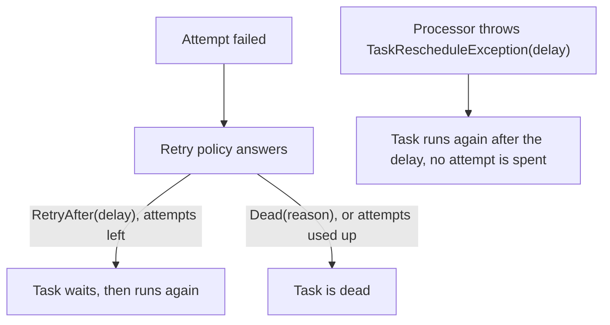
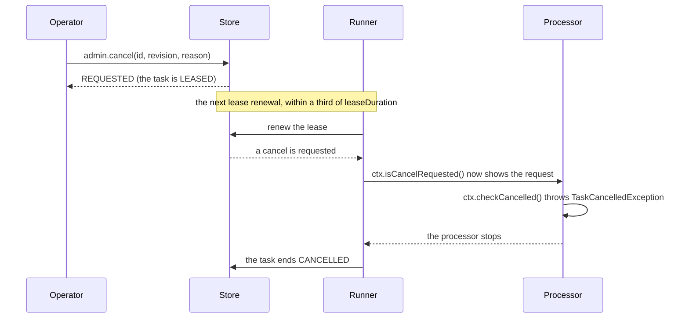
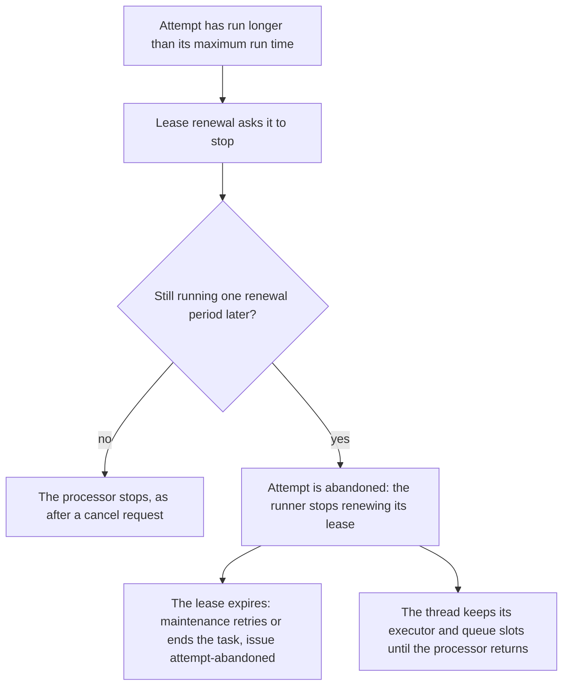

# Retries and cancelling

This page covers what happens after an attempt fails, and the ways a task is stopped: by an operator's cancel, by its
maximum run time, or because it did not start in time.

## On this page

- [Retries](#retries)
  - [The default retry policy](#the-default-retry-policy)
  - [Replacing the policy](#replacing-the-policy)
  - [Retrying until it works](#retrying-until-it-works)
  - [Clocks and retry delays](#clocks-and-retry-delays)
  - [Named retry policies](#named-retry-policies)
- [Cancelling tasks](#cancelling-tasks)
  - [Requesting a cancel](#requesting-a-cancel)
  - [Stopping the processor](#stopping-the-processor)
  - [While a cancel is requested](#while-a-cancel-is-requested)
  - [Lease loss](#lease-loss)
  - [Maximum run time](#maximum-run-time)
  - [Expiring a task that did not start](#expiring-a-task-that-did-not-start)

## Retries

### The default retry policy

When an attempt fails, the retry policy decides how long the task waits before it runs again. The default policy is:

| Setting | Default |
|---|---|
| Delay after the first failed attempt | 1 s |
| Growth | doubles per attempt |
| Cap | 1 hour |
| Variation | each delay varies by up to 20 percent |

The runner ends the task as dead anyway when the attempts are used up: 10 by default, at most 32767.

### Replacing the policy

Replace the default with one of these:

- `retryPolicy(RetryPolicy.exponential(base, cap))`
- `RetryPolicy.fixed(delay)`
- your own `RetryPolicy`, which returns `RetryAfter(delay)` or `Dead(reason)`

The policy answers like this:



### Retrying until it works

Pick the way that fits the failure:

| Situation | What to do |
|---|---|
| Expected transient failures ("retry until it works") | Throw `TaskRescheduleException(delay)`. The task runs again later without spending an attempt. |
| Crashes | Set a high `maxAttempts` with a capped backoff. The attempt budget is still finite. |

### Clocks and retry delays

Two clocks are involved:

| Clock | What it decides |
|---|---|
| The runner's clock | a retry's due time |
| The store's clock | promotion and leases |

Keep these clocks synchronized: skew changes the effective retry delay. After a failover to a store server whose clock is
behind, due tasks wait and leases last longer by that difference. Which store takes its time from where is in
[Which clock decides](stores.md#which-clock-decides).

### Named retry policies

Register policies under a name and let a request choose one:

```java
BackgroundRunner.builder()
        .addRetryPolicy("slow-api", RetryPolicy.exponential(Duration.ofMinutes(1), Duration.ofHours(6)))
        ...

client.enqueue(TaskRequest.of(SEND_MAIL, mail).retryPolicy("slow-api").build());
```

A task that names a policy the runner does not have uses the default policy, and the runner records a `retry-policy`
issue (see [Issues](monitoring.md#issues)).

A process that only enqueues does not know the runners' policy names. Give its client the names with
`TaskClient.builder().addRetryPolicyName("slow-api")`, and `enqueue` and `enqueueAll` refuse a request that names any
other policy with a `TaskValidationException`, so a wrong name is found when the task is enqueued and not when it first
fails. A request that names no policy passes. A client with no names added checks nothing.

## Cancelling tasks

### Requesting a cancel

An operator cancels a task through `AdminOps` (see [Admin API](admin.md#admin-api)), with the revision it saw:

```java
AdminOps admin = runner.admin();
TaskView task = admin.task(id).orElseThrow();
CancelOutcome outcome = admin.cancel(task.id(), task.revision(), "customer withdrew the order");
```

What the call returns depends on the task:

| Task | `CancelOutcome` | What happens |
|---|---|---|
| QUEUED or SCHEDULED | `CANCELLED` | The task becomes CANCELLED at once. |
| LEASED | `REQUESTED` | The task only gets the request. The running runner sees it on the next lease renewal, within a third of `leaseDuration`, and the task ends CANCELLED when the processor stops. |
| No task has this id | `NOT_FOUND` | Nothing was done. |
| The revision is not the task's current one | `STALE` | Nothing was done. The task changed since it was loaded. |
| The task is in a final state (SUCCEEDED, DEAD, CANCELLED or EXPIRED) | `FINISHED` | Nothing was done. |

The store answers the first row that applies, from the top: a missing task is `NOT_FOUND` whatever the revision, and a finished task with a wrong revision is `STALE`.

The reason (default "cancelled by operator", at most 512 characters) stays on the task.

This is the path of a cancel for a running task:



### Stopping the processor

The processor decides how to stop:

| What | Effect |
|---|---|
| `ctx.isCancelRequested()` | shows the request |
| `ctx.checkCancelled()` | throws `TaskCancelledException`, which ends the task CANCELLED |
| A task type declared with `withInterruptOnCancel()` | its thread is also interrupted once per attempt, so sleeps and blocking calls wake up; the exception that follows is treated as the cancellation |

Starting a new `ctx.step` also checks for a cancel request, like `checkCancelled()`.

```java
static final TaskType<Export> EXPORT = TaskType.of("export", Export.class).withInterruptOnCancel();

runner.registry().register(EXPORT, (ctx, export) -> {
    for (var part : export.parts()) {
        ctx.checkCancelled();                     // ends the task as cancelled when an operator asked
        write(part);
    }
});
```

### While a cancel is requested

| What happens | Result |
|---|---|
| The processor throws any exception, also a `TaskUnrecoverableException` or a `TaskRescheduleException` | The task ends CANCELLED. A body that reschedules itself every attempt can still be cancelled. |
| The processor ignores the cancellation and returns normally, and the revision fence still accepts it | The task ends SUCCEEDED. The request is not applied after a normal return. |
| The request reaches the store after the last renewal of an attempt that then fails | The request stays on the task when it is retried, so the next attempt starts with `isCancelRequested()` true. |
| The runner dies while the cancel is pending | Maintenance ends the task CANCELLED when its lease expires, instead of retrying it. |

### Lease loss

`withInterruptOnCancel()` also interrupts the body when lease renewal reports a lost lease. What happens to the attempt's
outcome depends on that interrupt:

| Attempt | What happens to its outcome |
|---|---|
| Interrupted for lease loss | The outcome is discarded, even if the body swallows the interrupt and returns. Only such an attempt has its outcome discarded. |
| Without that interrupt | A returned result or failure still goes through the store's revision fence and can be applied before maintenance takes over. |

More about lease loss:

- `checkCancelled()` throws `TaskLeaseLostException` on known lease loss.
- A discarded attempt emits `Retrying` with outcome `LOST`, without changing the stored task.
- Interruption is opt-in because it can close sockets and NIO channels used by the body, including pooled database or
  Redis connections.
- Processors may run on virtual threads, where blocking socket I/O is interruptible.

### Maximum run time

`maxRunTime(duration)` uses the same path as a cancel. When an attempt has run longer, the runner asks it to stop
with the reason "max run time ... exceeded". The runner looks about once a second, so the request comes up to a second
after the limit.

| Setting | Value |
|---|---|
| The runner's `defaultMaxRunTime(duration)` | applies to a task without its own `maxRunTime`; one hour unless the builder sets another |
| `TaskRequest.MAX_RUN_TIME` | the most a task's own `maxRunTime` can be: about 24.8 days |
| The least a task's own `maxRunTime` can be | one millisecond, the finest a store keeps |

A task that legitimately runs longer needs its own `maxRunTime`.

An attempt that is still running one renewal period after the request is abandoned:



What abandoning means:

- The runner stops renewing the lease, so the lease expires and maintenance retries or ends the task, and raises the issue
  `attempt-abandoned`.
- The abandoned thread keeps its executor and queue slots until the processor returns. `RunnerHealth.abandonedAttempts` and
  the gauge `bth4j.runner.abandoned` count these.
- A processor that blocks without a timeout therefore costs a slot, not the task.

An attempt whose processor has returned keeps its lease renewed until its outcome is written. It is not asked to stop or
abandoned meanwhile, even when a slow store write takes it past its maximum run time.

### Expiring a task that did not start

`startBy(instant)` expires a task that did not start in time. Claims skip it, maintenance moves it to EXPIRED and the
observer receives `TaskEvent.Expired`.

This example shows both limits on one request:

```java
client.enqueue(TaskRequest.of(EXPORT, export)
        .startBy(Instant.now().plus(Duration.ofMinutes(10)))   // expired, not run, if no runner had a free slot by then
        .maxRunTime(Duration.ofMinutes(30))                        // asked to stop after 30 minutes
        .build());
```
