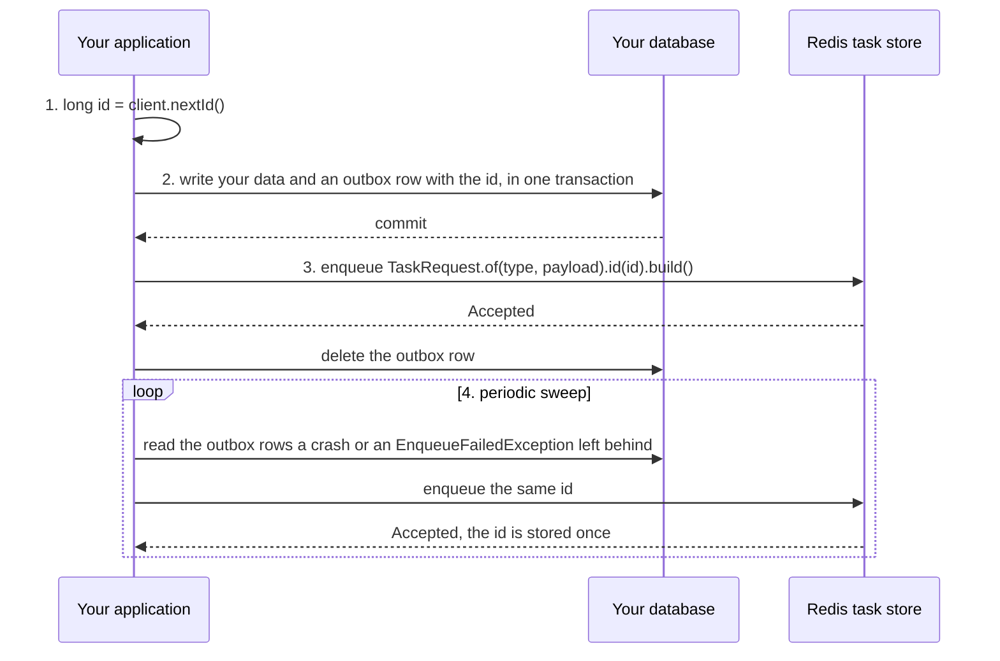

# Stores

A store keeps your tasks and makes every state change atomic. bth4j has stores for Redis, PostgreSQL and SQLite, and an in-memory store for tests. This page helps you choose one and lists what differs between them.

On this page:

- [Choose a store](#choose-a-store)
- [What every store does the same](#what-every-store-does-the-same)
- [Which clock decides](#which-clock-decides)
- [Time precision](#time-precision)
- [What a crash can lose](#what-a-crash-can-lose)
- [Enqueue inside your own transaction](#enqueue-inside-your-own-transaction)
- [Tasks due at the same time](#tasks-due-at-the-same-time)
- [Unique keys after a task ended](#unique-keys-after-a-task-ended)
- [Maintenance batches](#maintenance-batches)
- [Behavior that belongs to one store](#behavior-that-belongs-to-one-store)

## Choose a store

| | [Redis](stores/redis.md) | [PostgreSQL](stores/postgresql.md) | [SQLite](stores/sqlite.md) | In-memory |
|---|---|---|---|---|
| Module | `bth4j-redis` | `bth4j-postgres` | `bth4j-sqlite` | `bth4j-testing` (`InMemoryStore`) |
| Needs | Redis 7.4 or newer, or Valkey 9 or newer | PostgreSQL 16 or newer (17 or newer recommended) | SQLite 3.45 or newer in WAL mode | nothing to run, the data lives in the process |
| Runners on several machines | Yes | Yes | No: one or more runners in one process, or several processes on one machine, with the database file on a local disk | No: it is for tests |
| Enqueue inside your own transaction | No: commit first, then enqueue, with an outbox | Yes, when the task tables are in the same database as your data | Yes, when the task tables are in the same database as your data | No |
| Which clock decides | the Redis server (`TIME`) | the database server (`statement_timestamp()`) | the application's `java.time.Clock` | the application's `java.time.Clock` |
| What a crash of the server or machine loses | depends on your Redis settings: everything with no RDB and no AOF, nothing confirmed with `appendfsync always` | nothing confirmed, with the defaults (`synchronous_commit = on`, `fsync = on`) | depends on your `synchronous` setting: nothing confirmed with `FULL` | everything, whenever the process ends |
| Removes data on its own | only under a `maxmemory-policy` other than `noeviction`; `init` refuses to start under one, when it can read the policy | never | never | never |
| Best for | runners on several machines, when your task writes do not need to join a database transaction | runners on several machines, and tasks that must commit or roll back with your own data | runners on one machine, with the database file on a local disk | tests of your application |

The details behind each cell are below and on the store pages.

## What every store does the same

The runner works the same way on Redis, PostgreSQL and SQLite: the same states, leases, retries, unique keys, schedules and queue grants. The shared `StoreContract` and `RunnerContract` suites check this.

`InMemoryStore` from `bth4j-testing` is for tests. It passes the same suites and keeps nothing once the process ends.

What differs, and what your own settings decide, is listed in the sections below.

## Which clock decides

| Store | Current time comes from |
|---|---|
| Redis | the database server (`TIME`) |
| PostgreSQL | the database server (`statement_timestamp()`, the time the statement started) |
| SQLite | the `java.time.Clock` the store was given, in the application |
| In-memory | the `java.time.Clock` the store was given, in the application |

On every store the runner computes `createdAt`, delays and retry times on its own clock. Keep the application hosts and the database server on synchronized clocks. [Clocks and retry delays](retries-and-cancelling.md#clocks-and-retry-delays) says what a skew does.

## Time precision

Every store keeps times and durations in whole milliseconds and drops anything finer, so the timestamps you read back are alike on all of them.

## What a crash can lose

A write the store confirmed and then lost does the same on every store.

| Lost write | What happens |
|---|---|
| An enqueue | the task never runs |
| A claim or an outcome | the task goes back, so it runs again after its lease expires |

How much can be lost is set by the database, not by bth4j. The durability settings decide:

| Store | Setting | A crash of the server or its machine loses |
|---|---|---|
| Redis | no RDB, no AOF | everything: Redis restarts empty |
| Redis | RDB snapshots only (the default `save` rules take one after an hour if 1 key changed, 5 minutes if 100 did, 60 s if 10,000 did) | every write since the last snapshot |
| Redis | `appendonly yes` with `appendfsync everysec` (the default once AOF is on) | about the last second |
| Redis | `appendonly yes` with `appendfsync always` | nothing confirmed: each write is synced to disk before Redis replies |
| PostgreSQL | `synchronous_commit = on` and `fsync = on` (the defaults) | nothing confirmed |
| PostgreSQL | `synchronous_commit = off` | the last commits, at most three times `wal_writer_delay` (600 ms by default); the database stays consistent |
| PostgreSQL | `fsync = off` | possibly the whole database, on a power loss or operating system crash |
| SQLite (WAL) | `synchronous = FULL` | nothing confirmed |
| SQLite (WAL) | `synchronous = NORMAL` | the last commits on a power loss or operating system crash; nothing when only the application crashes |
| SQLite (WAL) | `synchronous = OFF` | possibly the whole database, on a power loss or operating system crash |
| in-memory | | everything, whenever the process ends |

Replication adds its own window:

| Store | Replication | Effect on a failover |
|---|---|---|
| Redis | asynchronous | a failover to a replica can lose writes the primary confirmed, and `WAIT` does not make that a guarantee |
| PostgreSQL | streaming replication is asynchronous by default | the same effect on failover; with synchronous standbys (`synchronous_standby_names`) a commit is confirmed only once a standby has it |
| SQLite | none of its own | no replication window |

## Enqueue inside your own transaction

With PostgreSQL and SQLite, `enqueue(Connection, TaskRecord)` writes the task on your connection when the task tables are in the same database as your data. The task then commits or rolls back with your writes (see [Enqueueing](enqueueing.md#enqueue-inside-your-own-transaction)).

| Setup | Can the task join your transaction? |
|---|---|
| PostgreSQL or SQLite, task tables in the same database as your data | yes |
| Redis | no |
| Task tables in another database | no |

When the task cannot join your transaction, commit first, then enqueue. Keep a list of what is still to be enqueued (an outbox), so that a crash in between loses nothing. The diagram shows the steps with Redis, and the list below it explains them.

1. Before the transaction, allocate the id: `long id = client.nextId()`.
2. In the transaction, write your data and an outbox row with that id and what the task needs.
3. After the commit, enqueue `TaskRequest.of(type, payload).id(id).build()` and delete the outbox row.
4. A periodic sweep enqueues the outbox rows a crash or an `EnqueueFailedException` left behind. The same id is stored once and answered `Accepted` either way.

When a succeeded task can be removed before the sweep comes (a short succeeded retention), also give the request a unique key with a `keepFor` longer than the sweep's reach, so that a resend cannot run it again. The resend is answered `Accepted` on every store.

Enqueueing first and cancelling the task when your transaction rolls back does not work. A runner can start the task before the rollback, and a crash between the two leaves a task for data that was never committed.

## Tasks due at the same time

| Store | Order of tasks with the same due time |
|---|---|
| PostgreSQL, SQLite, in-memory | id order |
| Redis | compares their ids as text, so of two tasks due in the same millisecond, id 1000 runs before id 999 |

A listing of tasks follows the same order on each store. The runner promises no order among tasks due at the same time.

## Unique keys after a task ended

A unique key with a keep window (`Uniqueness.keepFor`) stays taken for that long after its task ended. Whether a key is taken, and for how long, is the same on every store. Two things around it differ:

| Case | PostgreSQL and SQLite | Redis | In-memory |
|---|---|---|---|
| A finished task is read after its keep window ended and before the next maintenance pass | still shows `uniqueKey` and `keyUntil`; maintenance clears them | shows neither: the fields expire with the window | as PostgreSQL and SQLite |
| A task was removed inside its keep window, and its id is enqueued again with another unique key or with none | answered `Accepted`, and nothing is stored: the row that keeps the key holds the id until the window ends | stored as a new task | as Redis |

The second case needs an application that gives a task its own id and uses that id again for a different task, which is a mistake of the caller: while the first task is still there it is refused with `TaskIdReusedException`. With the same unique key, the resend is answered `Accepted` and stored once on every store.

## Maintenance batches

Promotion, expiry, purge and recurring batches pick tasks in a different order on each store. The runner calls again while a batch comes back full, so every store handles everything that is due in the same maintenance pass. Recurring schedules are the exception: one cycle takes at most 100 batches, and the rest waits for the next cycle.

## Behavior that belongs to one store

These differences matter for one store only. Each is described on that store's page.

| Topic | Store | In short | Details |
|---|---|---|---|
| Memory eviction | Redis | `init` reads `maxmemory_policy` and refuses to start with a `TaskConfigurationException` unless it is `noeviction`. When it cannot read the policy, it logs a warning and starts. PostgreSQL and SQLite never remove data on their own. | [Memory eviction](stores/redis.md#memory-eviction) |
| Claims behind tasks past `startBy` | Redis | A claim looks at a bounded number of queued tasks per queue, so many expired tasks at the front of a queue can block it until maintenance runs. PostgreSQL, SQLite and the in-memory store skip those tasks in the claim. | [Claims behind tasks past startBy](stores/redis.md#claims-behind-tasks-past-startby) |
| One writer at a time | SQLite | All runners on one SQLite database share a single write lock, so they write at the rate of one writer. | [One writer at a time](stores/sqlite.md#one-writer-at-a-time) |
