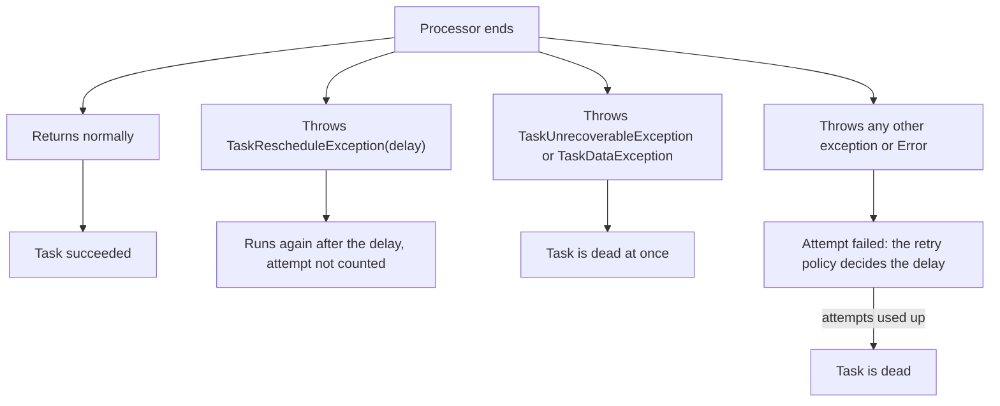
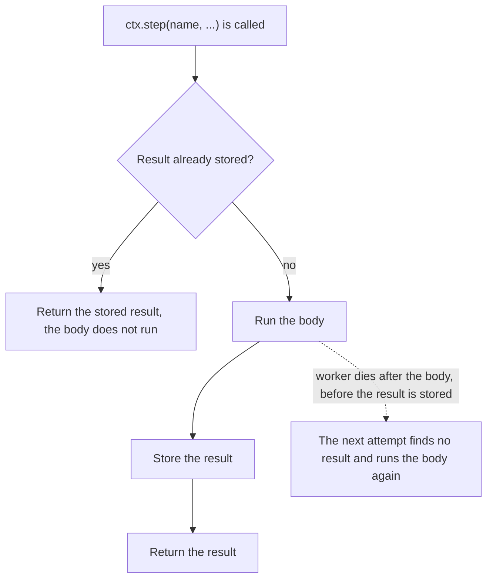

# Tasks, processors and steps

A task has a type, and a processor registered for that type runs it. This page explains how you declare a type, what a
processor's result or exception does to the task, and how steps keep finished work from running again on a retry.

## Task types and processors

### Declaring a task type

Use `TaskType.of` to declare a type. It has three forms:

| Call | Payload |
|---|---|
| `TaskType.of(name, PayloadClass.class)` | encoded with the runner's JSON mapper |
| `TaskType.of(name, codec)` | takes a `PayloadCodec`, for another format |
| `TaskType.of(name)` | a type without payload |

`payloadVersion(n)` is stored with each task. A processor can use it to read old tasks differently after the payload
shape changed.

### What a processor does

Delivery is at least once, so a processor must be safe to repeat. What a processor does decides what happens next:

| Processor | Effect |
|---|---|
| returns normally | the task succeeded |
| throws `TaskRescheduleException(delay)` | runs again after the delay, the attempt is not counted |
| throws `TaskUnrecoverableException` | the task is dead at once |
| throws `TaskDataException`, or the payload cannot be decoded | the task is dead at once |
| throws any other exception or `Error` | the attempt failed; the retry policy decides the delay, or dead when attempts are used up |

The same choices as a picture:

How the retry policy picks the delay is in [Retries](retries-and-cancelling.md#retries).

### Failed attempts and errors

A failed attempt is recorded with the task (the last 20), with the exception type, message and stack.

An `Error` (`AssertionError`, `StackOverflowError`, `NoClassDefFoundError`, ...) is handled like an exception. A
`VirtualMachineError` other than `StackOverflowError` gets one more step. This table shows what happens where:

| Where the error comes from | What happens |
|---|---|
| The processor throws a `VirtualMachineError` other than `StackOverflowError` (`OutOfMemoryError`, `InternalError`, `UnknownError`) | It is recorded, then rethrown, so the executor thread's uncaught exception handler still sees it. |
| A retry policy, the store or an observer throws such an error while a task runs | The task is recorded first, then the error is rethrown. |
| An observer or a retry policy throws an error outside task execution (maintenance, the scheduler) | It is logged and swallowed. |

The rethrow rule applies to task execution only.

### What `TaskContext` gives a processor

`TaskContext` gives `id()`, `attempt()`, `headers()`, `task()` (a `TaskView`) and `progress(text)`. It also has the
cancel checks `cancelRequested()` and `checkCancelled()`, described in
[Cancelling tasks](retries-and-cancelling.md#stopping-the-processor), and `step(name, ...)`, described next.

## Steps

`ctx.step(name, ...)` runs its body once per task, not once per attempt. Work outside a step runs on every attempt.

How a step behaves:

- The result is stored before `step` returns.
- On a retry the stored result is returned and the body does not run.
- A step is repeated only when the worker dies between finishing the body and storing the result.

So put side effects inside steps and keep each step idempotent.

Step results are encoded with the runner's JSON mapper. On a runner without one, a step with a result type fails with a `TaskConfigurationException` before its body runs; a step without a result needs no mapper. These limits apply:

| What | Limit |
|---|---|
| A step name | nonblank, at most 64 UTF-16 code units, without U+0000 |
| An encoded result | at most 8192 |
| All step names and encoded results of one task together | at most 65536 |

These limits use Java `String.length()`, not encoded bytes.
