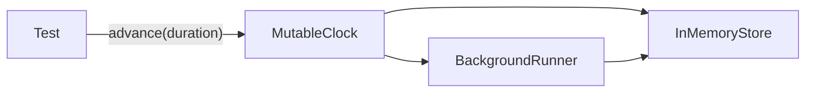

# Testing

`bth4j-testing` gives you an in-memory store and a clock you move by hand, so a test can run tasks without a server and move time forward on demand. This page shows how to use them and how to run the library's own integration tests.

## Test tools

`bth4j-testing` provides two classes:

| Class | What it is |
|---|---|
| `InMemoryStore` | A store that keeps everything in memory (one lock, no server). |
| `MutableClock` | A clock a test moves by hand. |

## A test with a clock you control

Both the store and the runner take the clock, so due times, leases and retention follow it.



The example below enqueues a task with a one hour delay and moves the clock forward:

```java
var clock = new MutableClock(Instant.parse("2026-01-01T00:00:00Z"));
var store = new InMemoryStore(clock);

var runner = BackgroundRunner.builder()
        .store(store)
        .clock(clock)
        .jsonMapper(new JacksonMapper())
        .idlePollInterval(Duration.ofMillis(10))
        .build();
runner.registry().register(SEND_MAIL, (ctx, mail) -> { /* ... */ });
runner.start();

runner.client().enqueue(TaskRequest.of(SEND_MAIL, new MailRequest("a@example.com", "Hi"))
        .delay(Duration.ofHours(1))
        .build());
clock.advance(Duration.ofHours(1));                 // the task is promoted and runs
```

- `new InMemoryStore()` uses the system clock.
- The in-memory store passes the same `StoreContract` as the Redis, PostgreSQL and SQLite stores, so behavior in tests matches production.
- The services still wait in real time between their checks. A test that moves the clock should poll for the result (for example with Awaitility) instead of asserting at once.

## A task view made by hand

A retry policy and a `TaskObserver` receive a `TaskView`. The library builds views from the store; in a unit test `TaskView.builder()` makes one without a store:

```java
TaskView task = TaskView.builder()
        .id(41)
        .queue("mail")
        .typeName("send-mail")
        .state(TaskState.LEASED)
        .attempts(3)
        .maxAttempts(5)
        .build();

assertThat(policy.decide(task, new IOException("reset"))).isInstanceOf(RetryPolicy.Decision.RetryAfter.class);
```

A view that is given nothing else is a QUEUED task with payload version 1 and one attempt allowed; every other field that is not set is null, zero or empty.

## Pinning the stored form of a payload

`new Codecs(jsonMapper)` encodes and decodes payloads and step results exactly as the runner stores them:

| Method | What it does |
|---|---|
| `encode(type, payload)` | Encodes a payload. |
| `decode(type, text)` | Decodes a payload. |
| `encodeStep(result)` | Encodes a step result. |
| `decodeStep(text, class)` | Decodes a step result. |

A test can use them to pin the stored form of a payload version or a step result against the library's own rules.

## Running the store integration tests

The integration tests of the store modules start containers with Testcontainers.

| Store | How the tests run |
|---|---|
| Redis | By default against `redis:8.10-alpine`. `./mvnw -pl bth4j-redis -am verify -Pvalkey` runs the suite against `valkey/valkey:9.1.3-alpine`. |
| PostgreSQL | By default against `postgres:18-alpine`. |
| Other images | `-Dbth4j.redis.image=...` or `-Dbth4j.postgres.image=...` selects any other image. |
| SQLite | No Docker needed. The tests run in the `test` phase on a database file in a temporary directory. |

## Test output

Test output (logs included) goes to `target/surefire-reports` and `target/failsafe-reports` of each module, one `*-output.txt` file per test class, so the build log shows only results and failures.

Add `-Dmaven.test.redirectTestOutputToFile=false` to see the output on the console.
