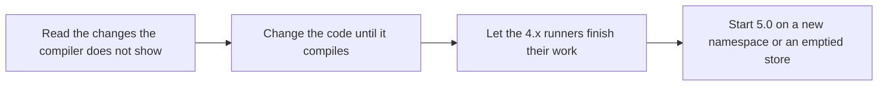

# Upgrading from 4.x to 5.0

5.0 cannot read data written by 4.x, and it renames and moves a good part of the API so that one thing has one name. This page tells you what to do with your data, which changes the compiler does not show you, and what each old name is now.

On this page:

- [The steps](#the-steps)
- [Moving your data](#moving-your-data)
- [Changes the compiler does not show](#changes-the-compiler-does-not-show)
- [Queues](#queues)
- [The runner and its settings](#the-runner-and-its-settings)
- [Tasks, requests and processors](#tasks-requests-and-processors)
- [Schedules](#schedules)
- [Exceptions](#exceptions)
- [Events, views and operator actions](#events-views-and-operator-actions)
- [The admin server and its HTTP API](#the-admin-server-and-its-http-api)
- [The stores](#the-stores)
- [For store authors](#for-store-authors)

## The steps



Every release with what it changed is in [CHANGELOG.md](../CHANGELOG.md).

## Moving your data

Every store writes a new schema version, and `init` refuses everything written by 4.x or older. There is no migration and no tool that copies tasks.

| Step | What to do |
|---|---|
| 1 | Stop the producers, or let them go on writing to the 4.x store until step 3. |
| 2 | Let the 4.x runners finish the tasks that are queued and running. |
| 3 | Stop 4.x. A task that is still scheduled for later stays in the old store: enqueue it again on 5.0 if you need it. |
| 4 | Start 5.0 on a store without 4.x data (see the table below). |
| 5 | Register your schedules again with `TaskClient.putSchedule`, which most applications do at every start. |

| Store | A store without 4.x data |
|---|---|
| PostgreSQL | a new namespace (the second constructor argument), or drop the tables and sequences of the old one |
| Redis | a new namespace, or delete the keys of the old one |
| SQLite | a new database file, or a new namespace in the same file |

The schema versions are 4 for PostgreSQL, 6 for Redis and 2 for SQLite.

## Changes the compiler does not show

| Change | What to do |
|---|---|
| The built-in queue is `general`. It was `Q:DEF`, with `Q:LOW`, `Q:MED` and `Q:HIGH` beside it. | Nothing, when you named your own queues. To keep the old names pass `Queues.of("Q:DEF", "Q:LOW", "Q:MED", "Q:HIGH")`. Otherwise metric tags, the HTTP API, the dashboard and pause commands show `general`. |
| The default queue is the first name of `Queues.of(...)` on runner and client alike. A 4.x runner took the first queue it processes. | A runner that processes a subset and relied on that names the default with `.withDefault(name)`. |
| `cancelledRetention` no longer sets how long EXPIRED tasks are kept. | Set `expiredRetention` too, when you changed the default of 48 hours. |
| `catch (TaskStoreException e)` does not catch `UnreadableTaskException`, and many refusals that were `IllegalArgumentException` or `IllegalStateException` are now `TaskValidationException` or `TaskConfigurationException`. | Catch `Bth4jException` for everything bth4j throws, or the class listed in [Exceptions](errors.md). |
| After `stop()` the runner reports `STOPPING` until its last task has ended, then `STOPPED`. It reported `STOPPED` at once. | A deploy script that waits for `STOPPED` now waits for the tasks, which is what it wanted. |
| `start()` after `stop()` throws `IllegalStateException` on the runner and the admin server. The runner logged a warning and did nothing. | Build a new object to start again. |
| Admin API: the fields `workerId`, `workers`, `due`, `nextFire` and `lastSeen` are `runnerId`, `runners`, `dueAt`, `nextFireAt` and `lastSeenAt`, and `GET /api/v1/workers` is `GET /api/v1/runners`. | A script or an alert that reads an old field gets no error, the field is missing. Change it. |
| Admin API: a session ends `sessionTtl` after the sign-in (12 hours by default), not after its last request. | A script that keeps one session signs in again when the lifetime has passed. |
| Log lines say "runner" where they said "worker", and the message of a `TaskConfigurationException` no longer starts with `ERR11_Error in configuration `. | Change log filters and alerts that match those texts. |
| A unique key that starts with `sched:` is refused, as are a step name with U+0000 and a `startBy` in the past for a task that runs at once. Each throws `TaskValidationException`. | Rename such keys and steps. |
| `bth4j-micrometer` needs `micrometer-core` 1.17 or newer. | Raise the version when yours is older. |
| Metrics: the counter `bth4j.tasks` carries the real `type` and `queue` tags for expired tasks and lost leases, where it had `unknown`, and `bth4j.deferred` has a `queue` tag. | Change dashboards and alerts that sum or filter by those tags. |
| A second `MicrometerRunnerMetrics.bind` with the same tags on one registry is refused while the first is open. | Give each runner its own tags. |
| More settings are checked when they are set: a queue name of more than 128 characters, a null or negative argument of `RetryPolicy.exponential` or `RetryPolicy.fixed`, an interval below its shortest value, `concurrency` together with `taskExecutor`. Each throws `TaskConfigurationException`. | Correct the setting; [Configuration](configuration.md) has the limits. |
| `AdminHttpServer.start()` on a started server does nothing (it threw), and `stop()` before `start()` stops the server for good. | Nothing, unless your code relied on either. |
| `TaskClient.tasks`, `AdminOps.tasks` and every store listing with a `limit` below 1 returned an empty page. | They throw `TaskValidationException`. Check the limit you pass. |
| A step whose result is too long to record ended in a `TaskValidationException` and was retried. | The task ends DEAD at once, with a `TaskUnrecoverableException` from `ctx.step`. Keep step results under 8192 characters in their stored form; store a reference when the result is larger. |
| `TaskClient.tasks(state, "", cursor, limit)` listed the default queue. | A blank queue is refused with `TaskValidationException`. Pass the queue's name, or null for every queue. |
| A null request, definition or listing state was a `NullPointerException`. | It is a `TaskValidationException`. |
| `RetryPolicy.exponential` could return a delay up to 20 percent above its cap. | The cap is the longest delay. Nothing to do, unless you set the cap lower to make up for it. |
| The admin server logged nothing about sign-ins and changes. | It writes one INFO line per sign-in, refused sign-in and POST or DELETE; see [What the server logs](admin.md#what-the-server-logs). Lower the level of its logger if you do not want them. |
| PostgreSQL cuts the server's clock to the millisecond. It rounded, which put its clock up to half a millisecond ahead of the server's. | Nothing, unless a test relied on a task due in the next millisecond being queued at once. |
| Redis `init` refuses a namespace that holds keys of the store but no schema version, for example one restored without its `meta` key. It wrote the current version and worked on whatever was there. | Restore the `meta` key, or use a new namespace. |
| `TaskRequest.Builder.uniqueKey(key)` sets the key to be taken until the task is done. After `uniqueKey(key, Uniqueness.keepFor(...))` on the same builder it kept the earlier keep window. | Call the version with the keep window last when you want it. |
| `RetryPolicy.exponential` keeps doubling up to the cap. It stopped at base x 2^20, which is 2.9 hours for a 10 ms base. | Nothing, unless you set a cap above that and relied on the stop. |

## Queues

Queues are set up with one `Queues` value on both builders.

```java
// 4.x
BackgroundRunner.builder().configureQueues(List.of("default", "mail"), List.of("mail"), null);
TaskClient.builder().queues(List.of("default", "mail"), "default");

// 5.0
var queues = Queues.of("default", "mail");            // the first name is the default queue
BackgroundRunner.builder().queues(queues).processQueues(List.of("mail"));
TaskClient.builder().queues(queues);
```

| 4.x | 5.0 |
|---|---|
| `BackgroundRunner.Builder.configureQueues(available, toProcess, default)` | `queues(Queues)`, and `processQueues(list)` when the runner does not process all of them |
| `TaskClient.Builder.queues(list, default)` | `queues(Queues)` |
| a default queue named as an argument | `Queues.of(...).withDefault(name)` |
| `BackgroundRunner.Builder.queue(name, policy)` | `addQueuePolicy(name, policy)` |
| `QueuePolicy.weight(int)`, `QueuePolicy.maxConcurrent(int)` | `QueuePolicy.ofWeight(int)`, `QueuePolicy.ofMaxConcurrent(int)` |
| `AdminOps.tasks(state, null, cursor, limit)` for every queue | `AdminOps.tasks(state, cursor, limit)`; a queue argument is never null or blank |

## The runner and its settings

The process that runs tasks is a runner everywhere. 4.x also called it a worker.

| 4.x | 5.0 |
|---|---|
| `BackgroundRunner.workerId()`, `RunnerHealth.workerId`, `TaskEvent.Started.workerId`, `TaskView.workerId()` | `runnerId` |
| `Builder.workerLabel(...)` | `runnerLabel(...)` |
| `Builder.workerStaleAfter(...)` | `runnerStaleTimeout(...)`, at least three times `maintenanceCheckInterval` |
| `Builder.recurringTasksCheckInterval(...)` | `scheduleCheckInterval(...)` |
| `Builder.scheduledTasksCheckInterval(...)` | `scheduledTaskCheckInterval(...)` |
| `Builder.retryPolicy(name, policy)` | `addRetryPolicy(name, policy)` |
| `Builder.cancelledRetention(...)` for CANCELLED and EXPIRED tasks | `cancelledRetention(...)` for CANCELLED, `expiredRetention(...)` for EXPIRED |
| `AdminOps.workers()` returning `WorkerInfo` with queue and type ids | `AdminOps.runners()` returning `RunnerView` with queue and type names |
| `AdminOps.purgeStaleWorkers(...)` | `purgeStaleRunners(...)` |
| `DefaultVtExecutor.getActiveTaskCount()` | `activeTaskCount()` |
| `void stop()` | `boolean stop()`: whether everything had ended when it returned |

`BackgroundRunner` and `AdminHttpServer` are `AutoCloseable`. `concurrency` and `taskExecutor` together are refused, and a runner with a JSON task type and no `jsonMapper` refuses to start.

## Tasks, requests and processors

| 4.x | 5.0 |
|---|---|
| `TaskContext.attempt()` | `attemptNumber()` |
| `TaskContext.cancelRequested()` | `isCancelRequested()` |
| `TaskType.payloadVersion(int)`, `TaskType.interruptOnCancel()` | `withPayloadVersion(int)`, `withInterruptOnCancel()` |
| `TaskRequest.Builder.header(name, value)`, `headers(map)` | `addHeader(name, value)`, `addHeaders(map)` |
| `EnqueueResult.accepted()` | `isAccepted()` |
| `TaskView.due()` | `dueAt()` |
| `TaskView.type()` | `typeName()` |
| `TaskView.record()`, `new TaskView(record, queue, type)` | gone; `TaskView.builder()` makes a view for a test |
| `TaskState`, `StateCounts`, `QueueInfo`, `CancelOutcome`, `RetryOutcome`, `FailureInfo`, `StepResult` in `today.bonfire.oss.bth4j.spi` | the same names in `today.bonfire.oss.bth4j` |
| a `maxRunTime` or a `Uniqueness.keepFor` below one millisecond | refused with `TaskValidationException` |

## Schedules

A cron schedule has no default overlap rule any more. Pass `Overlap.ALLOW` to keep what a 4.x definition did, or `Overlap.SKIP` to drop a fire while the previous occurrence is still open.

```java
// 4.x
ScheduleDefinition.of("nightly", type, "0 2 * * *");

// 5.0
ScheduleDefinition.of("nightly", type, "0 2 * * *", Overlap.ALLOW);
```

| 4.x | 5.0 |
|---|---|
| `ScheduleDefinition.of(id, type, cron)`, `of(id, type, payload, cron)` | `of(id, type, cron, overlap)`, `of(id, type, payload, cron, overlap)` |
| `ScheduleDefinition.queue(String)`, `account`, `maxAttempts`, `maxRunTime`, `zone`, `misfire`, `overlap` (with an argument) | `withQueue`, `withAccount`, `withMaxAttempts`, `withMaxRunTime`, `withZone`, `withMisfire`, `withOverlap` |
| `TaskClient.putSchedule` returning the next fire time | returning `PutScheduleResult(outcome, nextFireAt)` |
| `TaskClient.schedules()`, the map of id to next fire time | `nextFireTimes()` |
| `ScheduleView.nextFire`, `ScheduleView.type` | `nextFireAt`, `typeName` |
| `ScheduleView.zone` as a `ZoneId` | the zone id as text |

`Overlap.SKIP` now decides at the fire time, not when the occurrence is created ahead of it, so a job that takes most of its interval no longer loses every second fire.

## Exceptions

Everything bth4j throws to refuse a call or to report a failure of its own extends `Bth4jException`, except the decode helpers for store authors (`TaskState.fromCode` and `RecordJson`), which throw `IllegalArgumentException`. [Exceptions](errors.md) lists the classes.

| 4.x | 5.0 |
|---|---|
| `IllegalArgumentException` for data that is sent or stored (a malformed cursor, `Uniqueness.keepFor`, and others) | `TaskValidationException` |
| `IllegalStateException` or `IllegalArgumentException` for a setting of the runner, the admin server, an executor or the metrics binding | `TaskConfigurationException` |
| `TaskStoreException`, `UnreadableTaskException` in `today.bonfire.oss.bth4j.spi` | in `today.bonfire.oss.bth4j.exceptions` |
| `UnreadableTaskException` is a `TaskStoreException` | it is not: the store works, and the same call fails until the task is repaired or deleted |
| a missing `jsonMapper` is a `TaskDataException` | `TaskConfigurationException` |
| `Misfire.catchUp(0)` threw `TaskConfigurationException` | `TaskValidationException` |
| `enqueue` with a caller id that belongs to an unreadable task threw `EnqueueFailedException` | throws `UnreadableTaskException` itself; nothing was written |
| `enqueueAll` wrapped only `TaskStoreException` and `TaskIdReusedException` | from the first write on, every failure is an `EnqueueFailedException` with `ids`, `settled` and `notStored`, and the failure as its cause |

## Events, views and operator actions

| 4.x | 5.0 |
|---|---|
| `TaskEvent` is sealed | it is not, so that an event kind can be added in a minor release: a `switch` over events needs a `default` branch |
| `TaskEvent.Expired(id)`, `LeaseExpired(id, attempts, maxAttempts, dead)`, `Deferred(id, type, reason)` | `Expired(id, queue, type)`, `LeaseExpired(id, queue, type, attempts, maxAttempts, dead)`, `Deferred(id, queue, type, reason)` |
| `TaskEvent.Rescheduled.due()` | `dueAt()` |
| `Issue.kind()` as text | the enum `Issue.Kind`; `Issue.Kind.text()` is the old text |
| `CancelOutcome.STALE` for a missing or finished task too | `NOT_FOUND`, `STALE` and `FINISHED` are told apart |
| `RetryOutcome.DUPLICATE` | gone; `NOT_FOUND`, `STALE` and `NOT_RETRYABLE` are told apart |
| `AdminOps.delete` returning a boolean | returning `DeleteOutcome` (`DELETED`, `NOT_FOUND`, `STALE`, `LEASED`) |

## The admin server and its HTTP API

| 4.x | 5.0 |
|---|---|
| `Builder.user(name, password, role)` | `addUser(name, password, role)`; a second user with the same name and an empty password are refused |
| `Builder.corsOrigin(String...)` | `addCorsOrigin(String)`, once per origin |
| `GET /api/v1/workers` | `GET /api/v1/runners` |
| `GET tasks/by-key/{key}`, `POST tasks/by-key/{key}/cancel` | `GET tasks/by-key?key=`, `POST tasks/by-key/cancel?key=` |
| a retry, cancel or delete that is refused for its state answers 409 like a stale revision | every refusal has a `code` in the error body: 404 `NOT_FOUND`, 409 `STALE` or 409 `WRONG_STATE`; the code `KEY_HELD` is gone |
| JSON `workerId`, `workers`, `due`, `nextFire`, `lastSeen` | `runnerId`, `runners`, `dueAt`, `nextFireAt`, `lastSeenAt` |

Failed logins are also counted by the user name they give. Behind a reverse proxy, name the proxy with `addTrustedProxy`, so that failures are counted per client; see [Failed logins](admin.md#failed-logins).

## The stores

| 4.x | 5.0 |
|---|---|
| `RedisTaskStore.LAYOUT_VERSION` | `RedisTaskStore.SCHEMA_VERSION` |
| "table prefix" of the PostgreSQL and SQLite stores | "namespace", as in the Redis store; the message for a name that is not allowed starts with `namespace must match` |
| `redis.Keys`, `RedisTaskStore.keys()` | not public; [the Redis store page](stores/redis.md#inside-the-redis-store) lists the keys |
| the store classes can be subclassed | `RedisTaskStore`, `PostgresTaskStore` and `SqliteTaskStore` are final |
| `new RedisTaskStore(...)` throws `IllegalArgumentException` for a missing client or a namespace that is not allowed | `TaskConfigurationException` |

Redis needs hash field expiry (Redis 7.4 or newer, Valkey 9 or newer), and `init` refuses a server without it.

## For store authors

The store SPI says "schedule" and "runner" as the API does, and its record types keep the names of the things they hold. Stored names (tables, columns, Redis keys) did not change with these renames.

| 4.x | 5.0 |
|---|---|
| `RecurringDefinition` with `Long fixedDelayMs`, `maxRunTimeMs` | `StoredSchedule` with `Duration fixedDelay`, `maxRunTime` |
| `RecurringSchedule(definition, nextFire)` | `ScheduleEntry(definition, nextFireAt)` |
| `spi.PutRecurringResult`, `spi.PutRecurringOutcome` | `PutScheduleResult`, `PutScheduleOutcome` in `today.bonfire.oss.bth4j` |
| `putRecurring`, `deleteRecurring`, `pauseRecurring`, `resumeRecurring`, `triggerRecurring` | `putSchedule`, `deleteSchedule`, `pauseSchedule`, `resumeSchedule`, `triggerSchedule` |
| `dueRecurring`, `commitRecurring` | `dueSchedules`, `commitSchedule` |
| `commitRecurring` returns `boolean` | `commitSchedule` returns `CommitOutcome`: `STORED`, `SKIPPED` (the definition advanced, the occurrence's unique key is held) or `NOT_COMMITTED` |
| `recurringDefinitions()`, `recurringSchedules()` | `schedules()`, `nextFireTimes()` |
| `setNextFire(scheduleId, nextFire)`, the operator's write | `triggerSchedule(scheduleId, fireAt)`; `DueSchedule` has `triggered` |
| `ScheduleEffect.nextFire()`, `pauses()`, `applied()` | `nextFireAt()`, `isPause()`, `isApplied()` |
| `WorkerInfo` | `RunnerRecord`, with `lastSeenAt` |
| `allocateWorkerId`, `purgeWorkers`, `AdminStore.workers()` | `allocateRunnerId`, `purgeRunners`, `runners()` |
| `TaskRecord.workerId`, `ClaimRequest.workerId` | `runnerId` |
| `TaskRecord.due` | `dueAt` |
| `ClaimRequest` and `QueueGrant` throw `IllegalArgumentException` | `TaskValidationException` |
| `InspectionStore.getTask(id)` | `task(id)` |
| `MaintenanceStore.expire` returning ids | returning `List<ExpiredTask>`; `ExpiredLease` has `queueId` |
| `AdminStore.delete` returning a boolean | returning `DeleteOutcome` |
| no such method | `InspectionStore.holdsKey(id, key)` |
| argument checks throw `IllegalArgumentException` | `TaskValidationException` (`StoreArguments`) |

The stores also behave alike in more places than before, each pinned by a contract test; the "Store SPI" entries of [CHANGELOG.md](../CHANGELOG.md) list them. [Writing a store](writing-a-store.md) has the rules a store follows.

The JSON helper `today.bonfire.oss.bth4j.common.Json` is `internal.Json`. Nothing in the package `today.bonfire.oss.bth4j.internal` is supported API.
