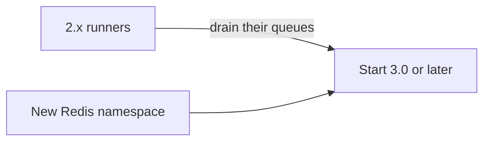

# Upgrading from 2.x

This page tells you what to do with your data when you move from 2.x to 3.0 or later, and which parts of the API changed in 3.0.

## Moving your data

bth4j 3.0 and later cannot read 2.x data. You have two ways to deal with that:

| Option | What to do |
|---|---|
| Drain the 2.x queues | Let the 2.x runners drain their queues, then start 3.0 or later. |
| Use a new Redis namespace | Start 3.0 or later on a new Redis namespace. |

## What changed in the API

The API was redesigned.

| 2.x | 3.0 |
|---|---|
| `Event` and `Task` | `TaskType` and `TaskRequest` |
| `TaskOps` | `TaskClient` |
| The runner takes a Jedis client and a namespace prefix | The runner takes a store |

The list of changes is in [CHANGELOG.md](../CHANGELOG.md).
