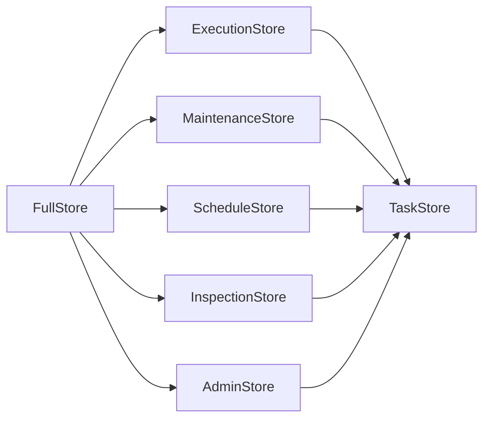
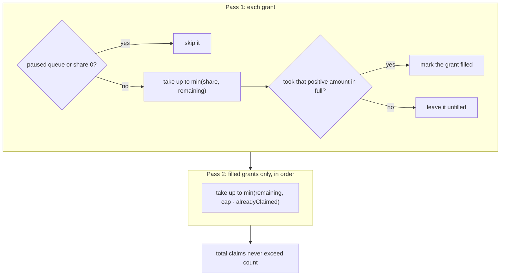

# Writing a store

A store keeps tasks and makes every state change atomic. bth4j defines the store as an interface, so you can add a store on another engine. This page lists the interfaces, the rules every store follows, how a claim works, and how to test your store. For the reasoning behind the interface see [design-3.0.md](design-3.0.md#the-store-spi-and-how-to-implement-a-store), which records the 3.0 design; for how the existing stores keep their data today, see the store pages ([Redis](stores/redis.md#inside-the-redis-store), [PostgreSQL](stores/postgresql.md#inside-the-postgresql-store), [SQLite](stores/sqlite.md#inside-the-sqlite-store)).

On this page:

- [What to build](#what-to-build)
- [The interfaces](#the-interfaces)
- [What a store needs from its engine](#what-a-store-needs-from-its-engine)
- [Rules every store follows](#rules-every-store-follows)
- [How a claim works](#how-a-claim-works)
- [Other details of the SPI](#other-details-of-the-spi)
- [Testing your store](#testing-your-store)

## What to build

| Step | What you do |
|---|---|
| 1 | Implement the store interface, `today.bonfire.oss.bth4j.spi.FullStore`, on your engine. |
| 2 | Subclass `StoreContract` and `RunnerContract` from `bth4j-store-tests`. |

## The interfaces

The SPI is the package `today.bonfire.oss.bth4j.spi`, split by who calls it. A store module implements all of the interfaces through `FullStore`.

An arrow means "extends".

| Interface | Content |
|---|---|
| `TaskStore` | `info`, `init`, `allocateIds`, `allocateWorkerId`, `queueId`, `typeId`, `queueNames`, `typeNames` |
| `ExecutionStore` | `enqueue`, `enqueueAll`, `claim`, `renew`, `ack`, `fail`, `failExpired`, `finishCancelled`, `reschedule`, `unclaim`, `saveSteps`, `progress` |
| `MaintenanceStore` | `promote`, `reclaim`, `expire`, `purge`, `purgeWorkers`, `releaseKeys`, `nextDue` |
| `ScheduleStore` | `putRecurring`, `deleteRecurring`, `recurringSchedules`, `recurringDefinitions`, `dueRecurring`, `commitRecurring`, `pauseRecurring`, `setNextFire` |
| `InspectionStore` | `getTask`, `counts`, `tasks` (by state, paged by an opaque cursor on `(due, id)` for QUEUED and SCHEDULED and on `(stateChangedAt, id)` for the other states) |
| `AdminStore` | `cancel`, `retry`, `delete`, `pauseQueue`, `queues`, `heartbeat`, `workers` |

## What a store needs from its engine

The contract is small because the services never read and then write in two steps. Each method is one atomic transition with its own check.

A store needs three things from its engine:

1. A conditional multi-row write: compare the revision, then move the task.
2. A way to take n queued rows exclusively.
3. Its own clock.

The existing stores meet this in these ways:

| Engine | How |
|---|---|
| Redis | one Lua script per method |
| An SQL database | one statement per method, with `FOR UPDATE SKIP LOCKED` for the claim and `UPDATE ... WHERE id = ? AND revision = ? AND state = 2` for the fenced transitions |

See [Redis](stores/redis.md), [PostgreSQL](stores/postgresql.md) and [SQLite](stores/sqlite.md) for how each store works.

## Rules every store follows

| Rule | What it means |
|---|---|
| Never write a null field | Steps and failures are encoded to JSON by the core (`RecordJson`). The store only fences and writes the whole field, so step logic is not duplicated per engine. |
| Use the store's clock | Time for `due` defaults, leases, promote, reclaim and retention is the store's clock. |
| Be safe under concurrency | Calls are made concurrently from many threads and processes. Each must be atomic and safe to repeat. |
| Throw `TaskStoreException` | A failure to reach the engine throws `TaskStoreException`. Callers retry on their next cycle. |
| Check the schema in `init()` | `init()` creates the schema or verifies the store's schema version (`StoreInfo.schemaVersion`) and refuses another one. |
| Check arguments with `StoreArguments` | Arguments are checked alike on every store: queue and type names, worker label, the `reschedule` due, every count and limit (at least 1) and the purge state. A pause of a queue id that was never registered is ignored. |
| Stay within the time limit | Every time the library hands a store lies within `TaskRequest.MAX_TIME_FROM_NOW` (100 years) of now, and every duration is at most that long, so epoch milliseconds or SQL timestamps hold them. |

## How a claim works

`ExecutionStore.claim` takes `ClaimRequest(List<QueueGrant> grants, int count, Duration lease, int workerId, Set<Integer> knownTypeIds)`.

| Part | Rule |
|---|---|
| `QueueGrant(queueId, share, cap)` | requires `0 <= share <= cap` |
| `grants` | must be non-empty and contain no duplicate queue ids |
| Passes | The store performs both passes atomically across all grants, claiming each queue by `(due, id)`. Redis may compare equal-due ids as decimal text. |
| Total | Total claims never exceed `count`. |
| Without policies | Each queue has `share = cap = count`, preserving queue preference order. |
| Unknown types | They stay unchanged, including their due times. A null `knownTypeIds` accepts every type. |

The two passes:

| Pass | What the store does |
|---|---|
| Pass 1 | Skips paused queues and zero shares. Takes up to `min(share, remaining)`. Marks a grant filled only when it took that positive amount in full. |
| Pass 2 | Visits only filled grants, in order. Takes up to `min(remaining, cap - alreadyClaimed)`. |

## Other details of the SPI

| Method or type | What it does |
|---|---|
| `InspectionStore.queuedByType()` | Returns exact QUEUED counts as queue id to type id to count, with only non-zero entries. |
| `AdminStore.heartbeat(workerId, label, queueIds, typeIds, running, accepting)` | Persists the worker's accepting state, exposed by `WorkerInfo.accepting()`. It creates the row again under the same id when maintenance purged it. |
| `allocateWorkerId` | Creates accepting workers. |
| `StoreArguments` | Holds the argument checks every store applies. Every time the library hands a store lies within `TaskRequest.MAX_TIME_FROM_NOW` of now. |
| `StoreContract` | Covers these behaviors for every store implementation. |

## Testing your store

The tests every store must pass are `StoreContract` and `RunnerContract` in `bth4j-store-tests`, which is not published. A store module subclasses `StoreContract` and supplies:

| Method | Needed | What you supply |
|---|---|---|
| `newStore(namespace)` | Always | A fresh, isolated store per test |
| `clock()` | When the test can move time | The clock the store reads. The default is the system clock. |
| `advance(duration)` | When the test can move time | Lets store time pass. The default sleeps. |
| `releasesKeysOnItsOwn()` | When the store ends key windows itself | `true`, so that the tests expect `releaseKeys` to count nothing |
| `orderOfIdsThatShareATime()` | When a listing does not order tasks of one time by id | The order the store documents. It must be total and stable. |
| `corruptStoredValue(namespace, taskId)` | When the store can hold a value it cannot read | Overwrites a stored value of the task with an unreadable one and returns `true`. The default returns `false`, which skips the tests that need one. |
| `registryBound()` | When the largest queue or type id is not 32767 | The largest id the store accepts |
| `fillRegistry(...)` | When the bound is large | Moves the id counter directly instead of registering filler names |

Where the existing stores run it:

| Store | How it runs the contract |
|---|---|
| In-memory | in `bth4j-testing` |
| Redis and PostgreSQL | as integration tests against real servers (Testcontainers) |
| SQLite | as tests that need no Docker, on a database file in a temporary directory |
