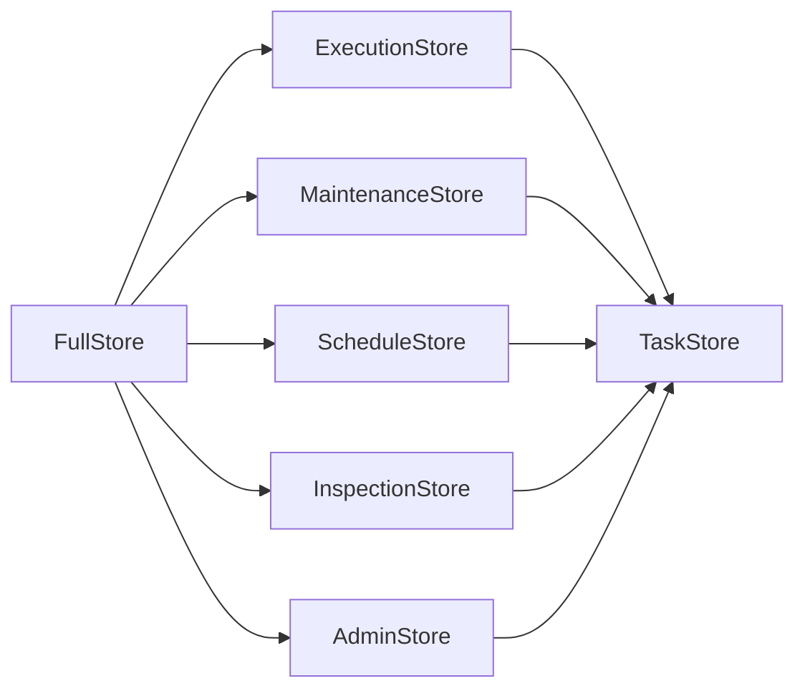
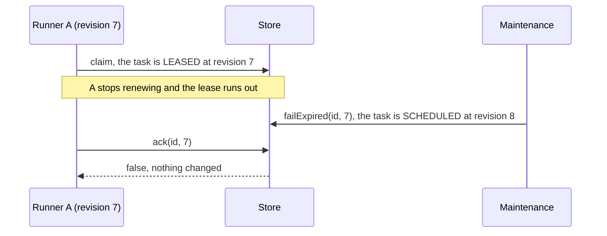
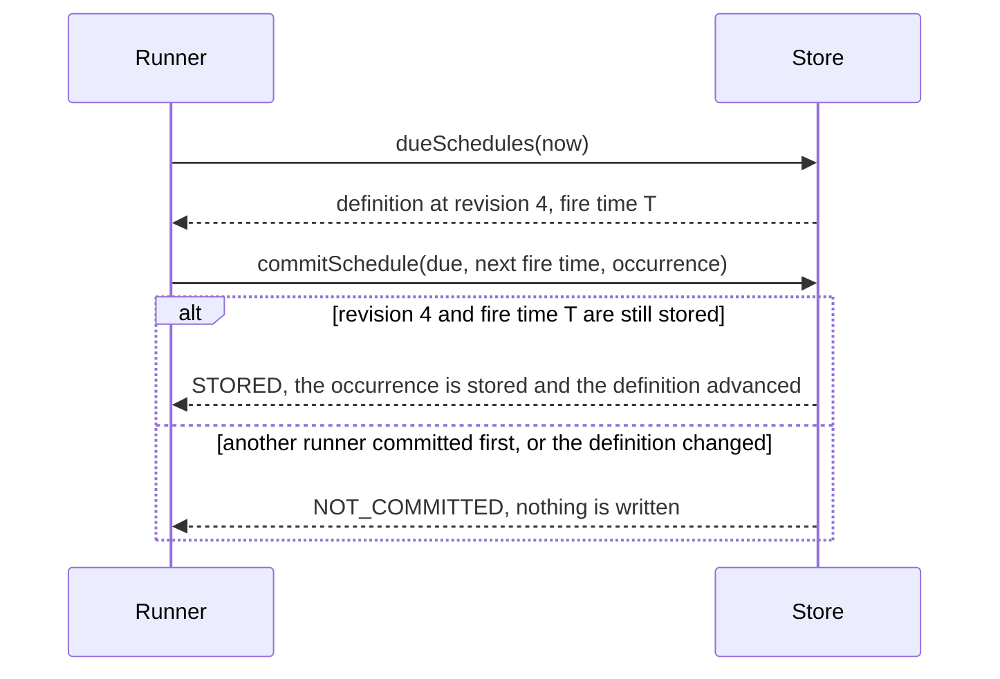
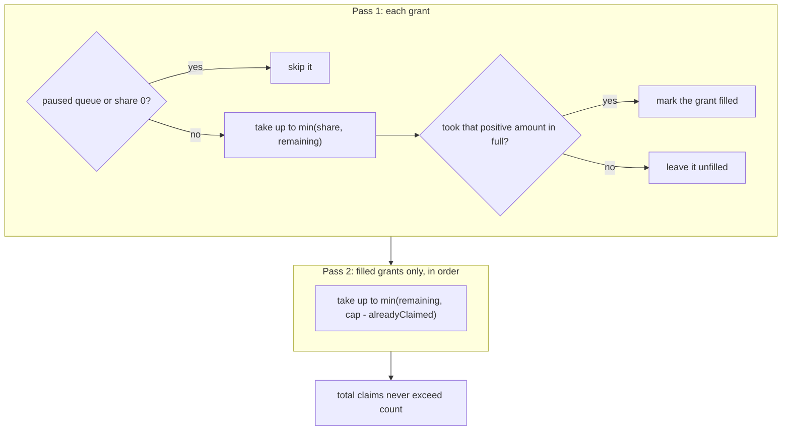

# Writing a store

A store keeps tasks and makes every state change atomic. bth4j defines the store as an interface, so you can add a store on another engine. This page lists the interfaces, the rules every store follows with the reason for each, how a claim works, and how to test your store. For how the existing stores keep their data, see the store pages ([Redis](stores/redis.md#inside-the-redis-store), [PostgreSQL](stores/postgresql.md#inside-the-postgresql-store), [SQLite](stores/sqlite.md#inside-the-sqlite-store)).

On this page:

- [What to build](#what-to-build)
- [The interfaces](#the-interfaces)
- [What a store needs from its engine](#what-a-store-needs-from-its-engine)
- [Rules every store follows](#rules-every-store-follows)
- [The fence](#the-fence)
- [Time fields](#time-fields)
- [Ids and names](#ids-and-names)
- [Enqueue and unique keys](#enqueue-and-unique-keys)
- [How tasks end and leave](#how-tasks-end-and-leave)
- [Schedules](#schedules)
- [How a claim works](#how-a-claim-works)
- [Other details of the SPI](#other-details-of-the-spi)
- [Testing your store](#testing-your-store)

## What to build

| Step | What you do |
|---|---|
| 1 | Implement the store interface, `today.bonfire.oss.bth4j.spi.FullStore`, on your engine. |
| 2 | Subclass `StoreContract` and `RunnerContract` from `bth4j-store-tests`. |
| 3 | Subclass `FaultContract` and `RunnerFaultContract` to check the store through cut calls ([Fault-tolerance tests](fault-tolerance-tests.md)). |

## The interfaces

The SPI is the package `today.bonfire.oss.bth4j.spi`, split by who calls it. A store module implements all of the interfaces through `FullStore`.

An arrow means "extends".

| Interface | Content |
|---|---|
| `TaskStore` | `info`, `init`, `allocateIds`, `allocateRunnerId`, `queueId`, `typeId`, `queueNames`, `typeNames` |
| `ExecutionStore` | `enqueue`, `enqueueAll`, `claim`, `renew`, `ack`, `ackAll`, `fail`, `failExpired`, `finishCancelled`, `finishCancelledExpired`, `reschedule`, `unclaim`, `saveSteps`, `progress` |
| `MaintenanceStore` | `promote`, `reclaim`, `expire`, `purge`, `purgeRunners`, `releaseKeys`, `nextDue` |
| `ScheduleStore` | `putSchedule`, `deleteSchedule`, `nextFireTimes`, `schedules`, `dueSchedules`, `commitSchedule`, `pauseSchedule`, `resumeSchedule`, `triggerSchedule`, `setNextFire` |
| `InspectionStore` | `task`, `idHighWaterMark`, `taskByKey`, `holdsKey`, `counts`, `queuedByType`, `tasks` (by state, paged by an opaque cursor on `(dueAt, id)` for QUEUED and SCHEDULED and on `(stateChangedAt, id)` for the other states) |
| `AdminStore` | `cancel`, `retry`, `delete`, `pauseQueue`, `queues`, `heartbeat`, `runners` |

## What a store needs from its engine

The contract is small because the services never read and then write in two steps. Each method is one atomic transition with its own check.

A store needs three things from its engine:

1. A conditional multi-row write: compare the revision, then move the task.
2. A way to take n queued rows exclusively.
3. Its own clock.

The existing stores meet this in these ways:

| Engine | How |
|---|---|
| Redis | one Lua script per method |
| An SQL database | each method is atomic, one statement or one transaction, with `FOR UPDATE SKIP LOCKED` for the claim and `UPDATE ... WHERE id = ? AND revision = ? AND state = 2` for the fenced transitions |

See [Redis](stores/redis.md), [PostgreSQL](stores/postgresql.md) and [SQLite](stores/sqlite.md) for how each store works.

A store needs no way to wake an idle runner. The SPI has no notification method: a runner that found nothing to claim asks again after `idlePollInterval`.

## Rules every store follows

| Rule | What it means |
|---|---|
| Never write a null field | Steps and failures are encoded to JSON by the core (`RecordJson`). The store only fences and writes the whole field, so step logic is not duplicated per engine. |
| Use the store's clock | Time for `dueAt` defaults, leases, promote, reclaim and retention is the store's clock. |
| Be safe under concurrency | Calls are made concurrently from many threads and processes. Each must be atomic and safe to repeat. |
| Throw `TaskStoreException` | A failure to reach the engine throws `TaskStoreException`. Callers retry on their next cycle. A stored task that cannot be read throws `UnreadableTaskException`, which is not a store failure: a retry would fail the same way. |
| Check the schema in `init()` | `init()` creates the schema or verifies the store's schema version (`StoreInfo.schemaVersion`) and refuses another one. |
| Check arguments with `StoreArguments` | Arguments are checked alike on every store: queue and type names, runner label, the `reschedule` due, every count and limit (at least 1) and the purge state. A refused argument throws `TaskValidationException`, as a malformed listing cursor does. A pause of a queue id that was never registered is ignored. |
| Stay within the time limit | Every time the library hands a store lies within `TaskRequest.MAX_TIME_FROM_NOW` (100 years) of now, and every duration is at most that long, so epoch milliseconds or SQL timestamps hold them. |

## The fence

Every task has a revision. A call that moves a task names the revision its caller saw, and the store compares it in the same atomic step as the write. That comparison is the fence: it keeps a runner that lost its lease, or an operator who looked at an old page, from changing a task that has moved on.

| What happens to the task | Revision |
|---|---|
| Every change of state: a claim, a promotion, a failed attempt, every way a task ends, `reschedule`, `unclaim`, an operator change to a task that is not LEASED | plus one |
| `renew`, `saveSteps`, `progress`, a cancel request on a LEASED task | unchanged, so the runner that works on the task keeps its fence |

| Rule | What it means |
|---|---|
| A caller with an old revision changes nothing and is told so | The call answers `false`, `FailOutcome.LOST` or a `STALE` outcome. Losing a race is a normal answer, never an exception. |
| Only the holder moves a LEASED task | Only the runner with the current revision of a LEASED task moves it on. `delete` refuses a LEASED task, and `cancel` of one only stores the request: the revision stays, because the running runner's fence must stay valid. The runner learns of the request through `renew`. |
| `renew` never revives a lease | It extends the tasks whose revision matches, that are LEASED and whose lease has not run out, and reports every other lease as not owned. Once a lease has run out, maintenance may take the task over, and an extension must not race with that. |
| The expired variants check the lease too | `failExpired` and `finishCancelledExpired` do nothing when the lease is no longer expired. `renew` leaves the revision alone, so the revision by itself would let maintenance end a task that its runner renewed in between. |
| `reclaim` only reads | It lists the expired leases, oldest first, each with `cancelRequested`. Maintenance ends a task with a cancel request through `finishCancelledExpired` and every other one through `failExpired`, so a cancelled task is not retried. |
| A cancel request stays with the task | It survives a retry, a reschedule and an unclaim: the claim and the renewals of the next attempt report it, until the task ends or `retry` clears it. |
| Attempts | A claim adds one to `attempts`. `reschedule` and `unclaim` give the attempt back. `fail` decides from `attempts` and `maxAttempts` whether the task is DEAD. |

## Time fields

| Field | What it means | Whose clock |
|---|---|---|
| `dueAt` | "May run from this time", in every state. A null `dueAt` at enqueue becomes the store's time, and it is never null once stored. A claim and a promotion keep it, and `unclaim` returns the task with it. The order inside a queue is `(dueAt, id)`. | the client's when the request names a time, else the store's |
| `stateChangedAt` | When the current state was entered. For a finished task that is the finish time, which retention is measured from. It orders the listings of every state but QUEUED and SCHEDULED. | the store's |
| `createdAt` | When the client built the task. A record without one is created at the store's time of the call. | the client's |
| `claimedAt`, `leaseUntil`, `keyUntil` | When the last attempt started, when the lease ends unless renewed, and when the kept key of a finished task is released. | the store's |

Whether a new task is QUEUED or SCHEDULED is decided by the store's clock: SCHEDULED when `dueAt` is later than the store's time. A store keeps times and durations in whole milliseconds: it drops what is finer from those it is given, takes its own clock to the millisecond, and compares to the millisecond.

## Ids and names

| What | Rule |
|---|---|
| `allocateIds(count)` | The caller owns `[first, first + count)`. Ids are unique within the store, never reused and not ordered in time across processes. `idHighWaterMark()` is the first id that was not handed out yet. |
| Queue and type ids | Permanent, so callers cache them for the life of the process. Registered ids start at 1, and the largest is 32767 unless the store documents another bound. |
| Runner ids | Never reused. A runner row is there for operators: the lease on a task decides who owns it, and `heartbeat` creates a row again that maintenance purged. |

## Enqueue and unique keys

| Topic | Rule |
|---|---|
| Answers of `enqueue` | `STORED`, `EXISTS` when the id exists in any state (nothing changes), or `DuplicateKey` with the task that holds the key. |
| A write that is sent twice | The client takes `EXISTS` for an id that another writer generated. A store whose transport may resend a write therefore answers `STORED` when the resend finds its own earlier write. The Redis store tells by a token it writes with each record. |
| Run fields | A new task starts without them, on every way in (`enqueue`, `enqueueAll`, `commitSchedule`): zero attempts and no runner, lease, claim time, key-until, cancel request, progress, steps or failures, whatever the record says. |
| How long a key is held | While its task is not finished. After that until `keyUntil`, which the terminal transition sets when the task has a `keyKeep`; without one the key is released at the terminal transition. This holds on every way a task ends. |
| The key check is part of the write | Concurrent enqueues of one key have exactly one winner, and every other one answers `DuplicateKey` with the winner's id. The same holds right after a keep window ended, and a cleanup that runs at that moment must not release the new holder's key. |
| A task removed inside its keep window | Leaves the key taken until `keyUntil`. `releaseKeys` frees it then, or the store ends the window itself and `releaseKeys` counts nothing (`releasesKeysOnItsOwn()` in the contract tests). Meanwhile another task with that key answers `DuplicateKey` with the removed task's id, and the removed task sent again with its id and key answers `EXISTS`. |

## How tasks end and leave

| Call | Rule |
|---|---|
| `ack` | SUCCEEDED, or the record is removed in the same step when `keep` is false. The payload is dropped unless `keepPayload`; steps are kept. |
| `fail` | SCHEDULED for `retryAt`, or DEAD when `retryAt` is null or the attempts are used up. The store keeps the last 20 failures. It must work for a task with a stored value that cannot be read, so that such a task can still end. |
| `expire(limit)` | Moves QUEUED and SCHEDULED tasks past `startBy` to EXPIRED, oldest first. It is the one way to end a task that takes no `ScheduleEffect`; the runner gives an occurrence of a schedule no `startBy`. |
| `purge(state, retention, limit)` | Removes finished tasks of one state whose `stateChangedAt` is older than the retention, by the store's clock. The retention is an argument, not a stored value, so a changed setting applies to the tasks that are there. |
| `retry` | Returns a DEAD, CANCELLED or EXPIRED task to its queue with zero attempts and without its cancel fields, runner, lease and `startBy`; failures and steps stay. A task that still holds its key holds it again as an open task. |
| `delete` | Removes a task in any state but LEASED and releases its key. |
| Calls with a limit | Fill the batch while more qualify. The runner calls again while a batch comes back full. |

## Schedules

A schedule is a definition with a next fire time. Each fire becomes one task, the occurrence, exactly once across all runners.

| Rule | What it means |
|---|---|
| A commit is one compare-and-set | `commitSchedule` stores the occurrence and advances the definition in one step, and only while the definition still has the revision and the fire time the runner read with `dueSchedules`. Of several runners that read the same fire, the first commit wins and the others get `CommitOutcome.NOT_COMMITTED`. |
| Revisions never go back | Every put that writes takes a new revision from a counter that never goes back, also after a delete, so that a runner that still holds an old definition cannot commit against its replacement. The existing stores use a sequence or a counter per namespace. |
| A put that writes nothing keeps the revision | Applications register their schedules at every start. Such a put answers `UNCHANGED` and must not make another runner's commit fail. A put never changes the paused flag of a definition that exists. |
| `keepUntil` | A put keeps the stored next fire time when the timing is unchanged and either the occurrence in flight is not finished or the stored time is not later than `keepUntil`. A stored time later than that with no occurrence in flight has skipped fires, so the put replaces it. |
| Paused | A paused definition keeps its next fire time and is left out of `dueSchedules`. `setNextFire` does nothing for it. |
| An overlapping occurrence is skipped in the commit | When the occurrence names a unique key that another task holds, it is not stored, the definition is still advanced, and the commit answers `CommitOutcome.SKIPPED`, not `STORED`. The runner reports the skipped fire from that answer; it does not read the task back. |
| Fixed delay | The runner commits the occurrence with the next fire time 100 years ahead, and the store records that occurrence as the one in flight. The end of the occurrence sets the real next fire time through a `ScheduleEffect`. |
| `ScheduleEffect` | It is applied in the same atomic step as the task transition that carries it (`ack`, `fail` when the task ends DEAD, `failExpired`, `finishCancelled`, `finishCancelledExpired`, `cancel` when it cancels at once, `delete`), so that a process that dies right after cannot leave the definition parked. It applies only while the recorded occurrence is that task, and then clears the record. A re-arm of a paused definition stores the time and leaves it paused. The store calls `markApplied()` when it changed the definition. |
| Operator writes check the revision | `deleteSchedule`, `pauseSchedule`, `resumeSchedule` and `triggerSchedule` take the revision the operator saw, or null for any, and answer a `ScheduleOutcome`: `NOT_FOUND` when no definition has the id, then `STALE` when the revision is not the stored one, then `APPLIED`. The comparison and the write are one atomic step, and a refused call writes nothing. A call that matches and has nothing to change (pausing a paused definition, resuming one that is not paused) answers `APPLIED`. A pause, like a runner write, keeps the revision, so the revision protects against a replaced or re-timed definition and not against a pause or a runner fire. |
| Operator writes and runner writes | `triggerSchedule`, and `resumeSchedule` with a time, assign a new revision, so a runner write that is based on the old one does nothing. `setNextFire` and a `ScheduleEffect` keep the revision and do nothing when their own check fails. A trigger also forgets the recorded occurrence, so that the end of an occurrence that is still running does not undo it. |

## How a claim works

`ExecutionStore.claim` takes `ClaimRequest(List<QueueGrant> grants, int count, Duration lease, int runnerId, Set<Integer> knownTypeIds)`.

| Part | Rule |
|---|---|
| `QueueGrant(queueId, share, cap)` | requires `0 <= share <= cap` |
| `grants` | must be non-empty and contain no duplicate queue ids |
| Passes | The store performs both passes atomically across all grants, claiming each queue by `(dueAt, id)`. Redis may compare equal-due ids as decimal text. |
| Total | Total claims never exceed `count`. |
| Without policies | Each queue has `share = cap = count`, preserving queue preference order. |
| Unknown types | They stay unchanged, including their due times. A null `knownTypeIds` accepts every type. |
| What a claim returns | Each claimed task as a full record with its new revision, lease and runner: one more attempt, `claimedAt` set, `dueAt` kept. |
| Whose limits | `share` and `cap` come from the queue policies of the runner that claims. The store keeps no count across runners, so a limit is per runner. |

The two passes:

| Pass | What the store does |
|---|---|
| Pass 1 | Skips paused queues and zero shares. Takes up to `min(share, remaining)`. Marks a grant filled only when it took that positive amount in full. |
| Pass 2 | Visits only filled grants, in order. Takes up to `min(remaining, cap - alreadyClaimed)`. |

## Other details of the SPI

| Method or type | What it does |
|---|---|
| `InspectionStore.holdsKey(id, key)` | Tells whether the task with that id holds the unique key now: open, finished inside its keep window, or removed inside it. `taskByKey` shows the first two only. |
| `MaintenanceStore.expire(limit)` | Returns `ExpiredTask(id, queueId, typeId)` for each task it moved to EXPIRED. The queue and type id are read in the same atomic step as the move, never afterwards: the task may be purged or deleted right after. |
| `MaintenanceStore.reclaim(limit)` | Returns `ExpiredLease` with `queueId` and `typeId`, read by the same statement or script that lists the lease. |
| An id a store cannot read | A store that cannot read a queue or type id from a damaged record reports 0. Registered ids start at 1, so 0 is never a real id, and the runner names it `unknown` in the event. |
| `InspectionStore.queuedByType()` | Returns exact QUEUED counts as queue id to type id to count, with only non-zero entries. |
| `AdminStore.pauseQueue(queueId, paused)` | A paused queue is skipped by `claim` on every runner. An id that was never registered is ignored. |
| `AdminStore.heartbeat(runnerId, label, queueIds, typeIds, running, accepting)` | Persists the runner's accepting state, exposed by `RunnerRecord.accepting()`. It creates the row again under the same id when maintenance purged it. |
| `AdminStore.cancel`, `retry`, `delete` | Each answers in the same atomic step as the change, with the first reason that applies: no such task (`NOT_FOUND`), then another revision (`STALE`), then a state that refuses the change (`FINISHED`, `NOT_RETRYABLE` or `LEASED`). A key-only row, which is a removed task that still holds its key, is not a task. A `retry` that finds the task's unique key held by another task, which only damaged data can cause, throws `TaskStoreException` and changes nothing. |
| `allocateRunnerId` | Creates accepting runners. |
| `StoreArguments` | Holds the argument checks every store applies. Every time the library hands a store lies within `TaskRequest.MAX_TIME_FROM_NOW` of now. |
| `ScheduleStore.triggerSchedule(scheduleId, expectedRevision, fireAt)` | The operator's trigger. It marks the fire time it stores, and `dueSchedules` reports the mark as `DueSchedule.triggered()`, so that the runner creates the task however late it takes the fire up. The mark goes with the next write that replaces the fire time. |
| `StoreContract` | Covers these behaviors for every store implementation. |

## Testing your store

The tests every store must pass are `StoreContract` and `RunnerContract` in `bth4j-store-tests`, which is not published. A store module subclasses `StoreContract` and supplies:

| Method | Needed | What you supply |
|---|---|---|
| `newStore(namespace)` | Always | A fresh, isolated store per test |
| `clock()` | When the test can move time | The clock the store reads. The default is the system clock. |
| `advance(duration)` | When the test can move time | Lets store time pass. The default sleeps. |
| `releasesKeysOnItsOwn()` | When the store ends key windows itself | `true`, so that the tests expect `releaseKeys` to count nothing |
| `orderOfIdsThatShareATime()` | When a listing does not order tasks of one time by id | The order the store documents. It must be total and stable. |
| `corruptStoredValue(namespace, taskId)` | When the store can hold a value it cannot read | Overwrites a stored value of the task with an unreadable one and returns `true`. The default returns `false`, which skips the tests that need one. |
| `removeSchemaVersion(namespace)` | When the store keeps a schema version | Removes the stored version and leaves the tasks, and returns `true`, so that the test can see `init()` refuse a store that holds tasks without a version. The default returns `false`, which skips that test. |
| `writeOtherSchemaVersion(namespace)` | When the store keeps a schema version | Replaces the stored version with one the store does not write and returns `true`, so that the test can see `init()` refuse it. The default returns `false`, which skips that test. |
| `registryBound()` | When the largest queue or type id is not 32767 | The largest id the store accepts |
| `fillRegistry(...)` | When the bound is large | Moves the id counter directly instead of registering filler names |

Some tests check what a store does inside a short time window, a lease of 200 ms for example. On a store with a real clock a busy machine can take longer than the window. Such a test then ends as skipped, with the reason "the machine took longer than the test's time window", instead of failing. A store whose `advance` moves a test clock never skips them.

Where the existing stores run it:

| Store | How it runs the contract |
|---|---|
| In-memory | in `bth4j-testing` |
| Redis and PostgreSQL | as integration tests against real servers (Testcontainers) |
| SQLite | as tests that need no Docker, on a database file in a temporary directory |
